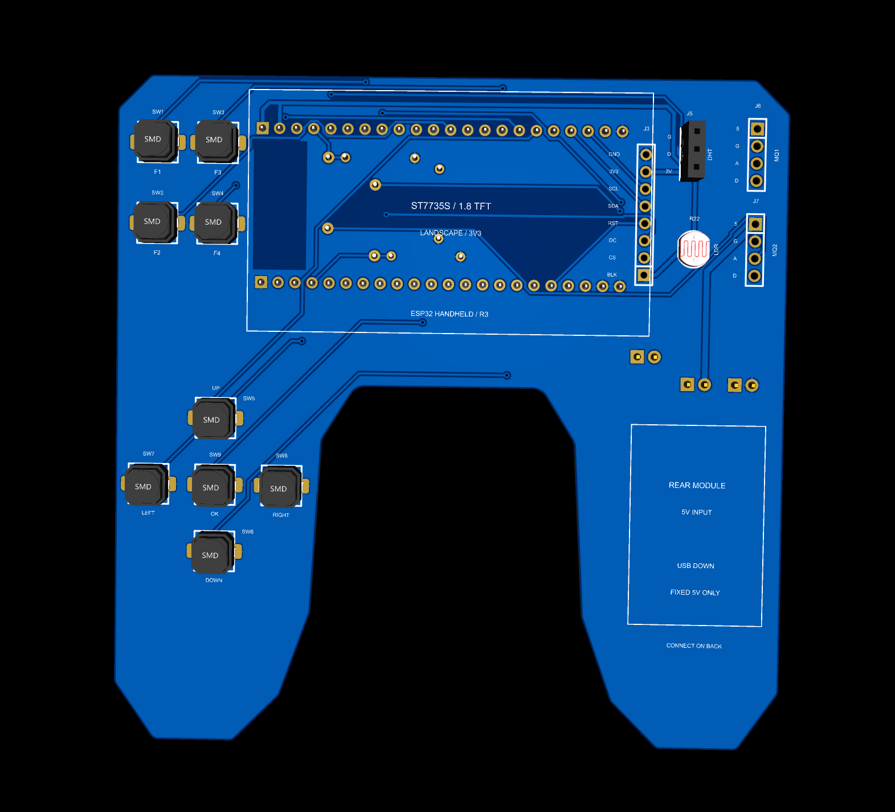

# 智联迷城 ESP32 手柄 · R9

## R9 十芯直连与直插装配

手柄板 99.60 × 99.60 mm，执行板 86 × 64 mm，适配 MG996R 180°。一根 2×5、2.54 mm IDC 排线，5 V、地、3.3 V 各占一针，其余七针直接连接舵机和 TB6612 两路控制。执行板右侧三组直插螺丝端子分别接 B 路输出、方向输入和 PWM/GND。两板由原 Type-C 取电板统一断电，板上自锁键只管启停。执行板按 MG996R 的 54.5 × 20 mm 安装耳包络和 48.5 × 10 mm 耳孔中心距，加工四个 M3 过孔 Ø3.2。

| 内容 | 文件 |
| --- | --- |
| 嘉立创专业版工程 | [两块板和原理图](hardware/R9-10P/ESP32-handheld-R9-10P.epro2) |
| 针序、器件与装配 | [启停接线、舵机孔位与逐图核对](docs/R9/十芯直连与直插装配.md) |
| 制板文件 | [手柄 Gerber](hardware/R9-10P/PCB1-R9-10P-Gerber.zip) · [执行板 Gerber](hardware/R9-10P/PCB2-R9-10P-Gerber.zip) |
| 保存后验证 | [手柄正面](hardware/R9-10P/PCB1-front.png) · [执行板正面](hardware/R9-10P/PCB2-front.png) · [DRC 和线序核对](hardware/R9-10P/validation.json) |
| Arduino `1.4.0-r9-outline` | [手柄源码](software/ExamHandheld/ExamHandheld.ino) · [编译、配网与操作](software/README_先读我.md) · [烧录文件](software/binaries/) · [版本对照与验证](software/validation/r9-outline.md) |
| 中文显示与实时取模 | [字符、轮廓、点阵原理及算法代码](software/汉字实时取模与显示.md) · [ThingsCloud 图文联调记录](software/validation/r9-thingscloud.md) |

## 历史初版 R9（67.056 × 50.292 mm 执行板）

R9 包含两块板。手柄集成 ESP32-S3、横置 LCD、按键和传感器接口，尺寸为 **99.60 × 99.60 mm**。执行器板尺寸为 **67.056 × 50.292 mm**，舵机在下方转向，直流电机和扇叶装在舵机上方。板间一根 10 芯防呆排线同时传输 5 V、3.3 V、地和控制信号。

| 要找的内容 | 文件 |
|---|---|
| 采购基线、设计变更、问题处理和验收 | [R9 工程更新记录](docs/R9/CHANGELOG.md) |
| 嘉立创 EDA 专业版工程、三页原理图 | [工程文件](hardware/ESP32-S3-handheld.epro2) · [原理图 PDF](hardware/ESP32-S3-schematic.pdf) |
| 两板制造文件 | [手柄 Gerber](hardware/gerber/PCB1-手柄-Gerber.zip) · [执行器 Gerber](hardware/gerber/PCB2-执行器-Gerber.zip) |
| 模块、按键、排针排母、排线与安装件 | [采购与装配](hardware/采购与装配.md) · [焊接 BOM](hardware/PCB焊接BOM.csv) · [1:1 对孔图](hardware/assembly/装配与对孔图.pdf) · [电机托架 DXF](hardware/assembly/电机托架分面孔位.dxf) |
| 嘉立创实际画面与检查报告 | [2D 走线及 3D](hardware/images/) · [DRC、DFM 和网表核对](hardware/validation/) |
| Arduino 固件 `1.2.0-r9` | [历史源码和烧录说明](https://gitee.com/hjz0810/H2O/tree/acf6e3c2336e4b479444d8c00ba66cf2f968b36e/software) · [历史烧录文件](https://gitee.com/hjz0810/H2O/tree/acf6e3c2336e4b479444d8c00ba66cf2f968b36e/software/binaries) |

R9 交付检查记录显示，两板保存并重载后原生 DRC 均为 **0**，原理图、PCB 和飞针网表共核对 **152** 个电气脚。固件已编译并通过本地测试，烧录和实物联调留待首件。装配前用 1:1 图核对快充板孔位、舵机固定孔和屏幕位置，装好后再测 5 V 带载压降和扇叶净空。

`dist/` 保存与早期 PCB 对应的 **v1.1.0** 历史交付包。R9 开发和制造使用上表列出的工程、固件和 Gerber。
