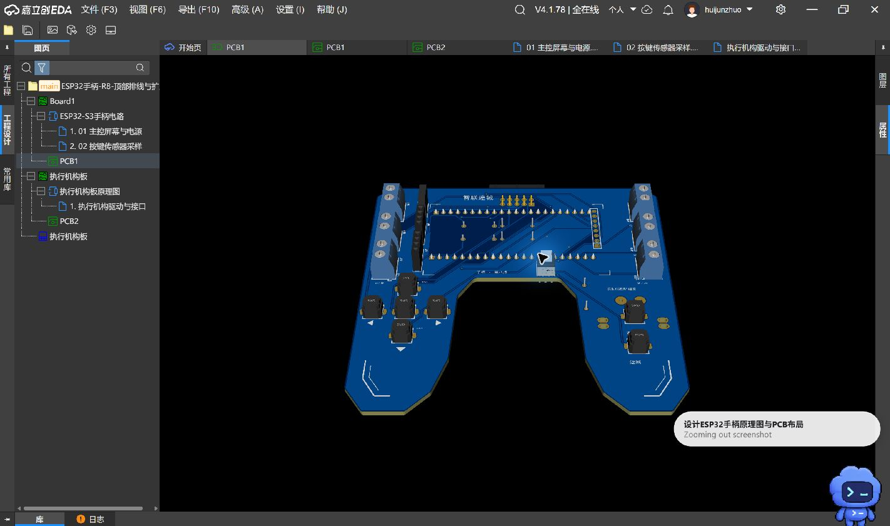
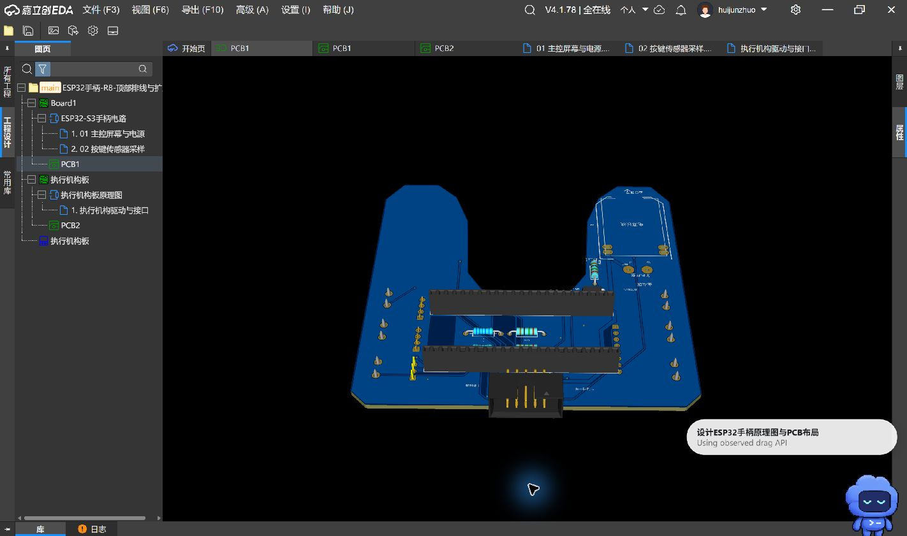
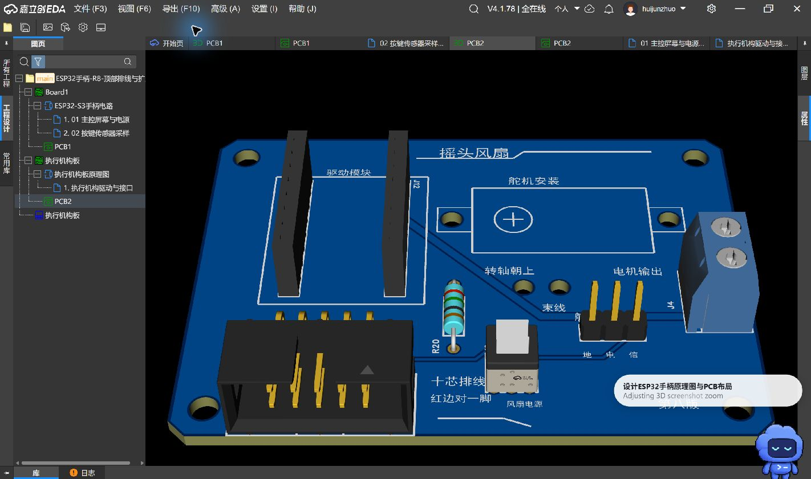

# R8 · 顶部排线、六组扩展端子与自锁开关

原始设计时间为 2026 年 11 月 19 日。这一版整理单根排线与手柄正面器件，补足 GPIO 扩展接线。

### 本版做了什么

- 手柄左右两侧各布三个 5.00 mm KF301-5.0-2P 螺丝端子，顶面拧紧、侧面进线。六组分别引出 GPIO6、9、10、47、19、20 与地，执行器电机端子统一成同款。
- 把 DHT11、MQ-2、MQ-135 排母移到屏幕左侧，重新排列背面四只 MQ 分压电阻。明确两只 MQ 的 DO 留空。
- 两板分别加六脚直插自锁电源开关和本版的 P 沟道 MOSFET 电源开关电路。取消 JP1/JP2 跳帽，保留 J4 对焊长槽及 J14 飞线输入。
- 保留顶部朝外的板座与单根 10 芯直通线，更新三页原生 A4 原理图、两块板的制造文件和焊接 BOM。

### 与上一版对比

| 项目 | R7 | R8 |
| --- | --- | --- |
| 扩展接线 | 仅板间及原有模块接口 | 手柄左右各三组 GPIO 螺丝端子 |
| 传感器布置 | 上一版接口位置 | 三组排母移到屏幕左侧，MQ 分压在背面集中 |
| 电源启停 | JP1/JP2 跳帽和旧供电布置 | 双板直插自锁开关，保留 J4/J14 |
| 板间线 | 单根 10 芯 IDC | 沿用 R7 的直通针序，重排板上位置和走线 |
| 交付核验 | 保存的工程、双板 Gerber 与 3D | 增加六组端子与电源电路的核对，166 个焊盘交叉检查 |

### 验证与交付

两板原生 DRC 均为 0。核对两块板共 166 个焊盘、飞针网络、板框、钻孔及 IDC 针序。实物安装、通电、摆动净空和满载压降留待试装。

[R8 嘉立创原生工程](hardware/ESP32-handheld-R8.epro2) · [双板 Gerber、原理图与 BOM](hardware/) · [制造文件核验](verification/manufacturing.json)

[当前设计与制造文件（R9.1.1）](https://gitee.com/hjz0810/H2O/releases/tag/r9.1.1)

### 工程截图与装配图

**R8 手柄正面原生 3D**。左右六组蓝色螺丝端子，屏幕左侧布置传感器排母。

**R8 手柄背面原生 3D**。展示开发板排母、四只轴向分压电阻和快充模块区。

**R8 执行板原生 3D**。执行板的电机螺丝端子、MG90S 安装区和本版直插自锁键。

