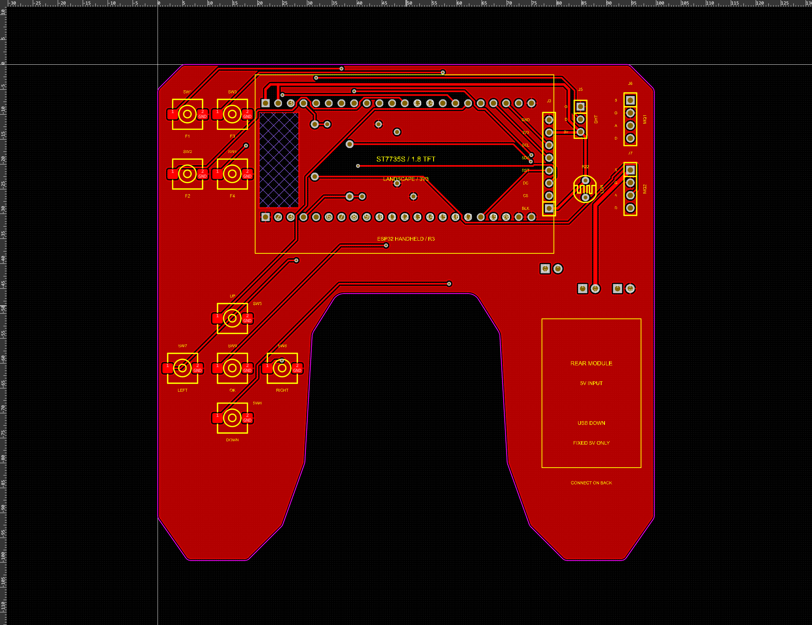
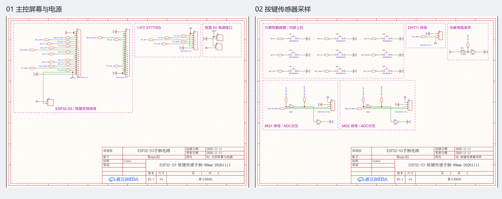

# R3 · 双层布线与首套 Gerber

原始设计时间为 2026 年 11 月 11 日。本版归档 R3 的布线交付，并附同日 R3.1 的原理图修订。

### 本版做了什么

- 把手柄扩到 99.60 × 99.60 mm。五只采样电阻移到背面两排开发板排母之间，DHT11 和双 MQ 改用排母，光敏保留两个焊孔。
- 将 J4 5 V 输入、JP1 主电源和 JP2 开发板供电隔离移到背面。优先布 SPI、采样与供电，完成其余连接和双层接地铺铜，导出首套 Gerber。
- R3.1 把三组功能内容排成两页带原生 A4 标题栏的原理图，补全九只按键和五只固定电阻的型号、阻值，复核 99 脚网络。
- 同阶段的 Arduino v1.1.0 完成联网取题、屏幕答题、传感器上报，并补上断线续答、重复提交去重和 F1 演示。

### 与上一版对比

| 项目 | R2 | R3 |
| --- | --- | --- |
| 板形 | 99 × 88 mm 对称斜切 | 99.60 × 99.60 mm，扩大握持区 |
| 采样及电源 | 按装配区放置 | 采样电阻藏在开发板下，三个电源插接件移到背面 |
| 制造文件 | 布局和网表，保留飞线 | 双层布线与地铜，首套 Gerber |
| 图纸与软件 | 三页功能图 | R3.1 两页原生 A4 图框，另有配套 Arduino v1.1.0 |

### 验证与交付

R3 原生 PCB DRC 为 0，复核 24 件器件和 99 个焊盘。原理图有 3 条警告，附加 DFM 检查另有建议。R3.1 的 Gerber 与 R3 逐文件一致。Arduino 当时完成编译和线上答题验证，实板烧录与装配留待验证。

[R3 嘉立创原生工程](hardware/ESP32-handheld-R3.epro2) · [R3 Gerber](hardware/PCB1-Gerber.zip) · [R3.1 图框修订](hardware/R3.1/) · [Arduino v1.1.0 原交付](https://gitee.com/hjz0810/H2O/tree/08648e1/software)

[当前设计与制造文件（R9.1.1）](https://gitee.com/hjz0810/H2O/releases/tag/r9.1.1)

### 工程截图与装配图

**R3 手柄正面布线**。红色为顶层铜，左侧是九键区，右侧保留传感器与电源装配区。

**R3.1 两页原理图**。这是 R3 之后的图纸修订，标题栏、页码与器件分区均能从原生图纸核对。

