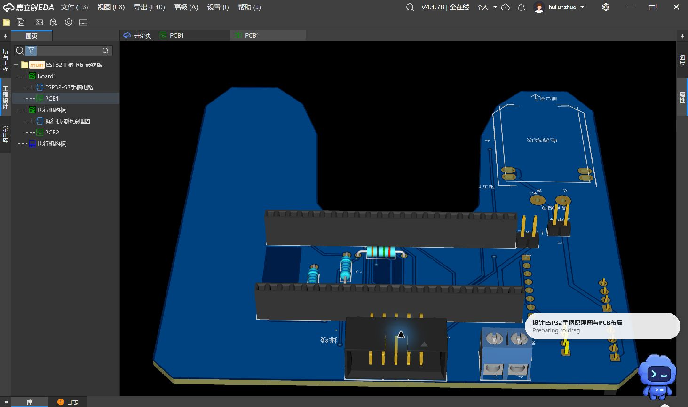
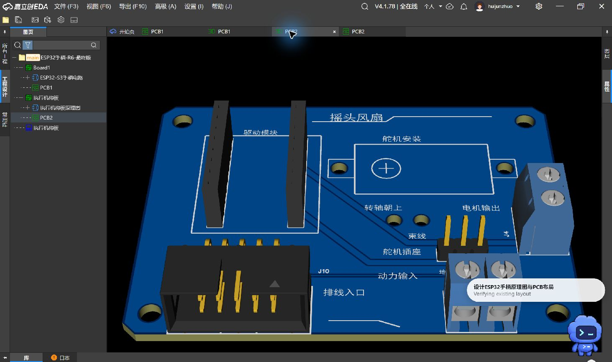

# R6 · 顶部插线与紧凑风扇板

原始设计时间为 2026 年 11 月 19 日。这一版把快充板收进握柄，整理顶部出线，并缩小执行板。

### 本版做了什么

- 在手柄背面给 20 × 30 mm 快充板留出板内位置。保留 J4 对孔焊槽，取消长直针方案，增加并联的 J14 备用短线焊盘，两焊孔中心距 6 mm。
- 手柄 J8 简牛和 J9 动力端子改为背面顶边出线。屏幕、开发板横置并下移，为顶部插头让出空间。
- 将执行板缩到 67.06 × 50.29 mm。保留四个底板支脚孔、两个舵机孔和两个束线孔，底边集中排线及动力输入。
- 重导双板 Gerber，更新手柄对孔模板、紧凑执行板的安装图和原生 3D。

### 与上一版对比

| 项目 | R5 | R6 |
| --- | --- | --- |
| 手柄进电 | J4 长直针板对板焊 | J4 对孔焊或 J14 短线焊，模块绝缘固定 |
| 手柄出线 | J8 从侧边插入 | J8、J9 改从背面顶部插入 |
| 执行板 | 上下叠装的原尺寸底板 | 缩到 67.06 × 50.29 mm，复核八处开孔 |
| 动力互连 | IDC 加独立 5 V 两芯线 | 沿用两路走线，连接口移到板边 |

### 验证与交付

两板保存后原生 DRC 均为 0。复核手柄 107 脚、执行板 33 脚，核对 J14 通孔、背面阻焊开窗及执行板八处开孔。3D 复核的是板件及已绑定器件，实物对孔、插拔和带载留待验证。

[R6 嘉立创原生工程](hardware/ESP32-handheld-R6.epro2) · [Gerber、对孔模板与装配图](hardware/)

[当前设计与制造文件（R9.1.1）](https://gitee.com/hjz0810/H2O/releases/tag/r9.1.1)

### 工程截图与装配图

**R6 手柄背面原生 3D**。顶部是排线和动力出线位置，握柄内为快充板贴装区及 J14。

**R6 紧凑执行板原生 3D**。显示缩小后的执行板、舵机固定孔和仍独立的 5 V 动力输入。

