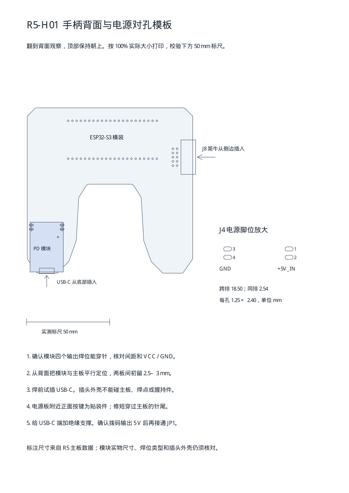
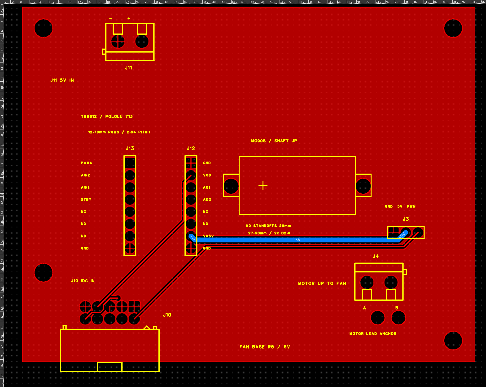
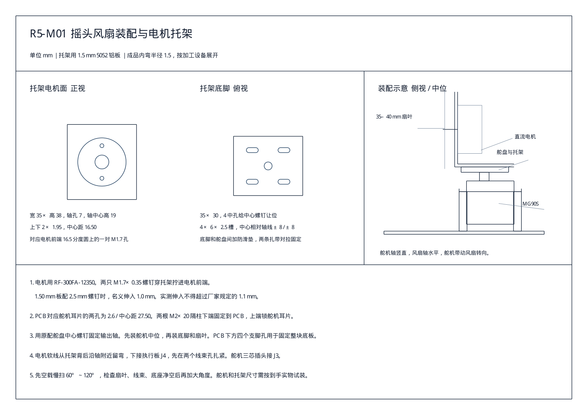

# R5 · 直焊电源与上下叠装风扇

原始设计时间为 2026 年 11 月 18 日。这一版重新处理快充板的固定、板边插线和摇头风扇的机械安装。

### 本版做了什么

- 把手柄背面 J4 改成四个 1.25 × 2.40 mm 镀铜长孔，拟用四根 0.64 mm 长直针把快充模块和 PCB 焊在一起。保留 USB-C 朝下的插拔空间。
- 把手柄 J8 移到侧边，执行板 J10 移到底边，改用 2×5、2.54 mm 弯脚防呆简牛。保留单独的红黑 5 V 动力线。
- 执行板新增两只 Ø2.60 mm、中心距 27.50 mm 的 MG90S 固定孔和两只束线孔。设计舵机在下、舵盘带动上方电机与扇叶的结构。
- 更新 M01 铝托架的固定方式和加工图，并输出主板背面的 1:1 对孔模板。

### 与上一版对比

| 项目 | R4 | R5 |
| --- | --- | --- |
| 快充板 J4 | 可调长槽上焊排母 | 四个镀铜长孔配长直针，板对板焊接 |
| IDC 出线 | 原板内直插布局 | 手柄侧边、执行板底边的弯脚简牛 |
| 舵机固定 | 执行板预留安装位置 | MG90S 两只实体通孔，上下叠装 |
| 机械资料 | 折弯支架与扎带装配设计 | 更新托架、舵盘装配图及供电对孔模板 |

### 验证与交付

两板原生 DRC 均为 0。核对手柄 105 个、执行板 33 个焊盘和 IDC 直通针序，Gerber 复核电源长孔及舵机固定孔。快充板 18.50 mm 跨距和舵机 27.50 mm 孔距均是当版设计值，试装和通电留待实物验证。

[R5 嘉立创原生工程](hardware/ESP32-handheld-R5.epro2) · [Gerber、对孔模板与托架图](hardware/)

[当前设计与制造文件（R9.1.1）](https://gitee.com/hjz0810/H2O/releases/tag/r9.1.1)

### 工程截图与装配图

**R5 手柄背面对孔模板**。四个 J4 镀铜长孔及模块 USB-C 的方向。

**R5 执行板布局**。舵机固定孔、板边简牛和独立动力端子的位置。

**R5 摇头风扇装配图**。底板支撑舵机，上方电机托架随舵盘摆动。

