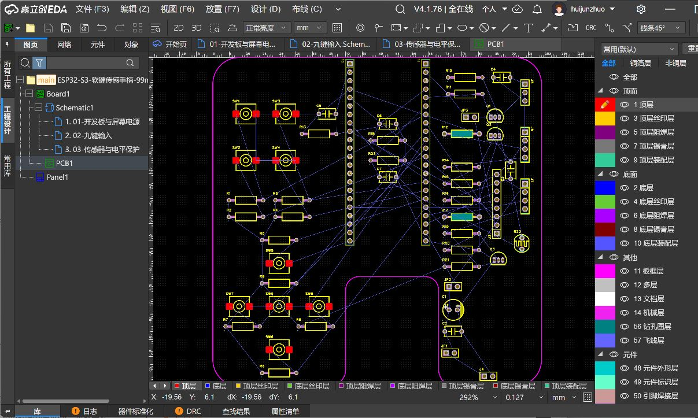
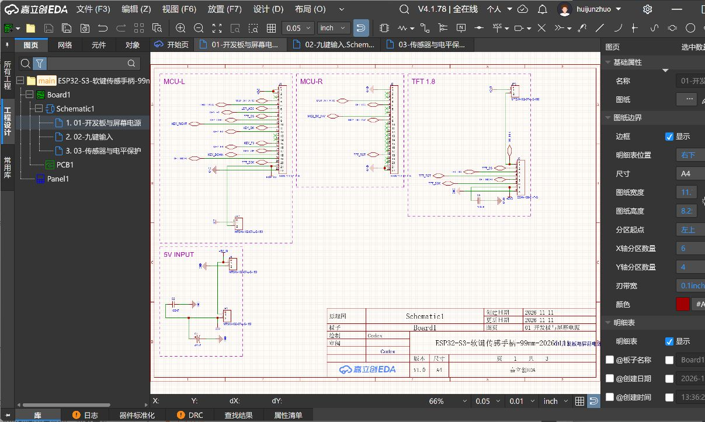

# R1 · 首版原理图与 PCB 布局

原始设计时间为 2026 年 11 月 11 日。这份归档取自改做 R2 前保存的首版嘉立创备份。

### 本版做了什么

- 新建 ESP32-S3 手柄工程，将控制板插座、八针横屏、5 V 输入、九个软键和传感器电路分到三页原理图。
- 分配 GPIO，完成网络标签和未接引脚标记。DHT11 加电平转换，两路 MQ 分别保留 AO 分压和 DO 反相，光敏电阻接 ADC。
- 把 52 个器件同步到 PCB，完成 99 × 99 mm 圆角 U 形初步布局。屏幕横放，ESP32-S3 开发板纵置于背面。

### 从立项到首版

| 项目 | 立项时 | R1 |
| --- | --- | --- |
| 工程 | 器件与接口方案 | 三页原理图、单块 PCB 和可编辑工程 |
| 电气 | 按模块确定信号需求 | 52 个器件、158 个物理脚，落实 GPIO、网络和未接脚标记 |
| 布局 | 构型草图 | 99 × 99 mm 圆角 U 形板框，正面横屏、背面纵置开发板 |
| 制造阶段 | 设计准备 | 原理图和元件放置，铜线及制造文件从后续版开始 |

### 验证与交付

当时保存重载并核对了 158 个物理引脚。本次复核了首版备份的归档完整性和对应截图。PCB 停在布线前的布局阶段。

[首版嘉立创原生工程](hardware/ESP32-handheld-R1.epro2)

[当前设计与制造文件（R9.1.1）](https://gitee.com/hjz0810/H2O/releases/tag/r9.1.1)

### 工程截图与装配图

**首版 PCB 初步布局**。圆角 U 形板框、背面纵置开发板插座及尚待布线的飞线。

**首版原理图连接检查**。首版将主控、横屏与 5 V 输入放在第一页，软键和传感器另分两页。

