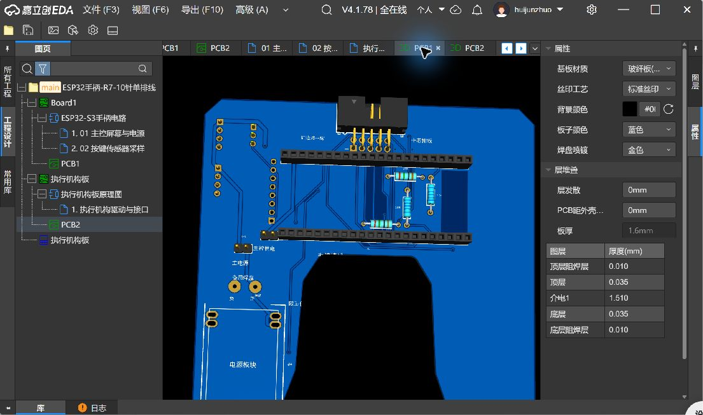
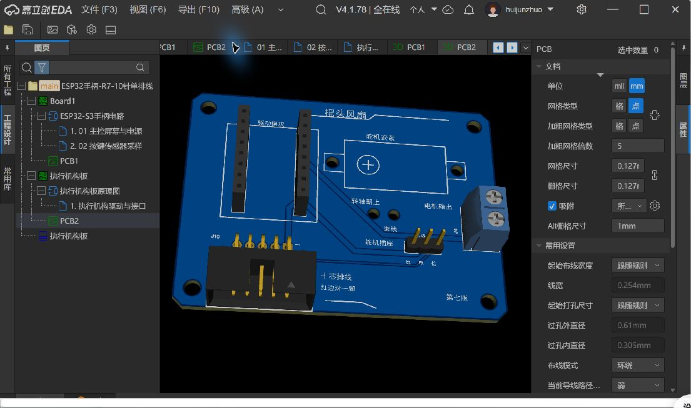

# R7 · 单根 10 芯排线同时供电和控制

原始设计时间为 2026 年 11 月 19 日。这一版把 R6 的两条板间线束合并成一根已选定规格的 IDC 排线。

### 本版做了什么

- 删除手柄 J9 与执行板 J11 两个独立动力端子，将 5 V 送到 J8/J10 的第 1、3 脚。第 5、9 脚接地，第 7 脚传 3.3 V，其余五脚负责舵机 PWM、电机 PWM、两方向输入和待机。
- 保留 2×5、2.54 mm、90° 弯脚防呆座。两端使用 FC-10P 双母头，按 1→1 至 10→10 直通，红边对 1 脚。
- 完成两端 5 V 主干重布线，保留 J4/J14 输入方案和执行板上的电机输出、舵机插座。更新三页原理图的供电路径和版号。

### 与上一版对比

| 项目 | R6 | R7 |
| --- | --- | --- |
| 板间线束 | 10 芯 IDC 加红黑 5 V 两芯线 | 单根 10 芯 IDC 同时传电与控制 |
| 动力接口 | 手柄 J9、执行板 J11 | 两端动力改由 IDC 第 1、3 脚送电 |
| 控制接口 | 舵机和单路电机控制由 IDC 传输 | 继续直通，并重布两端供电主干 |
| 装配证据 | R6 独立动力接线和紧凑底板 | 新增单线配置的双板 Gerber 与嘉立创 3D 截图 |

### 验证与交付

双板原生 DRC 均为 0。核对两根 5 V 芯线在两端接入各自的主干。后续从保存的 R7 工程补看了两板原生 3D。实物满载压降和排线温升没有历史实测记录。

[R7 嘉立创原生工程](hardware/ESP32-handheld-R7.epro2) · [两块板的 Gerber](hardware/) · [两板 DRC 记录](verification/)

[当前设计与制造文件（R9.1.1）](https://gitee.com/hjz0810/H2O/releases/tag/r9.1.1)

### 工程截图与装配图

**R7 手柄背面原生 3D**。顶边只保留一处板间 IDC，握柄背面仍是快充模块位置。

**R7 执行板原生 3D**。板边的独立动力端子移除，执行板由 10 芯排线供电。

