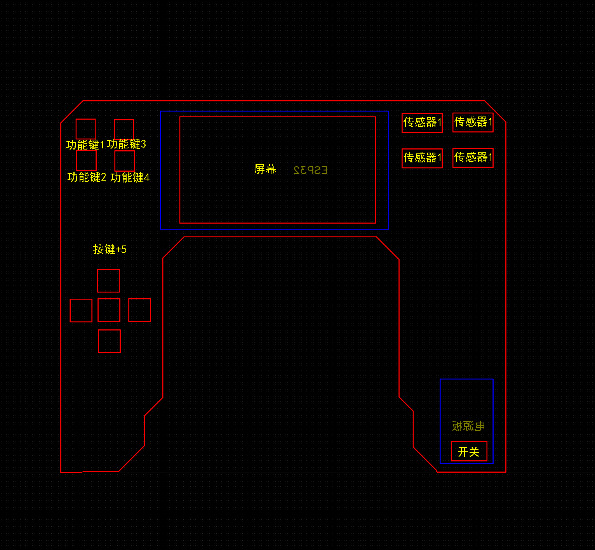
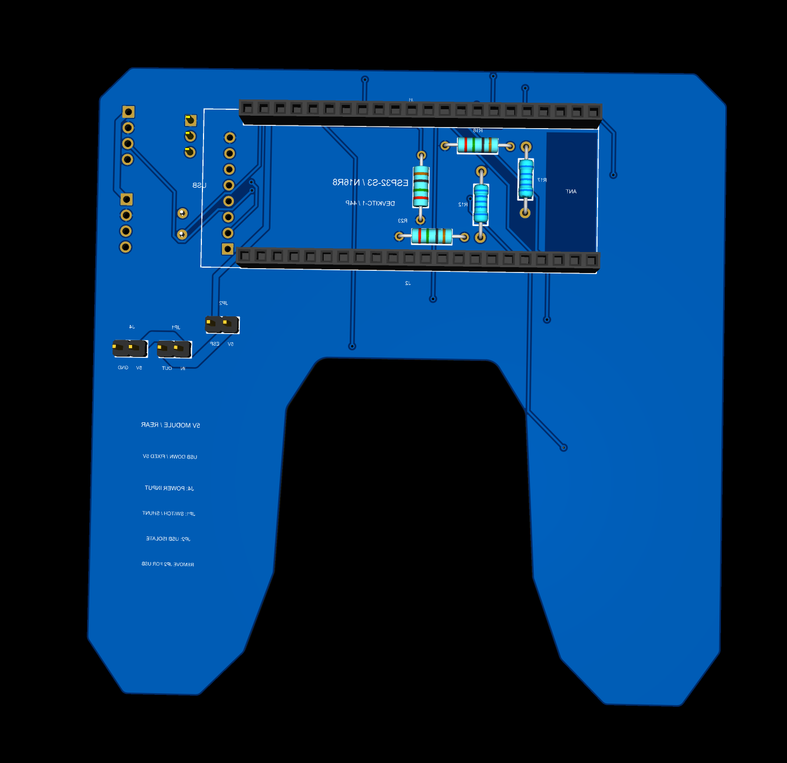
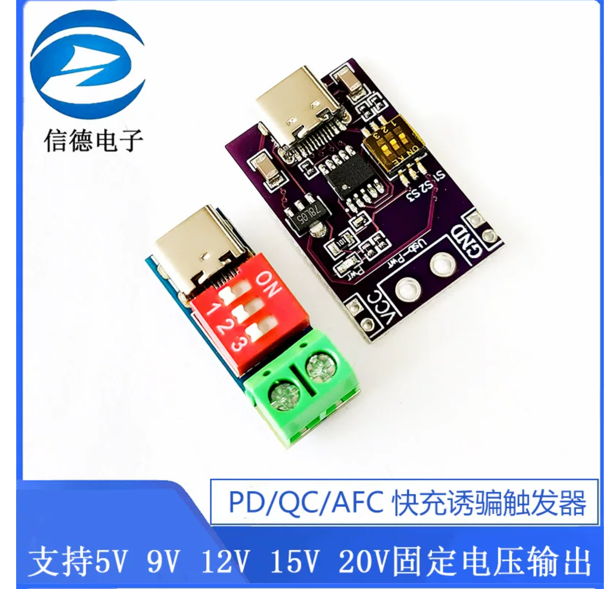

# 智联迷城 · 掌心终端

> 物联网四班 1 组 · 期末小组作业
>
> 基于 ESP32-S3 的掌上答题终端：自绘 PCB 底板 + ST7735S 横屏 + 多路环境传感器，配套 Arduino 固件与自动答题演示。

## 仓库结构

| 目录 | 内容 |
| --- | --- |
| `hardware/` | 原理图 PDF、嘉立创 EDA 专业版工程（`.epro2`）、面板与 PCB 预览图 |
| `software/` | Arduino 多文件工程源码、8 个锁定版本依赖库、构建与校验脚本 |
| `dist/` | v1.1.0 原始完整交付包（ZIP，含全部编译产物，可原样分发） |

## 硬件设计

| 项目 | 规格 |
| --- | --- |
| 主控 | ESP32-S3 N16R8（16 MB Flash / 8 MB PSRAM） |
| 显示 | ST7735S 1.8 英寸 TFT，横屏 160×128 |
| 底板 | ESP32 Handheld R3.1 |
| 环境传感 | DHT11 温湿度、MQ1 / MQ2 双路气敏、光敏电阻 |
| 供电 | PD/QC/AFC 快充诱骗模块，固定 5 V 输出 |
| 交互 | 功能键 F1–F4 + 五向键（上/下/左/右/OK） |

### 引脚分配

| 功能 | GPIO |
| --- | --- |
| TFT CS / DC / RST / MOSI / SCK | 15 / 2 / 21 / 13 / 14 |
| DHT11 | 5 |
| MQ1 AO / MQ2 AO / 光敏 | 1 / 4 / 6 |
| F1 / F2 / F3 / F4 | 7 / 8 / 9 / 10 |
| 上 / 下 / 左 / 右 / OK | 11 / 12 / 16 / 17 / 18 |

MQ 模拟输出经底板 22 kΩ / 33 kΩ 分压，固件按 0.6 系数还原；DHT11 按 3.3 V 逻辑使用。光敏与 MQ 未经标定，仅输出相对量，不标注 lux / ppm。

### 结构与 PCB

| 正面 | 背面 |
| --- | --- |
|  |  |

  

## 固件

工程入口：`software/ExamHandheld/ExamHandheld.ino`（标准多文件 Sketch，同目录 `.cpp` / `.h` 一并编译）。

### 编译配置

| 设置 | 值 |
| --- | --- |
| Board | ESP32S3 Dev Module |
| Flash Size | 16 MB (128 Mb) |
| Flash Mode | QIO |
| PSRAM | OPI PSRAM |
| Partition Scheme | 16M Flash (3 MB APP / 9.9 MB FATFS) |
| USB CDC On Boot | Enabled |
| USB Mode | Hardware CDC and JTAG |
| Arduino Runs On / Events Run On | Core 1 |
| Core | esp32 by Espressif Systems 3.3.12 |

### 快速开始

1. 安装 Arduino IDE 2 与 ESP32 Core 3.3.12。
2. 在 `software/` 目录执行 `powershell -ExecutionPolicy Bypass -File .\tools\InstallLibraries.ps1`，将随包 8 个锁定库安装到草图目录（内容相同的已有库会保留，冲突则报错不覆盖）。
3. 打开 `ExamHandheld/ExamHandheld.ino`，按上表配置后验证、上传。
4. USB 烧录前取下底板 JP2。

详细配网流程、按键映射与演示机制见 [`software/README_先读我.md`](software/README_先读我.md)。

## 交互与自动演示

- **首次配网**：设备开启临时热点，手机连接后访问 `http://192.168.4.1` 填写 2.4 GHz Wi-Fi、组号与密码，保存后自动重启。按住 F1 上电可强制进入配网。
- **手动作答**：F1–F4 选择 A/B/C/D，多选可再按取消，OK 提交。
- **自动演示**：主菜单短按 F1 启动；答题或解析界面长按 F1 启动；运行中任意键立即停止。演示按 `start → story_next → answer → continue` 逐步推进，单次完整流程可得 35 题 / 350 分。
- **可靠性**：协议为每次变更附加启动前缀、请求序号、会话与进度版本；同一请求仅生效一次，断线或重启后以服务器权威快照恢复，不盲目重发答案。

## 版本说明

- `v1.1.0` — 当前版本。服务器协议 2、自动答题演示数据、传感器上报与恢复逻辑。
- `software/binaries/` 保留可直接烧录的应用、引导程序与分区表；`.elf` / `.map` / `merged.bin` 等大体积中间产物未入库，完整版本见 `dist/` 内原始交付包。

---

本项目为课程小组作业，硬件工程与固件均在 `v1.1.0` 版本交付时冻结。
