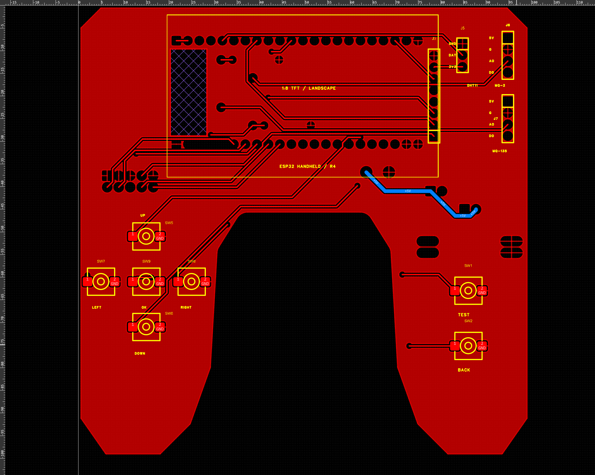
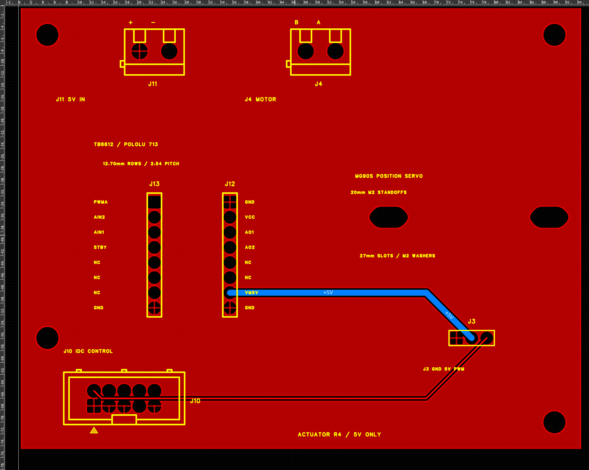
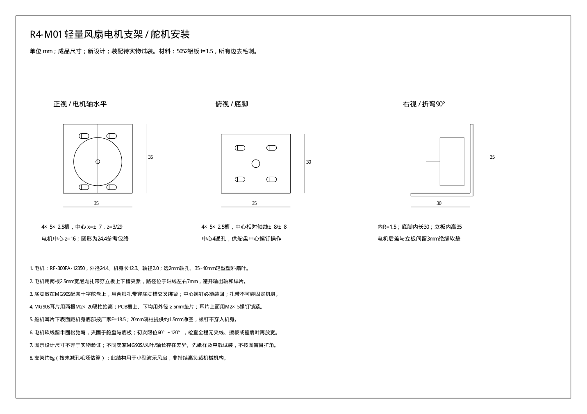

# R4 · 双 MQ 手柄与独立执行板

原始设计时间为 2026 年 11 月 18 日。这一版把手柄扩展成主控板与摇头风扇执行板的双板工程。

### 本版做了什么

- 手柄取消光敏通道，传感器定为 DHT11、MQ-2、MQ-135。双 MQ 只采 AO，两路各用 22 kΩ / 33 kΩ 直插分压。九个键改为五向键加两个功能键。
- 在手柄背面做快充模块的可调长槽和两只独立排母，复核开发板排距。电源包络留在装配层，清掉正面的旧外框。
- 新增 TB6612 模块、舵机 PWM 和直流电机端子的执行板。10 芯 IDC 送控制与逻辑供电，5 V 动力走 J9 到 J11 的独立两芯线。
- 完成双板布线、输出两份 Gerber 与三页原理图，并交付 R4-M01 电机支架 DXF 和装配图。

### 与上一版对比

| 项目 | R3 / R3.1 | R4 |
| --- | --- | --- |
| 传感器 | DHT11、双 MQ 和光敏 | DHT11、MQ-2、MQ-135，四只分压电阻 |
| 操作键 | F1–F4 加五向键 | 两个功能键加五向键，共七键 |
| 供电安装 | 背面插接 5 V 与跳帽 | 背面可调长槽和两只排母，给模块孔距留调整量 |
| 执行器 | 单块手柄 PCB | 独立 TB6612 执行板、舵机和风扇电机 |
| 互连 | 无板间互连 | 10 芯信号排线加独立 5 V 动力线 |

### 验证与交付

保存重载后，两板原生 DRC 均为 0。核对手柄 105 脚、执行板 33 脚、IDC 同号连接和实际 Gerber。电源跨排名义 18.50 mm 来自设计估算，舵机、电源孔位和带载情况留待实物核对。

[R4 嘉立创原生工程](hardware/ESP32-handheld-R4.epro2) · [双板 Gerber、BOM 与支架图](hardware/)

[当前设计与制造文件（R9.1.1）](https://gitee.com/hjz0810/H2O/releases/tag/r9.1.1)

### 工程截图与装配图

**R4 手柄正面**。改成七键及双 MQ 采样，板间接口与电源区单独布置。

**R4 执行板正面**。独立执行板上分布 TB6612 插接、舵机接口、电机输出和两种板间接线口。

**R4 电机支架加工图**。第一套 1.5 mm 铝板折弯支架，标出了电机、扎带及舵盘安装位置。

