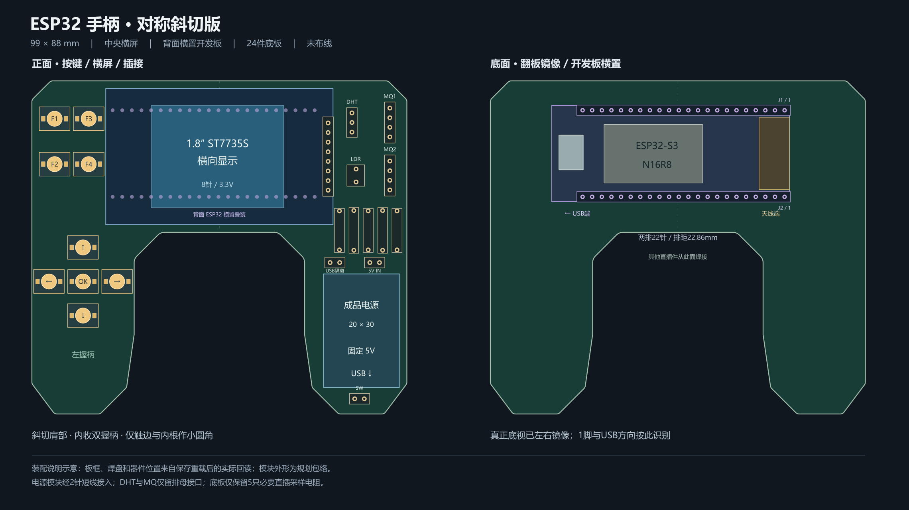
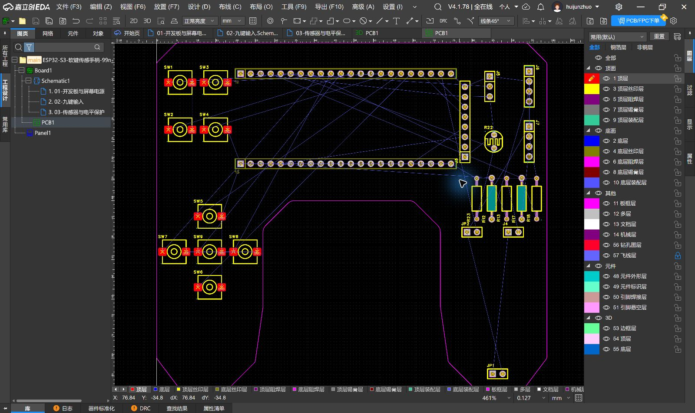

# R2 · 对称斜切手柄与底板精简

原始设计时间为 2026 年 11 月 11 日。这一版以成品模块插接和手焊为目标，重新整理了电路与正反面布局。

### 本版做了什么

- 重画 99 × 88 mm 左右对称斜切双握柄。中央保留横屏，背面 ESP32-S3 改为横置，两排各 22 针。
- 把左侧分成四个功能键和五向按键组，右侧安排 DHT11、两路 MQ、光敏焊孔与外接 5 V 模块。
- 移除多余稳压、滤波及电平转换外围，底板由 52 件减到 24 件。保留两路 MQ 分压和光敏采样所需的五只轴向直插电阻。

### 与上一版对比

| 项目 | R1 | R2 |
| --- | --- | --- |
| 板框 | 99 × 99 mm 圆角 U 形 | 99 × 88 mm 左右对称斜切双握柄 |
| 开发板 | 背面纵置 | 背面横置，双排 22 针 |
| 外围电路 | 52 件，含电平转换和电源外围 | 24 件，模块就近接入，保留五只采样电阻 |
| 布局输出 | 第一套布局 | 正反面装配图、BOM、99 脚网表和标准排针核对 |

### 验证与交付

原理图、PCB 布局和 99 个引脚保存后已重载核对。该版停在布线前，原生 PCB DRC 记录 78 项待布线连接。

[R2 嘉立创原生工程](hardware/ESP32-handheld-R2.epro2) · [原理图、BOM 与逐针表](hardware/)

[当前设计与制造文件（R9.1.1）](https://gitee.com/hjz0810/H2O/releases/tag/r9.1.1)

### 工程截图与装配图

**R2 正反面装配图**。图中标出中央横屏、背面横置主控、九键和右侧传感器接口。

**R2 嘉立创布局**。工程中的斜切对称板框和器件位置，供核对装配图。

