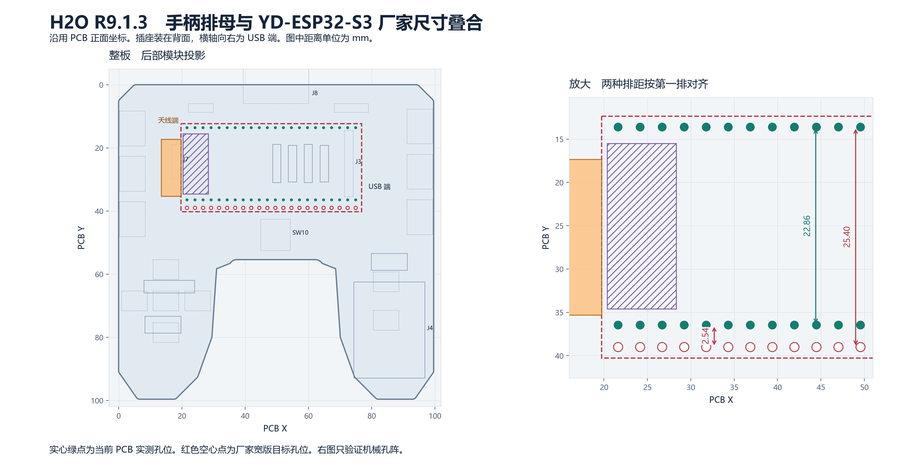
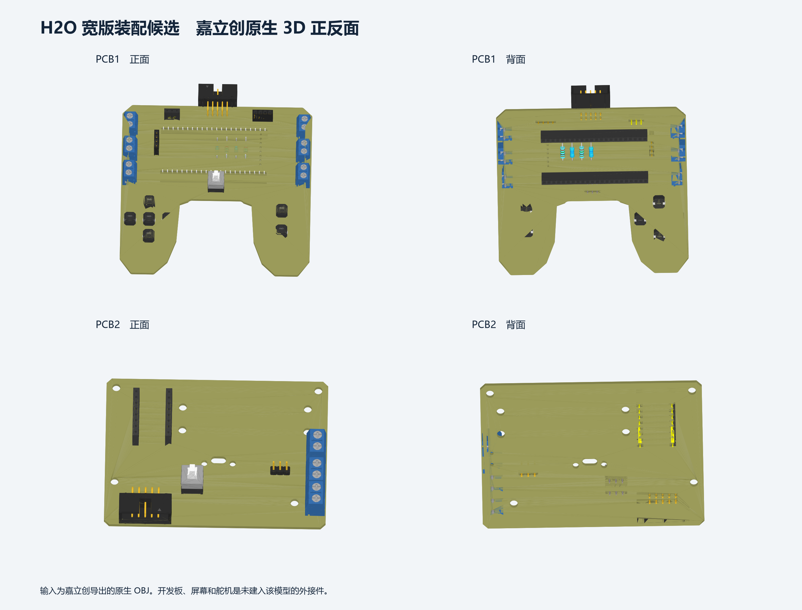

# R9 工程更新记录

## R9.1.4-rc.1 · 宽排距与执行板支撑孔

2026 年 11 月 20 日，装配验证预发布。R9.1.3 的 22.86 mm 孔阵对应乐鑫 DevKitC-1 v1.1。源地工作室 YD-ESP32-S3 双 Type-C 版需要 25.40 mm 排距。一排对齐后，旧板另一排会偏 2.54 mm。N16R8 指 Flash 与 PSRAM 容量，开发板的厂家、型号和机械图才决定孔阵。

| 位置 | 改动 | 核对结果 |
| --- | --- | --- |
| PCB1 J1/J2 排母 | 保留 J1，J2 向正面坐标 +Y 移 2.54 mm，重布受影响的局部信号和电源铜线 | 两排中心 25.40 mm，单排 2.54 mm 节距，首尾 53.34 mm。钻孔输出反量到 44 个 Ø1.05 mm 金属化孔。 |
| PCB1 丝印 | 移动压住焊盘的 J22 和 H₂O 丝印 | 回读确认这两处压焊盘警告消失。PCB1 另有 39 条 DFM 警告。 |
| PCB2 后部支撑孔 | 两个 Ø3.20 mm 孔的新中心为 (3.80, 45.00) 和 (73.80, 53.20) mm | 按 Ø7 mm 垫片计算，与相邻器件包络净空分别为 1.20 mm、0.57 mm。MG996R 的四个安装孔中心距为 48.50 × 10.00 mm。 |
| 电路与装配对账 | 对照两板原理图、板上坐标和制造文件，回读候选焊盘网络 | 两板保存重开后嘉立创原生 DRC 均为 0。复核覆盖 38 个器件位置、167 个焊盘和 22 个业务 GPIO。 |

[复核报告](../../hardware/R9-1-4-RC1/audit-report.md) · [支撑孔与垫片净空图](../../hardware/R9-1-4-RC1/images/actuator-mount-clearance.png) · [嘉立创工程](../../hardware/R9-1-4-RC1/H2O-R9-1-4-RC1.epro2) · [验证数据](../../hardware/R9-1-4-RC1/verification.json)

放行前须完成采购件首件试插和高度核对，复核射频禁布区、5 V 峰值带载压降及 GPIO43/48 启动行为，并更新工程里的旧 22.860 mm 文档标注。此版归档硬件候选及其证据，固件复核数据对应 1.4.0。

## R9.1.3 · MG996R 机械包络与 M3 过孔校正

| 项目 | R9.1.2 | R9.1.3 |
| --- | --- | --- |
| 舵机机械图 | 图片包络比例错误，单个机身框约 22.5 × 12 mm | 机壳俯视 40.7 × 19.7 mm，安装耳总包络 54.5 × 20 mm |
| 舵机安装耳开口 | 未与 PCB 孔径区分 | 明确为舵机自身 Ø4.4 mm 开口 |
| PCB 安装孔 | 四个 Ø4.4 mm | 四个 M3 紧配合过孔 Ø3.2 mm |
| 孔中心距 | 48.5 × 10 mm | 48.5 × 10 mm，不变 |
| 孔中心坐标 | X=29.75 / 78.25 mm，Y=12 / 22 mm | 不变 |
| `MOTOR_A2` 走线 | 为 4.4 mm 大孔临时下移 0.2 mm | 恢复 R9.1.1 的 Y=19.2 mm 原走线 |
| 元件、IDC、固件 | 不涉及 | 不变 |

R9.1.2 把 MG996R 安装耳本身的 Ø4.4 mm 开口误当成 PCB 钻孔，并沿用了比例错误的旧机械丝印。R9.1.3 按真实机壳与安装耳尺寸重新导入丝印，把 PCB 孔改为 M3 过孔 Ø3.2 mm，恢复相邻底层走线，同时保留正确的 48.5 × 10 mm 耳孔中心距。

保存、关闭并重新打开 PCB2 后，原生 DRC 为 0。Gerber 板框回读到四个独立的 3.2 × 3.2 mm 圆孔，中心坐标为 X = 29.75 / 78.25、Y = 12 / 22 mm。`MOTOR_A2` 从 J12.4 到 J4.2 的连续底层铜路径验证通过。实物的螺钉、垫片、螺母和安装耳支撑高度仍需首件试装。

## R9.1.2 · MG996R 固定孔尺寸校正

| 项目 | R9.1.1 | R9.1.2 |
| --- | --- | --- |
| 舵机通孔 | 四个 Ø4.0 mm | 四个 Ø4.4 mm |
| 耳孔中心距 | 49.5 × 10 mm | 48.5 × 10 mm |
| 孔中心 X | 29.25 / 78.75 mm | 29.75 / 78.25 mm |
| 孔中心 Y | 12 / 22 mm | 12 / 22 mm |
| 相邻走线 | 底层 `MOTOR_A2` 水平段 Y = 19.2 mm | 局部移至 Y = 19.0 mm 绕孔，保持同层同网络 |
| 其他电路 | 9 个执行板器件、10 针 IDC、A/B 两路驱动 | 不变 |

本版依据 MG996R 外形图的 48.5 mm 耳孔中心距、10 mm 纵向孔距和 Ø4.4 mm 四孔修正执行板。只删除并重建四个舵机固定孔，删除与左下固定孔间距不足的 `MOTOR_A2` 段并使走线下降 0.2 mm 绕孔，没有增加元件、端子、指示灯、过孔或控制线。

保存、关闭并重新打开 PCB2 后，原生 DRC 为 0。Gerber 板框回读到四个 4.4 × 4.4 mm 独立圆孔，中心坐标为 X = 29.75 / 78.25、Y = 12 / 22 mm。`MOTOR_A2` 从 J12.4 到 J4.2 的连续底层铜路径验证通过。螺钉、垫片、螺母空间及实物舵机批次仍需首件试装确认。

## R9.1.1 · 元件精简与 MG996R 四孔

去掉 Q1、Q11、R25、R35、D2、D3、R23、R24，两板由上游取电板统一断电，板上自锁键只控制 EN、STBY 和舵机 PWM。该版首次用四个圆形通孔替换旧支架长槽，但孔距按 49.5 × 10 mm、孔径按 Ø4.0 mm 输出。

本次改版从旧版手柄的装配采购清单开始，交付 **99.60 × 99.60 mm 手柄板**、**67.056 × 50.292 mm 执行器板**和 Arduino 固件 **1.2.0-r9**。旧版清单按旧 PCB 整理，R9 的模块、按键、排针排母、压接线和五金以[采购与装配清单](../../hardware/采购与装配.md)与[焊接 BOM](../../hardware/PCB焊接BOM.csv)为准。

| 更新任务 | 遇到的问题与处理结果 |
|---|---|
| **定型传感器和采样** | 传感器改为 DHT11、MQ-2、MQ-135，并移除光敏支路。三个模块使用排母，DHT11 选带板载上拉的三针模块。两块 MQ 只接 AO，各用一组 22 kΩ / 33 kΩ 分压，5.00 V 按名义值分到约 3.00 V，DO 留空。四颗轴向电阻纵向并排，靠近屏幕后方，阻值丝印置于电阻下方。 |
| **整理手柄握持区和显示** | 保留左上两键与五键方向/确认区，重排按键的中心和高度。以横置屏幕的可见区为基准调整 J3 插座，按参考模块居中。ESP32 横置于背面，两排排母按 DevKitC-1 v1.1 核为 2×22、2.54 mm 脚距、22.86 mm 排距。传感器排母靠中，六组 2P GPIO 扩展座左右各三组，进线朝板外。正面通孔焊脚在焊接和检查后可用绝缘膜遮挡。 |
| **匹配 5 V 快充模块** | 把模块移入手柄背面板框，背面标注轮廓与极性。货源资料缺少可核对的输出孔尺寸，J4 按名义 18.50 mm 跨列留四个背面表贴焊盘，并在旁边留 J14 两个飞线焊盘。焊盘均不钻穿。实物对齐时可做可检查的短焊桥，孔距不合时使用 J14。固定 5 V 从开发板 5V 输入送入，去掉 JP1、JP2、额外稳压及 R19/R20 等相关电阻。两板均配直插自锁按键开关 PB400EEQR1BLK。 |
| **合并供电和控制线** | 把多线连接收敛为一根 2×5、2.54 mm 双母头直通 IDC 压接排线。手柄弯脚简牛 J8 在正面顶部，插口朝外。十芯分配给 5 V、3.3 V、地、舵机 PWM，以及电机 PWM、方向和待机控制。手柄的 2P 是 GPIO 扩展座，执行器的 2P 是电机输出端。 |
| **实现上下叠装的摇摆风扇** | 执行器缩小为独立底板。MG90S 定位舵机在下方，横轴直流电机通过托架固定在舵盘上，随舵机改变吹风方向。TB6612FNG 模块驱动电机调速，ESP32 单独输出舵机控制脉冲，执行器由 5 V 支路供电。舵机固定用两个 Ø2.20 mm 孔，设计中心距 27.50 mm。中央两个 Ø1.90 mm 孔保留给 SW20 的塑料定位柱，四角孔用于安装支脚。随包提供 1:1 对孔图和托架 DXF。 |
| **收尾走线、丝印和原理图** | 换件后的旧铺铜曾造成间距报错。重建铺铜后逐项修正近孔过孔、局部地铜连接和 5 V 线宽。手柄电源入口主干 1.25–1.30 mm，执行器开关后主干 1.18 mm。补齐中文接口和安装标识，使用嘉立创原版图框导出三页原理图，并保存正反面 3D 与走线画面。 |
| **同步 Arduino 工程** | `ExamHandheld.ino` 同步新 GPIO、两路 MQ 模拟采样及电机速度档和舵机转向。舵机初装脉宽限在 1.20–1.80 ms。考试操作与测试组自动演示随源码提供。发布件包含锁定的 8 个库、编译脚本和烧录文件。 |

| 验收项 | 结果 |
|---|---|
| 原生设计规则检查 | 两板保存并重载后，嘉立创原生 DRC 均为 0。 |
| 网表与制造文件 | 原理图、PCB 与飞针网表逐脚核对 152 个电气脚，手柄 117 个、执行器 35 个。两份 Gerber 与交付校验值一致。 |
| DFM 参考检查 | 两板均为 0 错误。手柄 31 条、执行器 12 条警告，涉及背面丝印、并行走线、铺铜和插头包络等。 |
| 固件 | ESP32-S3 编译已完成。23 项核心、5 项协议测试及按键、演示停止和配网页检查通过。真机烧录和联网仍待首件。 |
| 首件装配 | 用 1:1 图对快充焊孔 18.50 mm 跨列与舵机 27.50 mm 耳孔设计值。试装时核对屏幕、插头和按键净空，通电后测 5 V 带载压降并确认扇叶扫掠和活动线余量。 |

[制造文件核验](../../hardware/validation/制造文件核验.json) · [嘉立创 2D 与 3D 截图](../../hardware/images/) · [装配与对孔图](../../hardware/assembly/装配与对孔图.pdf) · [Arduino 构建与烧录](../../software/README_先读我.md)
