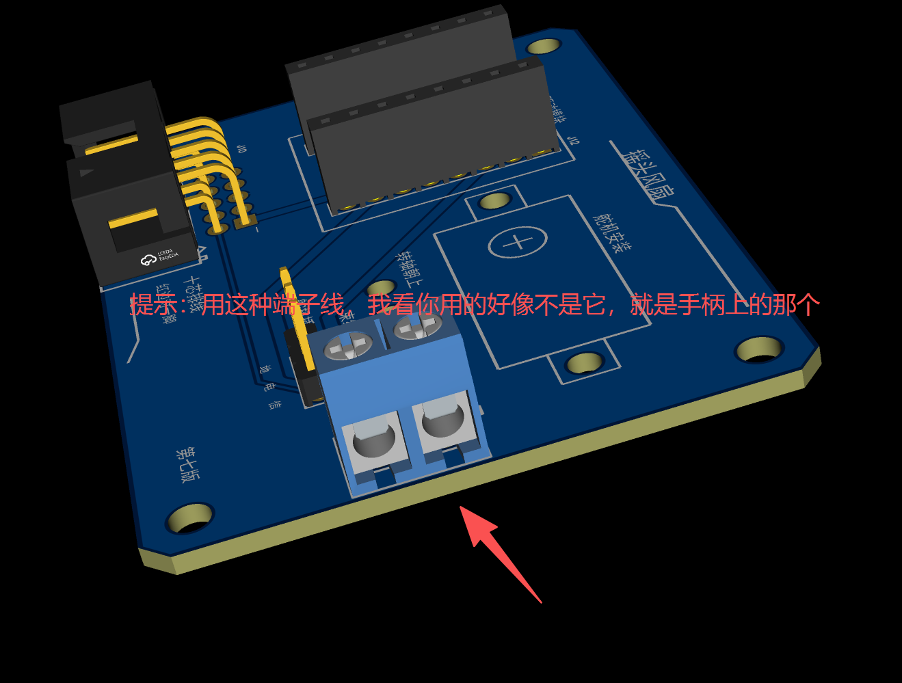
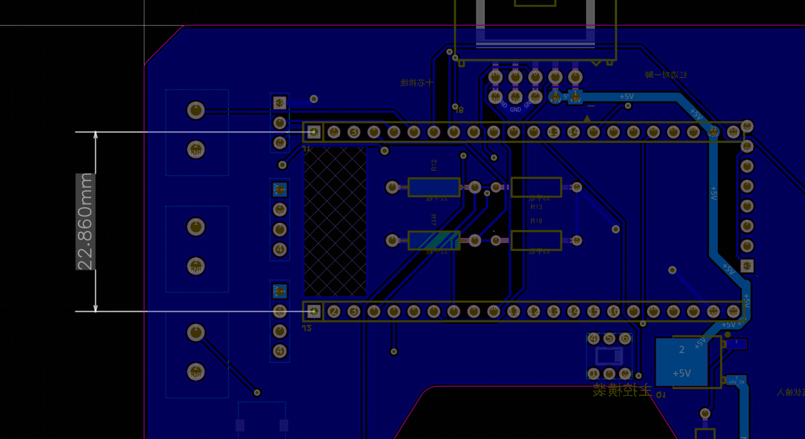

# R9 逐条对话记录

记录从 2026 年 11 月 15 日的采购提问开始，到 2026 年 11 月 19 日 R9 交付答复结束，统一使用北京时间。共收录 23 条用户消息（含弹窗答复和两张批注图）、247 条助手回复及 3 次弹窗提问。

跨会话文件重复保存了一次同一用户输入，采用内容更完整的一条。原话保留，公开版省略本机路径、账号和会话相关标识、非必要外部地址、运行日志和未向用户展示的内容。阶段回复反映当时状态，以[版本变更与验收](CHANGELOG.md)和最终 R9 工程为准。

## 001 · 2026-11-15 22:37:13 · 用户

> PCB不是下单制作了吗，然后我现在需要买上面的模块进行焊接啊，你告诉我需要买什么就行了，全部的，包括排针排母等

## 002 · 2026-11-15 22:37:27 · 助手 · 阶段回复

> 明白了，你要的是已制作 PCB 的完整装配采购清单，不含 PCB 裸板本身，排针、排母和可插接模块也要列齐。我会按现有设计文件逐项核对封装、引脚和型号；凡是设计里只留接口、实际模块型号未锁定的，会明确标成兼容规格，避免把不确定的型号说成已确认。

## 003 · 2026-11-15 22:40:25 · 助手 · 完整回复

> 按当前 **R3.1 已布线版本**，PCB 上需要焊接的器件是 **24 件**；另外还要购买 5 个外部成品模块。当前 BOM 里没有额外稳压芯片、降压模块、晶体管或电容。详细原始表见：[BOM-底板24件.csv]（本机附件）。
>
> **一、必须购买的外部成品模块**
>
> | 数量 | 购买型号/规格 | 购买要求 |
> |---:|---|---|
> | 1 | **ESP32-S3-DevKitC-1-N16R8 / N16R8V，44 针，2×22 排针版** | 必须是两排各 22 针、2.54 mm 间距、两排间距约 22.86 mm，并且已经焊好排针。不要买 2×15、2×19 或只有一排的板。官方型号有时标为 `ESP32-S3-DevKitC-1-N16R8V`，对应 16 MB Flash、8 MB PSRAM。([espressif.com]([外部地址已省略])) |
> | 1 | **1.8 英寸 ST7735S SPI TFT 彩屏，128×160，8 针横屏模块** | 必须确认排针顺序为：`BLK / CS / DC / RST / SDA / SCL / 3V3 / GND`。不同厂家顺序可能不同，不能只看“ST7735S”名称。常见 1.8 英寸模块确实使用 ST7735S 和 SPI 接口。([manuals.plus]([外部地址已省略])) |
> | 1 | **DHT11 三针成品模块** | 购买带 3 针排针的模块，接口为 `GND / DATA / VCC`，支持 3.3 V 供电或至少数据端兼容 3.3 V。 |
> | 2 | **MQ-2 四针气体传感器模块** | 建议先买两块相同的 MQ-2，接口必须是 `VCC / GND / AO / DO`，供电 5 V。MQ-2 四针模块的 AO 是模拟输出，DO 是比较器数字输出。([jyctec.com]([外部地址已省略])) |
> | 1 | **你提供淘宝链接中的 USB 快充/PD 诱骗电源模块，固定 5 V 输出版本** | 只买固定 **5 V 输出**版本，不要买 9 V、12 V、15 V 或 20 V 输出版本。该模块通过两根线接到 PCB 背面的 J4：`5V → J4.1`，`GND → J4.2`。当前设计没有再加降压模块。 |
>
> ESP32、屏幕、DHT11、MQ 模块通常会附带排针；下单时要选择“已焊排针”或“带排针套件”的版本。ESP32 和屏幕的实物接口必须先对照 PCB 接口表确认：[接口与GPIO表.md]（本机附件）。
>
> **二、PCB 上要焊的 24 件器件**
>
> | 位号 | 数量 | 具体型号 | 立创商城编码 | 说明 |
> |---|---:|---|---|---|
> | J1、J2 | 2 | **SAMTEC SSW-122-01-F-S** | **C7372682** | 1×22P、2.54 mm、直插排母；ESP32 开发板背面插座 |
> | J3 | 1 | **SAMTEC SSW-108-01-F-S** | **C7321585** | 1×8P、2.54 mm、直插排母；ST7735S 屏幕插座 |
> | J4、JP1、JP2 | 3 | **HDR-M 2.54 mm 1×2P** | **C124375** | 2 针直插排针，全部在 PCB 背面 |
> | SW1～SW9 | 9 | **ALPSALPINE SKPMAME010** | **C115348** | 软触感轻触开关，贴片、两只大焊脚，不是普通硬四脚 6×6 按键 |
> | J5 | 1 | **SAMTEC SSW-103-01-F-S** | **C5247900** | 1×3P 排母，DHT11 接口 |
> | J6、J7 | 2 | **SAMTEC SSW-104-01-F-S-LL** | **C7370857** | 1×4P 排母，两个 MQ 模块接口 |
> | R12、R17 | 2 | **YAGEO MFR-25FTE52-22K** | **C172986** | 22 kΩ、±1%、1/4 W 金属膜轴向电阻 |
> | R13、R18 | 2 | **YAGEO MFR-25FBF52-33K** | **C1369843** | 33 kΩ、±1%、1/4 W 金属膜轴向电阻 |
> | R22 | 1 | **GL5528** | **C125627** | 直插光敏电阻，孔距 3.40 mm |
> | R23 | 1 | **YAGEO MFR-25FBF52-10K** | **C1519255** | 10 kΩ、±1%、1/4 W 金属膜轴向电阻 |
>
> 建议购买数量可以稍微多一点：
>
> - SKPMAME010：买 **12 个**，实际装 9 个；
> - 22 kΩ、33 kΩ、10 kΩ 电阻各多买 1～2 个；
> - GL5528 买 **2 个**；
> - 排母和排针按表中数量购买，最好各备 1 个。
>
> **三、建议一并购买的连接线和辅助件**
>
> | 数量 | 物品 | 规格 |
> |---:|---|---|
> | 1 组 | DHT11 连接线 | 2.54 mm 杜邦线，3 芯，母对母或按模块接口配线 |
> | 2 组 | MQ 连接线 | 2.54 mm 杜邦线，4 芯，母对母，分别接 J6、J7 |
> | 1 组 | 电源连接线 | 两芯软硅胶线，24～26 AWG，约 15～20 cm；一端焊电源模块，另一端接 J4 |
> | 2 个 | 2.54 mm 短路帽 | 用于 JP1、JP2；JP1 也可以改接实体电源开关 |
> | 1 个，可选 | SPST 自锁电源开关 | 如果不想用 JP1 短路帽，可接一个两线自锁开关 |
> | 1 组，可选 | 2.54 mm 1×8 排针 | 屏幕没有焊针时使用 |
> | 1 组，可选 | 2.54 mm 1×3 排针 | DHT11 模块没有焊针时使用 |
> | 2 组，可选 | 2.54 mm 1×4 排针 | MQ 模块没有焊针时使用 |
> | 1 卷 | 电子焊锡丝 | 0.6～0.8 mm，含助焊剂 |
> | 1 瓶 | 助焊剂 | 免清洗助焊剂即可 |
> | 若干 | 热缩管或绝缘胶带 | 电源模块焊线处绝缘 |
> | 1 小包 | M2.5/M3 尼龙垫柱或泡棉胶 | 固定屏幕和背面电源模块，具体尺寸按实物调整 |
>
> **四、各接口实际怎么接**
>
> - **J1、J2**：背面插 ESP32-S3 开发板。
> - **J3**：插 ST7735S 屏幕，顺序是 `BLK、CS、DC、RST、SDA、SCL、3V3、GND`。
> - **J5**：`GND、DATA、3V3`，接 DHT11。
> - **J6、J7**：`5V、GND、AO、DO`，接两个 MQ 模块。
> - **J4**：接电源模块固定 5 V 输出。
> - **JP1**：主电源开关或短路帽，不是接地跳帽。
> - **JP2**：ESP32 的 5 V 隔离跳帽。用 USB 给 ESP32 调试时要拔掉 JP2；使用外部电源模块时再插回。
> - 两路 MQ 的 AO 经过 PCB 上的 `22 kΩ + 33 kΩ` 分压后进入 ESP32 ADC，**这四只电阻不能省略**。
> - MQ 的 DO 只是保留接口，当前没有接入 ESP32 GPIO。
> - 光敏部分使用 `GL5528 + 10 kΩ`，GL5528 直接焊在 PCB 的两个光敏焊孔上。
>
> **不需要购买的东西**
>
> 不需要另买 5 V 降压模块、3.3 V 稳压模块、恒流模块、外部按键上拉电阻、MQ 专用放大器、额外电容或晶体管。ESP32 开发板和传感器模块自身已经带有各自所需的外围电路，当前 PCB 只保留了必要的 MQ 分压和光敏采样电阻。

## 004 · 2026-11-18 10:27:36 · 用户

> 元器件确定了，准备重新设计：
> 1.传感器确定了是MQ-2，MQ-135，DHT11，我看你画了电阻，这个在这些确定的传感器中必要吗，不必要就删除
> 2."[本机路径已省略]"电源输入在板子背面，丝印却还在板子正面，改一下，另外我看你做的背面排针似乎对不上这个板子，做好适配它，使其能直接插在这上面
> 3.按键也确定了，左下角按键不变，左上角按键移动到刚才画错的丝印位置和，保留两个就行
> 4.光敏电阻去掉，现在多了两个执行机构：直流小马达和SG90黑色的那种舵机，需要另画一块板子用于走线和固定这些执行机构，找地方从手柄上引出和那个新板子上引入，采用简牛端子排线吧，或者你认为更合适的接口
> 有什么问题先问我，问完没问题整理任务清单然后开始做

## 005 · 2026-11-18 10:29:05 · 助手 · 阶段回复

> 我先核对现有 R3.1 工程、你给的电源板照片和当前接口分配，再只问一个会影响板框和连接器选型的关键问题。这个任务会按 `easyeda-agent` 的嘉立创工程流程处理，并保留关键步骤截图。

## 006 · 2026-11-18 10:33:19 · 助手 · 完整回复

> 执行机构小板需要我把电机驱动芯片也集成进去，还是只做“接口、供电、信号引出和机械固定”？
>
> 具体来说，直流小马达如果直接由 ESP32 GPIO 驱动是不行的；我需要确定是否加入类似 **TB6612FNG** 的成品驱动模块/驱动芯片，以及是否让 SG90 直接使用 5V、由 ESP32 输出 PWM 控制。

## 007 · 2026-11-18 10:39:21 · 用户

> ESP32输出PWM驱动舵机，而对于电机，ESP32只输出控制信号，由电源板提供电流（其实舵机也是），需要用一个TB6612用来驱动这两个，是否明白

## 008 · 2026-11-18 10:40:10 · 助手 · 阶段回复

> 明白你的总体架构：ESP32 只输出控制信号，执行机构电流由外部 5 V 电源板提供；执行机构小板负责驱动和接口。需要纠正一点：**TB6612FNG 只能驱动直流电机，不能驱动 SG90 舵机**；SG90 应由 5 V 电源供电，ESP32 输出一路 PWM 信号，三线接口直接接舵机。

## 009 · 2026-11-18 10:40:17 · 助手 · 完整回复

> 我只确认这一点：是否按下面的方案设计执行机构小板？
>
> - **直流小马达**：由 `TB6612FNG` 驱动，ESP32 输出 `AIN1/AIN2/PWMA` 控制信号，电机电流走外部 5 V 电源。
> - **SG90 舵机**：不经过 TB6612，直接接外部 5 V、GND 和 ESP32 的 `PWM_SERVO` 信号。
> - **TB6612FNG**：只负责直流小马达；预留第二路 A/B 通道，方便以后增加第二个直流电机。
> - 执行机构板与手柄主板之间使用一组可插拔端子，至少包含 `5V、GND、PWM_SERVO、AIN1、AIN2、PWMA、STBY`。

## 010 · 2026-11-18 10:41:36 · 用户

> 电机也要可调速，所以同样需要pwm吧

## 011 · 2026-11-18 10:46:13 · 用户

> 构型是舵机旋转，舵机上面是电机，意思是舵机控制电机吹风的方向

## 012 · 2026-11-18 10:49:10 · 助手 · 完整回复

> 明白了：
>
> - **SG90 舵机**负责旋转方向；
> - **直流小马达安装在舵机上方**，随舵机一起改变吹风方向；
> - 直流小马达需要 **TB6612FNG** 驱动，并通过 `PWMA` 调速；
> - ESP32 输出舵机 PWM、`AIN1/AIN2/PWMA/STBY` 控制信号；
> - 电机和舵机的工作电流都由外部 5 V 电源板提供。
>
> 为了正确选 TB6612 供电走线、端子和保护间距，我先确认一个参数：**这个直流小马达的额定电压和堵转电流是多少，或者你准备购买的具体型号/商品链接是什么？**

## 013 · 2026-11-18 10:51:08 · 用户

> 你来根据设计一个吧，到时候根据你设计的买电机，性价比高点的，便宜点的（20以内）就行

## 014 · 2026-11-18 10:54:06 · 助手 · 完整回复

> 那我按低成本方案选型：**3～6 V 直流小马达，额定电流约 100～300 mA，堵转电流尽量控制在 1 A 以内**，配 `TB6612FNG`，通过 PWM 调速；SG90 使用 5 V 供电和独立 PWM 信号。
>
> 还需要确认一个机械约束：**执行机构小板也要控制在嘉立创 10×10 cm 免费板范围内吗？**

## 015 · 2026-11-18 10:58:02 · 用户

> 对，并做好固定和设计，舵机是MG系列180或270度的

## 016 · 2026-11-18 10:59:23 · 助手 · 阶段回复

> 需求已足够明确，我按下面的任务清单执行：
>
> 1. 从 R3.1 工程复制出新版本，保留原工程不动。
> 2. 主手柄板：删除光敏电阻及其 10 kΩ 采样电阻；重新核对 MQ-2、MQ-135、DHT11 接口，只有确实需要的电阻保留。
> 3. 电源板：按照片中的 20×30 mm 快充诱骗板重新做背面直插适配，电源输入/模块丝印全部移到背面；核对 5 V、GND 和固定孔/排针位置。
> 4. 按键：左下方向/确认键保持；左上功能键改为只保留两个，并放到原先错误丝印对应位置。
> 5. 新增 10×10 cm 以内执行机构板：预留 MG 系列 180°/270° 舵机固定位、直流小马达固定位、TB6612FNG、5 V/GND 大电流端子、舵机三线端子，以及与手柄主板之间的可插拔控制排线。
> 6. 主板和执行机构板之间采用带锁扣的 **JST-XH 2.54 mm** 端子；电机输出用螺钉端子，避免把电机电流走细排线。
> 7. 保存、重载、回读、截图，并重新做原理图/PCB/DRC核对。
>
> 我现在先建立版本副本并核对当前工程中的真实器件、板框和排针位置，然后再进入修改。

## 017 · 2026-11-18 11:01:58 · 助手 · 阶段回复

> 我开始做工程级修改：先启动并检查嘉立创连接器，读取 R3.1 的真实原理图/PCB快照；随后按已确定的电机、舵机和连接器方案生成主板修订与执行机构子板。每个关键阶段都会在 `[本机路径已省略]` 留高清截图。

## 018 · 2026-11-18 11:18:53 · 助手 · 阶段回复

> 收到，按 MG 系列 180°/270°舵机作为上层转向机构设计，并把舵机与电机的安装固定一起纳入执行机构板。接下来我会先核对现有 R4 副本、舵机/电机的机械与电流边界，再落原理图和 PCB；完成关键布局时保存截图并回读验证。

## 019 · 2026-11-18 11:19:18 · 助手 · 阶段回复

> 我已经确认本地工作区里有比交接摘要更新的 R4 设计产物，因此先以当前文件与 EasyEDA 实时工程为准，避免覆盖已有进度。舵机规格我会收敛到常见、轻量的 MG90S 180°外形作为机械基准，电机和固定结构按此基准匹配，并在交付里标清替换 270°型号时要复核的尺寸。

## 020 · 2026-11-18 11:21:38 · 助手 · 阶段回复

> 实时工程仍是两页原理图、一块主板，当前 R4 副本还保留旧的光敏电路；新的执行机构板尚未创建。接下来我会以该副本为唯一写入目标，先核实接口与新增板的绑定方式，再处理主板接口修订和新增驱动板，避免把两块 PCB 错绑在一个原理图上。

## 021 · 2026-11-18 11:26:14 · 助手 · 阶段回复

> 方案已定为两块板分开：手柄原板保留主控、传感器与执行机构控制信号；新建执行机构板承载 TB6612FNG 驱动、MG90S 安装位、直流电机接口和独立电源入口。电机先按常见 130 规格小风扇选型，但电机堵转电流与 5V 电源模块总余量是制造前必须对照实物的边界；下面开始在 EasyEDA 建独立执行机构板项目，并写一份可追溯的接口/机械约束记录。

## 022 · 2026-11-18 11:27:31 · 助手 · 阶段回复

> 创建独立项目时 EasyEDA 返回了“未返回项目 UUID”，因此我没有重试创建，先检查是否发生了部分创建以及具体 API 状态。当前旧工程仍在线且未被改动；我会先确认项目列表是“确实未创建”还是“创建成功但回包丢失”，再决定继续建板。

## 023 · 2026-11-18 11:30:10 · 助手 · 阶段回复

> 新增 Board 已在原 R4 项目中成功创建，且与手柄原理图分开绑定；初始中文板名未被宿主持久化，我已通过原生重命名接口修复并回读确认。现在开始落执行机构电气图，驱动器采用库中 Toshiba TB6612FNG（C141517），并将数据手册要求的局部去耦保留在驱动模块内；其他模块接口继续用直插/排针，动力线路独立引出。

## 024 · 2026-11-18 11:32:59 · 助手 · 阶段回复

> TB6612FNG 已放到执行机构原理图并回读出完整 24 脚映射。器件库把并联输出脚分开列出（如 AO1 的 1/2 脚、PGND 的 3/4 脚），所以我会按数据手册把同名功率脚合并到对应电机端/地网，未用的 B 通道则明确标为不装载或保留 NC，不让未连接脚含混带过。

## 025 · 2026-11-18 11:37:40 · 助手 · 阶段回复

> 器件选型已收敛到直插接口：7 针传感控制排母、3 针舵机排母、两只 5.0 mm 间距螺丝端子，以及直插 100 nF 去耦、100 µF 电源缓冲和 100 kΩ 待机下拉。开始把这些放入新页并逐脚分配网络；物理端子仍让 5V 动力单独进板，控制排线只带逻辑信号、3.3V 和共地。

## 026 · 2026-11-18 11:39:59 · 助手 · 阶段回复

> 器件已经落到新原理图，默认 A4 图框与标题栏也保留了。接口约定固定为：控制排母 `GND / 3V3 / SERVO_PWM / MOTOR_PWM / AIN1 / AIN2 / STBY`；舵机和电机各走独立接口，J2 单独接外部 5V 动力。下一步按这个顺序批量生成网络标记，先 dry-run 检查冲突，再写入并核对每脚归属。

## 027 · 2026-11-18 11:42:19 · 助手 · 阶段回复

> 原理图已保存并回读核实：PWM、方向、待机、舵机信号、电机输出、逻辑电源和 5V 动力网都有明确逐脚网络；未用的 B 通道输出脚明确标 NC，输入拉低。现在进入执行机构 PCB：先同步真实器件，再定小板板框、端子边缘位置、驱动器与去耦的位置，并布置 MG90S 固定区和底板安装点。

## 028 · 2026-11-18 11:46:11 · 助手 · 阶段回复

> 我会按已确定的方向继续：把舵机按 MG 系列常见外形做可调固定结构，同时推进执行机构板与手柄接口整合。先核对 EasyEDA 当前工程状态和本地设计约束，再落板、回读并保存截图与装配说明。

## 029 · 2026-11-18 11:46:21 · 助手 · 阶段回复

> 我正在核对上次落下的执行机构板和主板当前状态，重点确认舵机、电机的接口边界、已同步元件和板框尺寸，避免把旧的默认位置或未核实的器件尺寸当成最终布局。

## 030 · 2026-11-18 11:47:13 · 助手 · 阶段回复

> 目前读到的执行机构板还停留在器件默认散布位置，42 条 DRC 都是未布线时的断网提示；这不是可交付布局。我会先刷新工程现场，然后按真实封装边界摆放端子、驱动器和安装位，再给 MG 舵机做独立的夹持/螺丝固定设计。

## 031 · 2026-11-18 11:49:26 · 助手 · 阶段回复

> 接口定义已经能对上：舵机只接 5V、GND、PWM；TB6612 单独控制有刷风扇电机，电机动力线不经过手柄排线。机械尺寸上“MG”不是单一外形，我会按常见 9g MG90S 壳体作为基准，在板上做长圆调节孔，兼容同壳体的 180°/270°版本，并把这个适配边界写进装配说明。

## 032 · 2026-11-18 11:50:03 · 助手 · 阶段回复

> 接下来我会把执行机构板扩到约 95×75 mm，给中心留出舵机安装区；控制与动力连接器分置板边，驱动器及去耦靠近供电/负载接口。随后加入两条兼容 9g 舵机耳位的调节长孔和清楚的丝印标记，并用保存、重载后的新读数核对边界与位置。

## 033 · 2026-11-18 11:50:51 · 助手 · 阶段回复

> 布局已重排到 95×75 mm，所有现有封装已在板框内。现在加舵机耳位调节槽与接口丝印；槽位只按 9g MG90S 外壳安装耳的常见约 27 mm 孔距作适配，转角范围 180°/270°本身不改变固定孔位。

## 034 · 2026-11-18 11:51:37 · 助手 · 阶段回复

> 板框和元件位置已经写入，舵机长孔也创建成功。我正在把长孔端部修成圆头形状，并检查丝印是否压到端子或调节孔；这一步后会保存重载，再从新快照确认实际几何。

## 035 · 2026-11-18 11:52:32 · 助手 · 阶段回复

> Typed 导出确认元件和布局数据可读，但因为 EasyEDA 标签页在后台，官方画布截图没有刷新，不能拿旧图当验收。我会切到真实 EasyEDA 窗口重新观察并截图；若窗口正被你使用，只做必要的前台切换与取证，不操作无关程序。

## 036 · 2026-11-18 11:54:51 · 助手 · 阶段回复

> 此刻桌面控制报告 EasyEDA 窗口被用户侧占用，我不会抢前台；官方实时截图因此受限。我会先用 EasyEDA 的新鲜版图回读生成可复核的工程渲染图，继续做几何与网络检查，并把“桌面截图未完成”明确记录，避免把静态渲染冒充真实画布截图。

## 037 · 2026-11-18 11:55:55 · 助手 · 阶段回复

> 执行机构板的几何已经落到项目里，但当前 PCB 没有任何铜线，不能称为布线完成。为了把舵机 PWM、电机 PWM/方向/使能真正接到主控，我接着检查主板现有 GPIO 与接口定义，再同步修改对应接口和接线说明。

## 038 · 2026-11-18 11:58:38 · 助手 · 阶段回复

> 我从已验证的 R3.1 GPIO 表找到了这块 2×22 ESP32-S3-N16R8 转接座的具体针脚映射，因此新增驱动控制可以用未占用的 GPIO38–42，不必碰 USB、启动绑带或 PSRAM 引脚。接下来会把这五个信号加到主板接口，同时删掉已取消的光敏支路；MQ 两路 22kΩ/33kΩ 分压保留，因为它们把 5V AO 限到约 3V。

## 039 · 2026-11-18 12:00:22 · 助手 · 阶段回复

> 主板原图已有 2×22 排母针脚表，可把 J2.6–J2.10 分配为 GPIO42–38。接下来改原理图时，我会在执行板和手柄板使用相同的 7 针顺序，按相同网络名跨页连接；光敏器件及其分压会从原理图和 PCB 一起移除，MQ 的 ADC 分压不动。

## 040 · 2026-11-18 12:00:53 · 助手 · 阶段回复

> 改动工具在断开 J1.6 标签后，添加 NC 标记时报告 J1 实例不可用。该错误出现在现场写入后，我先按系统化排障流程重新读取当前页与元件身份，确认没有误删或断开其他网络，再继续操作。

## 041 · 2026-11-18 12:02:05 · 助手 · 阶段回复

> 第二个连接尝试也被 API 拒绝，提示 J2.6 的短引线终点已有图元占位；网表并未改变。我会先导出这张原理图并查看引脚附近的真实布局，找到可用引线方向/空间后再连接，不会重复盲试。

## 042 · 2026-11-18 12:03:04 · 助手 · 阶段回复

> 已找到根因：J2.6–J2.10 在原始图上都带有 NC 标记（红叉），所以工具无法从这些脚拉出网络标签。它们正是预留的 ESP32 GPIO；我会先清除这五个 NC 标记，再按 GPIO42–38 加入控制网。

## 043 · 2026-11-18 12:08:48 · 助手 · 阶段回复

> 已确认失败不是引脚几何误判：当前 J2 的实例 ID 和命令错误里引用的 ID 不一致，`no-connect --clear` 也无法修改这些针脚，显示是这份多页工程的实例寻址问题。为避免绕过引脚约束造成网表假接通，我会检查工具的正式 no-connect 接口和这份工程的实例身份，找到受支持的清除方式后再继续。

## 044 · 2026-11-18 12:10:26 · 助手 · 阶段回复

> 原理图工具文档记录了这类 NC 清除会受实时同步和实例缓存影响；失败后需要先重载，再用稳定的当前引脚快照重试一次。现在按这个恢复步骤刷新主控页，确认 J2 实例仍在后再清除红叉。

## 045 · 2026-11-18 12:13:26 · 助手 · 阶段回复

> 根因已明确：工程内三个分立原理图都各自有 J1/J2，`sch no-connect` 的按位号查找错误地命中执行机构页的 J2（ID `97bd…`），而不是当前手柄页的 J2。为避免继续撞名，我会把执行机构板的两个接口顺延为 J10/J11，并同步 PCB 位号；随后再操作手柄板的 GPIO42–38。

## 046 · 2026-11-18 12:13:54 · 助手 · 阶段回复

> 执行机构页的接口已核实：J1 是 7 针控制信号，J2 是外部 5V/GND 输入。现在只调整它们的位号为 J10/J11，网络、焊盘和位置保持原样；再同步 PCB2 上对应位号并回读确认。

## 047 · 2026-11-18 12:14:48 · 助手 · 阶段回复

> J10/J11 位号已同步，工具现在能正确命中手柄板的 J2；五个 NC 标记已清除并回读为 `noConnected=false`。我现在把 GPIO42–38 分别标成舵机 PWM、电机 PWM、AIN1、AIN2、STBY 五条网，再读网表核对。

## 048 · 2026-11-18 12:16:21 · 助手 · 阶段回复

> 我会继续按 MG90S 这类小型金属齿舵机的尺寸推进固定结构，先把接口、供电和两块板的设计核对完整，再补齐布线与装配说明。180°/270°需要匹配具体舵机的控制范围，固定孔位也会注明适配型号，避免买错。

## 049 · 2026-11-18 12:16:35 · 助手 · 阶段回复

> 这次继续使用 easyeda-agent 技能修改工程，并用电脑控制技能核验实际画面。机械方案先选 MG90S 180°定位舵机，给转动的电机支架留出扫掠空间，并增加固定底座。

## 050 · 2026-11-18 12:18:14 · 助手 · 阶段回复

> 回读发现上一阶段把 TB6612 放成了裸芯片，这不符合你要求的易焊、模块插接方案。我会改成 TB6612FNG 成品驱动模块的排母插座。MQ 的模拟输出仍需保留分压电阻，用于保护 ESP32 的 ADC；光敏电阻和对应分压会一起删除。

## 051 · 2026-11-18 12:20:54 · 助手 · 弹窗提问

> 电源板图片只标了 20×30 mm 外形，没有输出孔距；VCC 与 GND 两组输出焊孔的中心距是多少毫米？这个尺寸决定背面插座能否直接插上，其余部分我继续完成。

## 052 · 2026-11-18 12:21:49 · 助手 · 阶段回复

> MG90S 的厂商尺寸是 22.8 × 12.2 × 28.5 mm，我核到现有两条安装长孔中心距约 27 mm，基本符合这类舵机的安装耳跨度。电机部分我按常见 130 规格 3–6 V 微型直流电机作为采购基准，做可拆的夹持座，风扇随舵机转向；安装座的螺孔会以可调整的长孔保留余量。

## 053 · 2026-11-18 12:22:30 · 助手 · 阶段回复

> 电源图片对应的是 5V/9V/12V/15V/20V 可选诱骗板，当前项目约定固定 5V。我会把它只作为外部 5V 电源输入接到执行板，电机电流走板上的独立端子；控制排线只传逻辑和舵机控制，不承载电机电流。正在处理主板接口和旧光敏网络，板间接口会按同一针序核对。

## 054 · 2026-11-18 12:24:37 · 助手 · 阶段回复

> 我已确认驱动板目前是双排 2×5 的 IDC 模块封装（5V VM、3.3V 逻辑、电机 PWM 与方向脚各自独立），会把原来按裸芯片做的部分改成适合排线插接的方案。接下来我先固化 2×5 线序与机械装配假设，再同步原理图和 PCB，避免主板和执行板采用不同接线定义。

## 055 · 2026-11-18 12:26:23 · 助手 · 阶段回复

> 先移除已经取消的光敏电阻采样支路，并清掉其标签和遗留导线；MQ-2/MQ-135 两路 ADC 保护分压保留。原理图改完会先逐针回读并保存，再同步 PCB，避免留下孤立网络。

## 056 · 2026-11-18 12:27:45 · 助手 · 阶段回复

> 光敏支路已从原理图删除，保存回读确认 `LDR_ADC` 已不存在，MQ 分压仍在；PCB 同步也确认从 24 个器件更新为 22 个。接下来我会检查板上是否遗留光敏网络铜线，再继续执行机构接口和模块插座改版。

## 057 · 2026-11-18 12:30:21 · 助手 · 阶段回复

> 机械接口可按常见 MG90S 做可调槽，并让电机安装座通过舵机摇臂固定，能覆盖 180°/270°舵机的不同转角。电气上我会把执行板的裸 TB6612 芯片和板载小阻容替换成两排 1×8 直插排母，适配成品双排驱动模块；驱动模块本身已带其必要去耦，未用的 B 通道会在原理图明确标 NC。

## 058 · 2026-11-18 12:34:53 · 助手 · 阶段回复

> 我按你刚确认的结构继续：MG 系列舵机采用 180°/270°可选规格，以 MG90S 外形作为安装基准；上方安装 130 规格小风扇电机，执行板负责固定和驱动。先核对 EasyEDA 当前工程与上次停下的接口状态，再继续改图、保存并用桌面截图核验。

## 059 · 2026-11-18 12:35:25 · 助手 · 阶段回复

> 当前工程仍在线，版本与连接正常；执行机构原理图是当前打开页。上次已将 TB6612 改为成品模块插座，但执行板 PCB 还没完成新接口适配、执行板结构固定也还需落实。我现在先读回原理图和两块板的真实器件/几何，再决定可直接落地的结构尺寸。

## 060 · 2026-11-18 12:37:30 · 助手 · 阶段回复

> 我核对到一个需要先纠正的实际状态：执行机构原理图已经换成 TB6612 成品模块双排插座，但 PCB2 仍保留裸芯片 U1 和周边电阻电容封装，当前板上还有多组旧网络飞线；这和你要求“买模块、插接焊装”不一致。我会先保存基线并重载 PCB2，再按原理图同步并重排，固定方案按 MG90S 安装槽加 130 电机夹持位表达，电源用独立大电流端子。

## 061 · 2026-11-18 12:37:41 · 用户

> 题目：电源板图片只标了 20×30 mm 外形，没有输出孔距；VCC 与 GND 两组输出焊孔的中心距是多少毫米？这个尺寸决定背面插座能否直接插上，其余部分我继续完成。
> 答复：你自己找找看看，全网找到这个板子的资料

## 062 · 2026-11-18 12:38:02 · 助手 · 阶段回复

> 收到，我会查找这款 20×30 mm 快充诱骗板的公开资料，重点确认输出焊孔中心距和 5V 输出能力；查不到可靠尺寸时，执行板会保留独立端子接线方案，避免按图片比例猜孔距。先等 PCB2 重载完成，再并行查资料和设计输入。

## 063 · 2026-11-18 12:38:46 · 助手 · 阶段回复

> 温馨提示：部分站点对浏览器自动化操作检测严格，存在账号封禁风险。已内置防护措施但无法完全避免，Agent 继续操作即视为接受。

## 064 · 2026-11-18 12:40:33 · 助手 · 阶段回复

> 我会把“固定”拆成两层处理：PCB 上留出舵机安装槽和执行板底座孔位，另配一份可打印的电机夹持支架尺寸/模型，避免把 130 电机直接焊在板上或靠软线承重。快充板图片没有可量的真实比例，查到精确孔距前不会把输出焊孔当成板对板插座接口。

## 065 · 2026-11-18 12:44:44 · 助手 · 阶段回复

> 已在卖家页面确认：这款模块外形约 20×30 mm，支持固定 5V/9V/12V/15V/20V档位，但页面没有输出焊孔间距或 5V 电流参数；因此接口采用电源板两根软线接执行板螺丝端子，不能宣称直接插合。另查到我上次按通用模块推定的 TB6612 插座针序不完全匹配实际 2×8 成品板，我会固定采用明确针序的 2×8 模块规格，并按其官方引脚顺序修正网络。

## 066 · 2026-11-18 12:46:55 · 助手 · 阶段回复

> 任务分成三段推进：先把 TB6612 2×8 模块针序和电源/舵机网络修正确；再把 7 针控制口改成带防呆 2×5 IDC，并同步主控端；最后重排 PCB2，加入舵机安装槽、底座固定孔和电机束带槽，更新 BOM/接线与装配说明并做保存重载回读。现在先只改执行机构原理图的网络映射，逐针复核后再同步 PCB。

## 067 · 2026-11-18 12:50:06 · 助手 · 阶段回复

> 7 针换 2×5 的替换已落到图上，但工具按旧单排线的几何位置保留了 5 条朝向错误的桩线，校验因此拒绝。器件替换本身成功，现已读到新插座 J10 和 10 个针脚位置；我正在按新针位清掉旧桩线并重新接线，修复完成前不会同步到 PCB。

## 068 · 2026-11-18 12:51:06 · 助手 · 阶段回复

> 新 2×5 的替换件已经定位到 10 针，但旧桩线是多段线，普通 `disconnect` 按接口约束拒绝了修改，没有再写入。我在改用原理图原始线段/图元回读来做精确清理，再按新插座两列针脚重接，避免留下漂线或标签错位。

## 069 · 2026-11-18 12:55:32 · 助手 · 阶段回复

> 我先查这块电源模块的公开资料，重点找输出焊孔的针距和模块实际尺寸；同时核对当前 EDA 工程状态，再把能确认的机械接口用于后续设计。商品页未标尺寸的部分，我会用可靠的实物图或同款资料交叉验证，避免把猜测当成适配尺寸。

## 070 · 2026-11-18 12:56:03 · 助手 · 阶段回复

> 公开搜索没找到该商品 ID 的可靠规格页，淘宝详情页也不能直接读取，所以暂时没有能证明焊孔间距的公开尺寸证据。我接下来会看你之前给的电源板实物图，并检查本机浏览器中可访问的商品详情；若页面仍只写外形尺寸，我会把机械接口设计成可兼容焊线/通用端子的形式，不虚构插针孔距，同时继续推进原理图和板间接口。

## 071 · 2026-11-18 12:58:33 · 助手 · 阶段回复

> 我已核对电源板原图：模块尺寸标注为 20×30 mm，VCC 与 GND 都是成对焊孔，板上也有 5V/9V/12V/15V/20V 固定档位拨码；但商品图和公开页面没有给焊孔中心距，也没有给 5V 输出电流。执行机构板继续采用独立电源端子，手柄主板若要给电源板做背插座，我会先按图片比例建立候选几何并明确标为未实测，避免把视觉估算说成厂家尺寸。现在转回工程，核验待保存的接口改动后再同步和布局。

## 072 · 2026-11-18 12:59:31 · 助手 · 阶段回复

> 原理图新鲜回读确认了：执行板输入端是 J11 的 5V/GND，J3 舵机三针，J4 电机两针，J10 是 2×5 IDC，J12/J13 是 TB6612 成品模块的两排 1×8 插座。接口网络已映射，但五个模块针脚仍悬空，且主控侧还需确认 GPIO 与对应 IDC 网络；我先做这部分对接，再同步 PCB。

## 073 · 2026-11-18 13:00:39 · 助手 · 阶段回复

> 资料证据和工程状态都已回到同一条设计链路。现在我会先存一张商品图证据和一张 EasyEDA 当前状态截图，再把主控侧五个控制信号映射到确认未占用的 GPIO42/41/40/39/38，随后把接口表同步更新，并开始执行板 PCB 机械布局与接口适配。

## 074 · 2026-11-18 13:01:44 · 助手 · 阶段回复

> 有一个界面截图与所选窗口不一致，我不会把它当作工程证据；后续截图会先校准到 EasyEDA 窗口再保存。主控原理图已经把五路控制信号落在开发板 GPIO42、41、40、39、38，对应 `SERVO_PWM`、`MOTOR_PWM`、`MOTOR_AIN1`、`MOTOR_AIN2`、`MOTOR_STBY`，与 IDC 线序保持一致。接下来核验 PCB1/PCB2 的实际封装与板框，再进行同步和机械布局。

## 075 · 2026-11-18 13:02:19 · 助手 · 阶段回复

> 我现在改两份本地设计记录：把 J2.6–J2.10 的 GPIO 与网络逐脚写实，并记录电源诱骗板的厂家未公开项以及本次采用的连接边界。文件只描述已经从原理图回读确认的网络；板孔距、电源电流能力仍单列为待实物核验。

## 076 · 2026-11-18 13:04:58 · 助手 · 阶段回复

> 查 TB6612 模块资料时发现需要先纠正一个关键点：当前 J12 的排针网络虽然看起来整齐，但与我选作参考的 Pololu 兼容双排 1×8 模块针序不一致，电机输出和 VCC 会错位。J13 控制排针针序与该模块一致；我会先按模块公开原理图修正 J12，再同步 PCB，确保插上模块时电源和电机脚不会接错。

## 077 · 2026-11-18 13:08:47 · 助手 · 阶段回复

> TB6612 接口修正中，J12.1、J12.2、J12.3、J12.4、J12.7 已按目标逐脚处理；J12.6 的连接器写入被原理图端点占用检查拒绝。我会先回读检查该针附近现有桩线/标注，再用规划器选一个不重叠的连接方向，避免重试覆盖别的图元。

## 078 · 2026-11-18 13:13:44 · 助手 · 阶段回复

> 原因已定位：J12.6 原本带有“非连接”标记，连接器因此拒绝新增桩线；规划器没能自动清掉这个标记。J12.5、J12.7 的 NC 标记则与当前未用脚/冗余地脚设计一致。我会只清除 J12.6 的 NC，再按 +3V3 接入并回读确认。

## 079 · 2026-11-18 13:16:39 · 助手 · 阶段回复

> 我刚才把 Pololu 尺寸图的底视针序读反了，核对原厂图后已确认正确顺序是：J12 1=GND、2=VCC、3/4=AO1/AO2、5/6=B 通道输出、7=VMOT、8=GND。当前临时修改因此不正确，我现在按原厂图恢复到这个顺序，并把 AO1/AO2 分别接到电机两端；改完会保存重载再逐针核对。

## 080 · 2026-11-18 13:28:34 · 助手 · 阶段回复

> 原厂图与当前接插件对应关系已澄清：电源行第 1 个 GND 由 J12.8/J13.8 的公共地冗余承接，J12.1暂作为未装的冗余地脚 NC；这样给 J12.2 留出 +3V3 标签空间。J12.7 的 +5V 桩线与相邻 NC 标记发生几何冲突，我会临时移除该标记完成布线，再看保存重载后的真实图形是否无碰撞；若冲突仍存在，会调整连接器图面位置。

## 081 · 2026-11-18 13:38:34 · 助手 · 阶段回复

> 我拿到了原厂原理图图像，针序现在可以按图逐项确认：J12 是 `VMOT、AO1、AO2、BO2、BO1、VCC、NC、GND`。我前一条把它误写成另一种排布；这次会按原厂图最终校正为 J12.1=+5V、2/3=电机两端、6=+3V3、7=NC、8=GND，并在文档中锁定“Pololu 针序兼容”以免买到不同排布模块。

## 082 · 2026-11-18 13:43:17 · 助手 · 阶段回复

> 下载并放大原厂原理图后，最终确认 J12 的正确针序为 **GND、VCC、AO1、AO2、BO2、BO1、VMOT、GND**；原先唯一的功能性错误是 AO1、AO2 被写成了同一网络。我前面的两次口头判读和临时修改有误，会全部纠正；接下来只以这张已保存的原厂图和逐针网表为依据。

## 083 · 2026-11-18 13:49:25 · 助手 · 阶段回复

> 我继续查这块电源板的商品详情和尺寸资料，核实背面插座的孔距；同时接着核对两块板的接口和网络，避免沿用上一轮的临时状态。

## 084 · 2026-11-18 13:49:34 · 助手 · 阶段回复

> 继续使用 easyeda-agent 核对工程，并通过 web-access 查这块电源板的原始商品资料。
>
> 温馨提示：部分站点对浏览器自动化操作检测严格，存在账号封禁风险。已内置防护措施但无法完全避免，Agent 继续操作即视为接受。

## 085 · 2026-11-18 13:54:47 · 助手 · 阶段回复

> 商品实物图已经找到，但卖家没有公开输出焊孔的精确中心距；图片能确认它是裸焊孔输出，不能据照片比例直接定制可插拔排针。接下来我核实当前 PCB 实际器件状态和保存结果，再把可确定的适配方案与未能从资料中确认的机械尺寸分开处理。

## 086 · 2026-11-18 13:58:58 · 助手 · 阶段回复

> 回读发现上一轮还留着两处未完成的改动：手柄仍有四个上方按键，执行板 PCB 仍是裸 TB6612 电路。我正在把它们同步为两键和成品模块插座，并补齐手柄侧 IDC 接口；现有 MQ 模拟量分压电阻暂时保留，后续结合 5V 模块输出与 ESP32 输入范围核对。

## 087 · 2026-11-18 14:08:14 · 助手 · 阶段回复

> 又找到一份同外观 USB-Pwr 板的实测资料，明确提到侧边小孔可焊标准 2.54mm 排针，但仍未给出 VCC、GND 两组之间的距离。我会继续查找这个尺寸；单组针距和两组间距会分别核对，避免把它们混为一谈。

## 088 · 2026-11-18 14:29:26 · 助手 · 阶段回复

> 精确组距仍没有查到。我准备把背面电源插座做成可调长圆孔：两组各用一只 2.54mm 两针排母，焊接时用电源板上的排针定位，固定后便可直接插拔。这样可以消化组距误差，也不用再让你测量；长孔的可调范围和装配方法会写进图纸。

## 089 · 2026-11-18 14:43:09 · 助手 · 阶段回复

> 我继续查这块电源板的孔位资料，并核对现有工程。会区分厂家标注尺寸和图片估算尺寸；无法核实的孔距不会当作精确数据直接定版。

## 090 · 2026-11-18 14:44:09 · 助手 · 阶段回复

> 我继续使用 easyeda-agent 编辑工程，配合 web-access 查原始资料。当前已找到卖家的 20×30 mm 外形标注和同外观板的小孔资料，但跨两组输出孔的距离仍待核实。

## 091 · 2026-11-18 14:48:30 · 助手 · 阶段回复

> 查到的商品资料仍没有标出 VCC、GND 两组孔之间的精确距离。我会保留前面提出的可调插座方案作为候选，并标明它需要试装验证；同时继续整理已核实的执行板接口和原理图，不让这个尺寸问题卡住其他工作。

## 092 · 2026-11-18 14:52:17 · 助手 · 阶段回复

> 执行板原理图已完成一次保存、重载和逐针回读：舵机口换成了配合舵机插头的三针公针，电机两端接 TB6612 的 AO1/AO2，IDC 两端线序一致。电源可调插座库也已建立，接下来检查孔槽方向、焊盘尺寸和实际摆放。

## 093 · 2026-11-18 14:59:16 · 助手 · 阶段回复

> 原理图调整中发现，自建电源插座的符号引脚方向被接线检查拒绝，尚未接入电源网络。我正在修正符号方向，确认可正常接线后再同步 PCB；不会跳过检查强行连上。

## 094 · 2026-11-18 15:06:27 · 助手 · 阶段回复

> 电源插座的符号方向已修正，接线也已同步到 PCB。我会继续查找这块电源板的孔距资料，并核对现有封装；查不到可靠尺寸的地方会明确标注，避免把估算当成实测。

## 095 · 2026-11-18 15:06:40 · 助手 · 阶段回复

> 我继续按 easyeda-agent 技能修改工程，用 web-access 技能查器件资料；关键检查点会保留截图。目前还在改版，尚未完成布线和最终检查。

## 096 · 2026-11-18 15:08:50 · 助手 · 阶段回复

> MQ 接口检查发现，库器件虽然叫“排母”，实际绑定的却是排针封装，我会更换并逐脚核对网络。电源板资料仍只确认了 20×30 mm 外形，跨两组输出孔的距离还没有可靠标注。

## 097 · 2026-11-18 15:13:02 · 助手 · 阶段回复

> 两路 MQ 接口已换成金航标直插排母，原理图逐脚回读确认网络未变。接下来整理主板布局，让背面电源、动力端子和 IDC 排线口避开握持区域，再检查两块板的走线通道。

## 098 · 2026-11-18 15:18:06 · 助手 · 阶段回复

> 布局检查拦住了一个碰撞：背面 IDC 座与 ESP32 下排插座相叠。我已把 IDC 座下移，候选检查已通过；现在正清理旧走线并写入新位置，避免移动器件后留下悬空旧铜。

## 099 · 2026-11-18 15:21:49 · 助手 · 阶段回复

> TB6612 模块的原厂尺寸图已找到：两排针中心距为 12.70 mm，组内间距为 2.54 mm。我会按这份图布置执行板插座，并保留独立动力线；舵机接 5V、地和 PWM，电机接 TB6612 输出。

## 100 · 2026-11-18 15:26:20 · 助手 · 阶段回复

> 主板第一轮布线、铺铜后，保存重载再运行原生 DRC，结果为 0 项违规。5V 线路已按 0.8 mm 线宽布设；这轮检查通过后，我继续整理丝印和执行板的布局、安装结构。

## 101 · 2026-11-18 15:32:22 · 助手 · 阶段回复

> 执行板首轮布线和铺铜也通过了原生 DRC，0 项违规。主板保留的四只电阻是两路 MQ 模拟输出的分压电阻，用来把最高约 5V 降至约 3V；它们不是重复的电源稳压电路。

## 102 · 2026-11-18 15:36:50 · 助手 · 阶段回复

> 我会继续查电源板的孔位资料，并把执行机构的固定方式、两块 PCB 的丝印和最终检查一起收尾。查不到可靠尺寸的地方会明确标出，不会把估算值当成能直接插接的依据。

## 103 · 2026-11-18 15:40:56 · 助手 · 阶段回复

> 两块板首轮布线的原生 DRC 都已是零违规。检查装配时发现，舵机不能只靠 PCB 上的两个槽直接贴板安装：机身会顶住板面。我会补上抬高安装和电机夹持方案，同时修正执行机构板上遗留的旧接口标注。

## 104 · 2026-11-18 15:52:51 · 助手 · 阶段回复

> 原理图还留着几处改版前的内容：七个按键仍标成“九颗”，光敏电阻区域剩了一个空框，执行机构页也有两段悬空网络标注。我正在清理这些残留，并把新增控制信号的标签拉开，方便后续查线和焊接。

## 105 · 2026-11-18 15:59:55 · 助手 · 阶段回复

> 电机已查到马步崎 RF-300FA-12350 的厂家参数和尺寸图，我按它来做轻量风扇方案；舵机按明确标注“180°定位型”的 MG90S 采购。固定件会用工程图技能输出尺寸图：舵机通过 20 mm 隔柱抬高，电机夹在随舵盘转动的 L 形支架上。价格还没有可靠报价，采购表里会把 20 元以内写成预算要求。

## 106 · 2026-11-18 16:05:15 · 助手 · 阶段回复

> 这一轮检查发现背面新加的说明文字没有按底面镜像显示，部分还落进了握把缺口；这需要修正。执行机构的两个螺丝端子也会转向板外，让进线更顺手，随后重新布线和检查。

## 107 · 2026-11-18 16:13:00 · 助手 · 阶段回复

> 我接着收尾这版双板设计。先核对已完成的电源插座适配、布线和丝印，再检查原理图、导出文件与采购装配清单；电源板资料里没能确认的尺寸会明确标注，不会当成实测值。

## 108 · 2026-11-18 16:13:54 · 助手 · 阶段回复

> 继续使用 easyeda-agent 和 computer-use 技能完成回读、检查和截图。电源板目前采用可调位置的排母插座：导出的钻孔文件已确认长槽尺寸，装配时仍需用实物对齐后焊接。

## 109 · 2026-11-18 16:18:50 · 助手 · 阶段回复

> 主板的电源输入、ESP32 插座和板间接口都在背面，传感器接口已换成排母。四颗电阻仍需保留：它们把 MQ 模块的 AO 电压分压后送入 ESP32；舵机直接接外部 5V 和 PWM，TB6612 只驱动直流电机。

## 110 · 2026-11-18 16:21:57 · 助手 · 阶段回复

> 检查发现了一个需要修正的问题：执行板重布线时，清铜操作连同安装槽、固定孔一起删掉了。我会恢复这些机械开孔，并核对制造文件里的实际轮廓。原理图另有两处单端网络提示和缺少图签字段，也会一起处理。

## 111 · 2026-11-18 16:29:19 · 助手 · 阶段回复

> 安装槽和固定孔已恢复，执行板原生 DRC 仍为零违规。接下来做保存、重载后的第二轮复核，并把模块、排母、排线、端子和安装五金整理成一份采购清单，避免沿用旧版型号。

## 112 · 2026-11-18 16:43:11 · 助手 · 阶段回复

> 第二轮保存重载复核已通过：主板 105 个引脚、执行板 33 个引脚与原理图网络一致，两块 PCB 的原生 DRC 均为零违规。原生工程和两块板的 Gerber 已导出，正在最后核对电源长槽、安装开孔和丝印。

## 113 · 2026-11-18 17:12:15 · 助手 · 阶段回复

> Gerber 核对又发现一处旧版残留：电源模块外框仍在正面制造丝印中，画布上的装配层不能证明它已移除。我会清掉这条实际丝印，再重新导出主板文件。

## 114 · 2026-11-18 17:15:11 · 助手 · 阶段回复

> 我会接着核对电源板资料和背面插座，先清理导出检查发现的正面残留丝印，再完成两块板的复核和交付文件；孔距没有可靠资料的部分会明确标注，不把估算当成实测。

## 115 · 2026-11-18 17:15:49 · 助手 · 阶段回复

> 两块板的引脚和网络已对上，执行板也已补回舵机安装槽和固定孔。现在发现的残留是旧版导入的丝印图形，普通丝印列表读不到它；我正在检查其原生对象，确保改动落在工程里，并能在重新导出的 Gerber 中验证。

## 116 · 2026-11-18 17:17:34 · 助手 · 阶段回复

> 查到的同类电源触发板资料只能确认每侧有标准2.54毫米排针孔，外形规格也与卖家图片不一致，没有给出这批板子的两排输出孔距。因此我会保留可调长槽插座并把18.5毫米标作布局名义值；接下来集中处理旧图形对象，避免猜具体孔距或误删其他装配丝印。

## 117 · 2026-11-18 17:18:04 · 助手 · 弹窗提问

> 旧电源外框已定位为独立丝印图形，但 easyeda-agent 的当前 typed 接口没有删除此类对象的功能。是否允许我仅用嘉立创界面删除这个已定位的旧外框，然后保存、重新导出并核验 Gerber？
> 可选项：允许，仅删除这个旧外框 / 保留现状，交付并注明问题

## 118 · 2026-11-18 17:18:14 · 助手 · 阶段回复

> 这一步需要你确认操作方式，因为 [easyeda-agent 的规则]（本机附件）明确要求“工程编辑……使用 typed 接口，不用 GUI……绕过缺失设计接口”。已定位到的旧外框正好缺少对应删除接口；我会先完成不依赖这一步的装配说明和交付核对。

## 119 · 2026-11-18 17:21:06 · 助手 · 弹窗提问

> 嘉立创的 typed API 不提供这个导入丝印图形的删除接口。我已经定位到它是单独的电源板矩形对象（ID `[内部标识已省略]`），会仅删除该矩形，然后保存并核对 Gerber。请确认现在可以在嘉立创界面删除它。
> 可选项：确认删除这个矩形 / 先不要删除

## 120 · 2026-11-18 17:22:03 · 助手 · 阶段回复

> 采购和接线资料已整理到具体型号：七只 ALPS SKPMAME010 软触按键、两组22kΩ/33kΩ直插分压电阻、MG90S 180°定位舵机，以及 RF-300FA-12350 电机。电阻用于把两路MQ的5V模拟输出降到ESP32可接受的电压范围，仍需保留；舵机和电机的动力由独立5V线送到执行板。

## 121 · 2026-11-18 17:26:26 · 助手 · 完整回复

> 已检索卖家资料和同类板资料，**仍未找到这个SKU可信的跨排输出孔距图**。目前采用背面两只独立排母＋长槽，预计可调整约16～21mm；18.5mm只是设计名义值，不能当成实测尺寸。
>
> 两块板引脚网络已对账，原生PCB DRC均无违规。[采购与装配说明]（本机附件）和[三页原理图]（本机附件）已整理。
>
> **还剩正面旧电源外框需要删除，暂未发布最终制造包。是否允许我仅通过界面删除该外框，再重新核验导出？**
>
> 需要确认是因为 [easyeda-agent规则]（本机附件）要求“不用GUI……绕过缺失设计接口”，而当前接口缺少这类图形的删除功能。

## 122 · 2026-11-18 17:56:42 · 用户

> 题目：旧电源外框已定位为独立丝印图形，但 easyeda-agent 的当前 typed 接口没有删除此类对象的功能。是否允许我仅用嘉立创界面删除这个已定位的旧外框，然后保存、重新导出并核验 Gerber？
> 答复：允许，仅删除这个旧外框
>
> 题目：嘉立创的 typed API 不提供这个导入丝印图形的删除接口。我已经定位到它是单独的电源板矩形对象（ID `[内部标识已省略]`），会仅删除该矩形，然后保存并核对 Gerber。请确认现在可以在嘉立创界面删除它。
> 答复：确认删除这个矩形

## 123 · 2026-11-18 18:00:48 · 助手 · 阶段回复

> 收到，我会只删除这个旧电源外框，然后保存重载、复核两轮主板布局和DRC，重新导出制造文件。

## 124 · 2026-11-18 18:02:47 · 助手 · 阶段回复

> 旧外框已删除。保存重载后，它没有再出现；接下来会核对对象差异，确认只少了这一幅图形，再检查新导出的 Gerber。

## 125 · 2026-11-18 18:05:48 · 助手 · 阶段回复

> 我会接着完成最后的保存、复核和交付打包。旧电源外框已按你的授权删除，接下来确认重新导出的工程和 Gerber 都保留这一结果。

## 126 · 2026-11-18 18:06:49 · 助手 · 阶段回复

> 保存重载后的第二轮图面检查已完成，正面的旧电源框没有再出现，原生 PCB DRC 也通过了。现在核对两板全部 138 个引脚和排线对应关系，并重新导出制造文件。

## 127 · 2026-11-18 18:08:50 · 助手 · 阶段回复

> 138 个引脚的网络对账一致，两块板的原生 DRC 均为零违规。新 Gerber 中已确认旧框消失，四个电源镀铜长槽和执行板六个安装开孔都保留了。交付包会附采购清单、接线表及电源孔距仍需实物对齐等未验证项。

## 128 · 2026-11-18 18:09:58 · 助手 · 完整回复

> 已完成：仅删除你授权的旧电源外框，保存重载后确认没有其他物理对象变化。两板原生 DRC 零违规，138 个引脚网络对账一致，新 Gerber 已确认旧框消失。
>
> [下载完整交付包]（本机附件）
>
> 包含原生工程、双板 Gerber、三页原理图、采购清单、GPIO 表、支架图及复核截图。
>
> 电源板准确孔距仍无可靠厂家资料，采用可调长槽座，焊接时需按实物对齐；供电与机械结构尚未实测。本轮未改固件和服务器。

## 129 · 2026-11-18 19:12:19 · 用户

> 不行啊，你这做的不行，首先我看着第一块板上也就是手柄那块板，电源板对应的排针根本焊不上去啊，你预留的孔位是排针的吗？我需要用排针把电源板上输出的电源接入到板子上同时排针也起到固定的作用，你根据那块板子上的物理结构设计好它，还有那个简牛端子，到底是怎么设计的？怎么没在手柄的边边上，你设计的那个位置怎么好插排线呢？，另外这种排线和端子有好几种压线方式，你搜一下常见的压线方式，然后你规定好，我到时候方便买排线，另外第二块板子上明显不对，我需要的是舵机在下面控制方向，直流电机在上面驱动风扇，类似一种摇摆电扇的设计，而你给出的这套设计似乎是往外引出两个独立的舵机和电机，而不是我这种上下的设计，同时你也没有给舵机在板子上预留位置，不管是丝印位置还是固定位置都没给留，你需要按照舵机上的螺丝孔，在开发板上也打对应的孔用来固定舵机，理解我的要求，并重新设计开发板

## 130 · 2026-11-18 19:12:25 · 助手 · 阶段回复

> 我按你说的重新检查装配：电源板用直焊排针接电并固定，简牛移到手柄板边，执行板按舵机在下、风扇电机在上的结构重做。我会用 easyeda-agent 核对现有工程，用 web-access 查排线和器件尺寸，再用 computer-use 截图检查实际装配空间。

## 131 · 2026-11-18 19:16:19 · 助手 · 阶段回复

> 现场回读确认，旧电源位是给两只排母留的长槽，手柄信号座也是朝板面插拔的直座。我会把电源位改成排针两端直接焊接，把信号座改成朝板外插拔。执行板会在舵机机身两侧留螺丝孔，把风扇支架固定到舵盘上，并把活动线束的路径画出来。

## 132 · 2026-11-18 19:30:29 · 助手 · 阶段回复

> 我在独立的 R5 工程里改，R4 留作回退。电源板商品图能辨认出两侧的四个输出孔，孔距用 20 × 30 mm 板身做了透视校正。主板会留能焊四根独立长针的镀铜孔，给照片测量留下余量。简牛已经选定为 XFCN BH254R-10P 弯插座，两端排线用同号针直通。

## 133 · 2026-11-18 19:41:13 · 助手 · 阶段回复

> 执行板已经做出两只舵机螺丝孔、机身丝印和电机线固定孔，刚通过嘉立创原生 DRC。手柄的弯插座和直焊电源位已保存，我正在核对插口伸出板边的距离，并复查改位后的布线。

## 134 · 2026-11-18 19:42:26 · 助手 · 阶段回复

> 我会另外出一张摇头风扇侧视装配图，把 PCB、隔柱、舵机、舵盘和电机托架的上下关系画清楚。电机托架按 RF-300FA 的前端螺孔出尺寸，并标明螺钉允许伸进电机的长度。

## 135 · 2026-11-18 20:03:52 · 助手 · 阶段回复

> 板框复测发现，手柄下方中央向内收得比较深，不能按整板外接矩形来放插头和模块。我把简牛移到左侧直边，电源移到右手柄背面，再按实际板边逐个核对铜孔位置和插拔方向。

## 136 · 2026-11-18 20:17:16 · 助手 · 阶段回复

> 两块 PCB 在保存并重载后都通过了嘉立创 DRC。我在做最后一轮装配复核，逐一对照插头的 1 脚、动力端子正负极，以及 Gerber 里实际输出的电源孔和舵机孔。

## 137 · 2026-11-18 20:22:54 · 助手 · 阶段回复

> 我会继续用 easyeda-agent 和电脑控制技能收尾，先核对两块板的装配位置和导出文件，再把采购规格、实物待确认的尺寸和高清截图一起交付。

## 138 · 2026-11-18 20:27:58 · 助手 · 阶段回复

> 回读图里有两处标注需要收尾：手柄背面把 USB-C 写成了输出，执行板的 J4 位号又和电机说明挤在一起。我会改好这两处，并附一张从背面实际观察的装配图，避免焊接时看反极性。

## 139 · 2026-11-18 20:40:44 · 助手 · 阶段回复

> 两块板重载后的原生 DRC 都是 0 违规，Gerber 里也查到了电源的四个镀铜长孔。卖家图只标了模块外形，没标输出孔距，照片也不能确认这四处焊位能否穿针；我会附 1:1 对孔图，把打样前要核对的地方标清楚。

## 140 · 2026-11-18 20:51:29 · 助手 · 阶段回复

> 我会把 R5 的采购表和装配图单独归档，旧版的直插简牛和电源排母不会混进清单。电源对孔图会标出背面的左右方向、USB-C 插入方向，以及需要用实物检查的间隙。

## 141 · 2026-11-18 21:21:31 · 助手 · 阶段回复

> 制造文件里的孔尺寸已经和图纸对上了：手柄是四个镀铜长孔，执行板有两个舵机固定孔。我正在做最后的打包检查，并把成品模块、排线和五金也列进采购说明。

## 142 · 2026-11-18 21:29:08 · 助手 · 完整回复

> 两块板已在嘉立创 EDA 中改成 **R5「直焊电源与摇头风扇」**。手柄电源改用长直针焊接，排线改成从板边插入，执行板增加了舵机的实际固定孔。
>
> [下载 R5 完整交付包]（本机附件），内含嘉立创工程、两块板的 Gerber、三页原理图、采购清单、装配图和高清截图。
>
> 1. **手柄背面电源 J4**：取消排母，改为四个 **1.25 × 2.40 mm 镀铜长孔**。用四根 **0.64 mm 方形长直针**把电源模块和手柄 PCB 直接焊在一起，两根接 `+5V_IN`，两根接 `GND`，同时固定模块。USB-C 朝底边，接口侧加绝缘支撑，分担插拔力。[背面装配图和 1:1 对孔模板]（本机附件）
> 2. **板间排线**：手柄 J8 放到侧边，执行板 J10 放到底边，两端都用 **XFCN BH254R-10P（立创 C492448）**，90°弯插、带防呆。下单规格写：**FC-10P 母对母，2×5、2.54 mm，10 芯 1.27 mm 灰排线，约 20 cm，两端带折返应力扣，1→1 至 10→10 直通**。平压盖和折返应力扣是两种装法；卖家的“同向／反向”说法不能代替逐针线序。排线走控制信号，舵机和电机的 5 V 另走红黑双线。
> 3. **上下叠装的摇头风扇**：执行板给 **DSSERVO MG90S 180°定位舵机**画了机身和耳片丝印，并开了两个 **Ø2.60 mm、中心距 27.50 mm** 的固定孔。舵机用两根 M2×20 隔柱锁在底板上，输出轴朝上；舵盘带动上方的铝托架，托架横装 **Mabuchi RF-300FA-12350** 电机和 35–40 mm 扇叶。ESP32 发 PWM 控制舵机转向，TB6612 控制电机转速。电机成交价是否低于 20 元尚未核实。[风扇侧视与托架加工图]（本机附件）
>
> 两块板保存、重载后，**嘉立创原生 DRC 均为 0 违规**；也复核了 Gerber 中的电源长孔和舵机固定孔。电脑截图已放在 [Agent截图]（本机附件）。
>
> **打样前先对一次实物。** 电源模块的 **18.50 mm 跨距**来自商品图估算，舵机的 **27.50 mm 孔距**来自机械图比例估算。先用 1:1 模板确认电源模块的四处输出焊位能穿针、USB-C 插头有空间，再量舵机耳孔中心距。当前尚未试装、带载或下单。

## 143 · 2026-11-19 08:28:18 · 用户

> 我不喜欢这个设计，首先，简牛端子应该在ESP32上方，ESP32和屏幕可以略微下移，让出一点空间就够了，然后，电源板怎么伸出板子外面了，那会很难看还扎手，不符合人体工学，保持在板子内部，另外，我不懂你讲的0.64长直针方案，我买不到它，我最终想的办法是，由于这个电源板背面是平整的，我用502把它粘在开发板上提供可靠的固定，然后你预留的孔位我注入焊锡，使得电源能够经此接入，另外，我对你的2pin接线端子的使用感觉不是很明白，两个板子上你都用了这个东西，但是位置又都摆在板子不是边缘的位置，我不明白这个东西是干什么的，为什么要摆放在如此奇怪的位置，于是我又看了看第二块板子，我才发现，由于程序画出来的板子排布都好不合理，你似乎根本没进行视觉上的美观考量和验证，如果你是在场的工程师，绝对不会允许这么难看和不符合工程逻辑的东西存在，你需要验证时候点击嘉立创的3d视图，查看一下考量一下，直到设计到最优结果，另外，丝印都用中文，英文不好看明白，丝印可以更丰富一些，我的意思是文字丝印简洁，绘制和位置标注以及装饰那种丝印，丰富一些;还有你看第二块板子，根本用不到那么多的10乘10的面积，紧凑一些，排布美观一些!，先理解我的需求，有不懂的一个个问清晰，然后规划任务，再开始

## 144 · 2026-11-19 08:28:25 · 助手 · 阶段回复

> 我会沿用易嘉立创 EDA 的 easyeda-agent 和电脑控制技能。先核对 R5 两块板的布局、2 针端子的供电路径和电源模块的焊位；把影响装配的疑问逐个问清后，再定改版计划、动板和看 3D。

## 145 · 2026-11-19 08:29:30 · 助手 · 完整回复

> 我先确认电源板怎么接，因为这会决定手柄背面的焊盘和装配顺序。你要的是把紫色电源模块整块收进板框内，USB-C 插头仍然好插，模块用胶固定，取消上一版的长直针。
>
> 我查了 R5 的接线：手柄 **J9** 和风扇底板 **J11** 是同一条 **5 V 动力线**的两端，给舵机和电机驱动供电；风扇底板上另一个两针端子 **J4** 是直流电机的输出。前两个是跨板接口，上一版放在板内，确实不方便插线和拧螺丝。
>
> 电源模块的商品图看不出输出焊盘能否和主板焊盘形成可检查的贯通焊点。只从主板孔里灌锡，孔填满了也不能确认锡已经焊到模块。**电源模块还是按你说的用胶固定，电气连接改用两根普通短导线，从模块的正负极焊到旁边露出的主板焊盘，可以吗？** 这样不用买特殊排针，粘好以后也能从外面补焊和测通断。

## 146 · 2026-11-19 08:32:16 · 用户

> 这样吧，预留我的想法，然后到时候如果赶不上，你需要在其附近提供额外的焊盘用于我飞线接入

## 147 · 2026-11-19 08:32:38 · 助手 · 阶段回复

> 电源接口按两种装法保留：模块下方留对位焊孔，模块旁边留一对装好后仍能焊到的正负极焊盘。我先用 easyeda-agent 核对 R5 的尺寸、接口方向和净空，再定新版布局。

## 148 · 2026-11-19 08:34:11 · 助手 · 阶段回复

> 改版顺序定了：先在 R6 副本里重排，手柄的简牛放在 ESP32 上方、朝顶部插，屏幕和开发板保持横向并一起下移；电源模块收回板框，动力线端子移到可从板边接线的位置。风扇底板按舵机孔位、驱动板和插拔空间缩小，保留舵机在下、电机在上的装法。布线恢复后，我会打开嘉立创 3D 检查正反面，再核对连接、DRC 和导出文件。

## 149 · 2026-11-19 08:36:50 · 助手 · 阶段回复

> R6 副本已经建好，两块板也都已回读。我先重排元件、板框和丝印；电源模块旁的备用焊盘会放在模块轮廓之外，方便粘好后再飞线。

## 150 · 2026-11-19 08:47:03 · 助手 · 阶段回复

> 第一轮回读发现，背面简牛旋转后的开口朝向了板内。我会把它翻回朝顶部，同时少下移一点屏幕，让屏幕下缘留在手柄中央开口之上。风扇底板的轮廓已缩到约 67 × 50 mm，接下来检查孔位和插头间隙。

## 151 · 2026-11-19 08:49:40 · 助手 · 阶段回复

> 风扇底板的四个支脚孔、两个舵机孔和两个理线孔已重新建好。备用焊盘已建成贯通镀铜孔；原理图校验发现焊盘符号的出线方向画反了，我会修正符号，再核对飞线焊盘与原对位孔同网。

## 152 · 2026-11-19 08:52:13 · 助手 · 阶段回复

> 备用焊盘 J14 已加入原理图和 PCB，回读确认正极接 5 V 输入、负极接地。两块板正在重新布线；我同时在做中文丝印，把文字留给接口和操作，把安装位置、极性和插拔方向交给图形。

## 153 · 2026-11-19 08:55:15 · 助手 · 阶段回复

> 风扇底板首轮电气检查通过。手柄还有两处 3.3 V 未连通，另有铺铜间距和原理图同步提示。我先修这些问题，再看最终 3D 和制造文件。

## 154 · 2026-11-19 08:57:17 · 助手 · 阶段回复

> 重新同步并重铺铜后，间距和网表提示都消失了。还剩两个 3.3 V 焊点和两个地焊点需要补接，我会逐点修正并重新跑 DRC。

## 155 · 2026-11-19 09:01:00 · 助手 · 阶段回复

> 已打开手柄的原生 3D 预览。正面能看到按键和排针，但外接屏幕没有对应的 3D 模型；我会用模块外形图补查净空。预览也发现部分装饰的位置不对，我会按渲染结果调整。

## 156 · 2026-11-19 09:03:29 · 助手 · 阶段回复

> 手柄和电源模块的位置已在新版里固定。我在缩短最后两处补地连接，让它们就近接回地铜；随后会复查背面 3D 的插拔方向和焊盘是否露出。

## 157 · 2026-11-19 09:05:51 · 助手 · 阶段回复

> 手柄的两处接地已补通，这一轮原生 DRC 显示零违规。接下来我会把 3D 里确认的丝印位置问题处理掉，再做两块板的最终回读和截图。

## 158 · 2026-11-19 09:06:33 · 助手 · 阶段回复

> 我在工程文件里定位到了旧屏幕框、旧主控框和旧舵机框，确认它们是独立的丝印图形。接下来会从交付副本里移除这三处，修正新图形的方向，并把备用焊盘的正负标记对回实际铜箔网络。

## 159 · 2026-11-19 09:11:09 · 助手 · 阶段回复

> 手柄最终版的正反面 3D 已复看：简牛和动力端子朝顶边，两个备用焊盘都露在电源模块框外。我会再核对风扇底板的固定孔、侧向出线和导出的钻孔文件。

## 160 · 2026-11-19 09:13:10 · 助手 · 阶段回复

> 风扇底板的 3D 已打开，能看到舵机固定孔、理线孔和朝板边的端子。有几处中文标签在装上端子后会被挡住，我会把它们移到器件旁边的空白区。

## 161 · 2026-11-19 09:15:43 · 助手 · 阶段回复

> 我会沿用已定的电源双方案：保留模块背贴对孔焊，在旁边留独立的 5V 和 GND 飞线焊盘。接下来用 easyeda-agent 和电脑控制技能复核最终工程，核对制造文件和装配说明。

## 162 · 2026-11-19 09:19:41 · 助手 · 阶段回复

> 风扇的原生 3D 已显示更新后的“转轴朝上”，三个插接方向也能在视图里看清。我会以保存后的工程为准重新跑 DRC、导出两块板，再核对飞线焊盘是否真的进入了钻孔和阻焊文件。

## 163 · 2026-11-19 09:22:20 · 助手 · 阶段回复

> 两块板重新跑过原生 DRC，都是 0 项违规。手柄的 Gerber 也已确认有四个镀铜长孔，以及两个带背面阻焊开窗的飞线孔；我现在把孔位、极性和接线方向整理到新版打印模板里。

## 164 · 2026-11-19 09:27:34 · 助手 · 阶段回复

> 对孔模板会按手柄背面朝上绘制，并分开标清 J4 的四个长孔和 J14 的两个飞线孔。我也会同步改采购清单，把长排针去掉，避免装配时拿错接口。

## 165 · 2026-11-19 09:28:54 · 助手 · 阶段回复

> 成图复核发现两处需要修：三张原理图的标题框还写着 R5，新增的 J14 也压在分区线上。我会把版本号统一成 R6，把 J14 收进电源区，再重导工程和原理图。

## 166 · 2026-11-19 09:31:54 · 助手 · 阶段回复

> 三页原理图都已保存并回读为 R6。电源区移动前后的引脚网络逐项一致；我再检查导出的图面和打印标尺，然后重新打包。

## 167 · 2026-11-19 09:33:41 · 用户

> 有问题，简牛端子传全部功能，不需要再接一堆什么别的端子单独供电啊，一堆线也不好看啊

## 168 · 2026-11-19 09:34:00 · 助手 · 阶段回复

> 我会改成两块板之间只接一根带防呆的简牛排线，5V 动力、地和控制信号全走它。R6 的 J9/J11 和独立电源线会取消；手柄电源模块旁的 J4 对孔焊、J14 备用飞线仍保留。请先别用刚导出的 R6 Gerber 打样。

## 169 · 2026-11-19 09:35:22 · 用户

> 简牛排线用那么大的干什么，必要吗，换小点的

## 170 · 2026-11-19 09:35:56 · 助手 · 阶段回复

> 20 针没有必要。我会保留原来的 2×5、2.54 mm 弯插简牛，重新分配 10 根芯线：2 根 5V、2 根地，剩下 6 根保留控制信号和 3.3V。这样板座尺寸不变，两块板之间只插一根排线。

## 171 · 2026-11-19 09:40:47 · 用户

> 不小心误触了esc，把电脑控制弄取消了，一会恢复一下

## 172 · 2026-11-19 09:44:28 · 助手 · 阶段回复

> 我先用嘉立创的接口继续改 R7，不占用鼠标。等到要看 3D 时，再检查电脑控制是否恢复。

## 173 · 2026-11-19 09:50:38 · 助手 · 阶段回复

> 原理图和两块 PCB 都已去掉独立的动力端子，10 针简牛的孔位和插入方向保持不变。接下来我会加宽排线的 5V 主干、检查地线回流，并把板上旧的“动力输入／输出”标注换掉。

## 174 · 2026-11-19 09:51:47 · 助手 · 阶段回复

> 先不接管电脑，我会用 easyeda-agent 接着做 R7 的布线和工程校验。等你恢复电脑控制后，再打开嘉立创 3D 视图检查两块板的插线方向和装配空间。

## 175 · 2026-11-19 09:53:13 · 助手 · 阶段回复

> 嘉立创接口仍然在线，手柄和风扇板的简牛针序已经对上。我接下来把两根 5V 芯线并到各自的电源主干，检查两根地线的回路，再更新原理图标题和板上的中文标注。

## 176 · 2026-11-19 09:55:09 · 助手 · 阶段回复

> 试导出的 Gerber 查出了一个问题：简牛重建后，2–10 脚的钻孔还在，但铜焊盘缩得比孔还小，实际焊不上。我先把封装几何修好，再用新的 Gerber 核对每个孔的铜环和阻焊开窗。

## 177 · 2026-11-19 09:58:30 · 助手 · 阶段回复

> 两块板都已通过原理图同步恢复了简牛封装，回读确认孔位、朝向和针序都在原处，其他器件及原有走线也未变。现在只新增简牛到电源主干的走线，再重铺地铜检查连通。

## 178 · 2026-11-19 10:02:06 · 助手 · 阶段回复

> 手柄的 5V 支路已写入，接在 JP1 下游，仍受原开关控制。接下来写入风扇板的支路，并把旧的“动力输入／输出”标注换成十芯排线和一脚方向提示。

## 179 · 2026-11-19 10:04:24 · 助手 · 阶段回复

> 重铺地铜并重新打开两块板后，嘉立创原生 DRC 都是 0 项违规。现在收尾原理图和丝印，再从新版制造文件复查简牛的焊盘和孔径。

## 180 · 2026-11-19 10:07:56 · 助手 · 阶段回复

> 三页原理图已更新到 R7，并保留了嘉立创原版 A4 图框。新版 Gerber 里的简牛焊盘已恢复正常；我正在逐脚核对两板的镀铜孔、阻焊和网络，并同步更新采购表和装配图。

## 181 · 2026-11-19 10:12:34 · 助手 · 阶段回复

> 原理图和丝印更新已完成。还剩装配画面检查：我会先确认嘉立创窗口当前状态，能正常恢复显示的话，再打开 R7 两块板的 3D 视图核对排线方向和插头空间。

## 182 · 2026-11-19 10:13:01 · 助手 · 完整回复

> Esc 已停止电脑控制，这一轮没有重新接管。R7 的原理图和两块 PCB 已保存到嘉立创工程 `ESP32手柄-R7-10针单排线`，恢复后可以直接从 3D 检查继续。
>
> **两板之间现在只用一根 10 芯排线。** 手柄背面顶边的 J8 接风扇底板下边的 J10，同一根线传 5 V、3.3 V、地和控制信号。两端板座是 **XFCN BH254R-10P（C492448，2×5、2.54 mm、90° 弯插）**；排线买 **FC-10P 双头 IDC 母对母、逐针直通、红边对 1 脚**。独立供电端子已去掉。手柄的电源对孔焊 J4 和备用飞线 J14 保留；风扇板的 J4 仍是接电机的板内端子。
>
> 两块板保存、重开后，**嘉立创原生 DRC 均为 0 项违规**，也确认了两根 5 V 芯线在两端都实际接到了各自的供电主干。原理图三页都保留了嘉立创 A4 图框，版号已更新到 R7。
>
> [打开 R7 嘉立创工程]（本机附件）
>
> **先别下单。** 等恢复电脑控制后，还需要看 R7 的原生 3D、截图检查两端插线空间，并完成 Gerber 的阻焊复核和交付打包。舵机和电机同时启动时的排线压降、温升也还没有实测。

## 183 · 2026-11-19 10:35:56 · 用户

> 好，验证一下，另外，简牛端子我希望放在顶部，而不是底部，并且可以往外伸出多些，不用全在板子里面，挤占esp太靠下了，另外，esp32-s3会再顶面上留下很难看的44个孔，有什么解决办法？比如现在靠屏幕能掩盖右侧一部分，但是左侧用什么能掩盖呢，我的建议是把传感器放到这里来，这样，板子的左右很多空间就空出来了，那里用之前的2p接线端子占位，在我图片中（"[本机路径已省略] 图像 2026年11月19日 10_26_12.png"）可以看到似乎是这样设计6个2p端子，占esp32其他可用的引脚位，便于以后的引出，另外，后面的四颗电阻如果必要不可去掉，那把他们摆放好看点，并丝印标注阻值（焊接后掩盖），另外，背部的JP1和JP2是干什么的，5V可以直接输给芯片啊，芯片自带5v输入以及能转出3.3V，不懂你这个为什么要短路设计，改了，还有，开关，两个板子上的电源开关，手柄简牛和esp上移后的空出的空间的中间位置，即esp引脚12，13这类引脚的差不多位置下方，执行器板放一个合适位置，找找那种按键开关而不是波动开关（要手感好，好焊接的啊）
> 有什么不懂得先弹窗问我，问完后开始

## 184 · 2026-11-19 10:37:59 · 助手 · 阶段回复

> 我先核对你提到的布局图和 R7 现状，只做只读查看；确认后我会一次只问一个会影响布局的问题，等你回复再改板。之后按嘉立创 EDA 和电脑控制流程保存、回读并截图验证。

## 185 · 2026-11-19 10:42:07 · 助手 · 完整回复

> 参考图里的六个 2P 端子，你希望每个端子的两脚分别接“一个空闲 GPIO 和 GND”，作为扩展口吗？

## 186 · 2026-11-19 10:44:27 · 用户

> 好

## 187 · 2026-11-19 10:45:07 · 助手 · 完整回复

> 收到，六个 2P 扩展口按“每口一个空闲 GPIO 加 GND”规划。
>
> 电源开关我建议两块板都用直插自锁按键，按一下接通、再按一下断开，可以吗？

## 188 · 2026-11-19 10:45:19 · 用户

> 对

## 189 · 2026-11-19 10:46:01 · 助手 · 完整回复

> 好，两块板都按直插自锁按键设计，按一下接通、再按一下断开。
>
> 下一项确认：MQ-2 和 MQ-135 模块的 AO、DO 两路都要接到 ESP32 吗？

## 190 · 2026-11-19 10:47:22 · 用户

> 不用，接一路精度高的AO就行

## 191 · 2026-11-19 10:48:29 · 助手 · 阶段回复

> MQ-2 和 MQ-135 都只接 AO；我接下来核对模块接口和现有板子，确认模拟输入保护以及排针孔位是否匹配。

## 192 · 2026-11-19 10:49:28 · 助手 · 阶段回复

> 我会用 easyeda-agent 回读 R7 工程，再用电脑控制技能检查新版的 3D 装配。先把两块板的开关走哪一路电、六个扩展口用哪些 GPIO 核实清楚，再改原理图和 PCB。

## 193 · 2026-11-19 10:53:19 · 助手 · 阶段回复

> 嘉立创连接和电脑控制都恢复了。R7 两块板刚重新跑过原生 DRC，均通过；我也查到 JP1 原先断开整机电源，JP2 单独隔离 ESP32 的 5V 输入。新版会用自锁开关替代供电跳帽，同时保留背面备用飞线焊盘。

## 194 · 2026-11-19 10:58:38 · 助手 · 完整回复

> MQ-2 和 MQ-135 都只接 AO，DO 留空。现有四颗电阻是两路 AO 的分压，每路一颗 22 kΩ 加一颗 33 kΩ，把 5 V 降到约 3.0 V 再送进 ESP32。新版把这四颗电阻成对排在开发板下方，阻值印在背面。
>
> R7 两块板已重新跑过嘉立创原生 DRC，均通过，也保存了[手柄正面 3D]（本机附件）、[手柄背面 3D]（本机附件）和[执行器板 3D]（本机附件）。这些是改版前的基线，尚未改动工程。
>
> 还需确认一个影响布局的问题：**DHT11、MQ-2、MQ-135 是要直接插在手柄上，用模块本体遮住左侧焊脚，还是沿用之前的排母加短线方案，由一片薄绝缘盖板遮住焊脚？** 单靠移动排母只能遮住很少一部分。

## 195 · 2026-11-19 11:00:59 · 用户

> 排母加短线方案是什么效果，用薄膜盖住焊脚，会影响焊接吗？不行就只移动就好

## 196 · 2026-11-19 11:01:17 · 助手 · 阶段回复

> 排母加短线就是把三个传感器插口移到手柄正面左侧，模块用短线接出去。遮挡片可以在焊完、检查完之后再贴；我按「PCB 只移动插口，遮挡片可选」继续，给焊点留足检修空间。

## 197 · 2026-11-19 11:04:45 · 助手 · 阶段回复

> 我准备把改版放在单独的 R8 工程里，保留 R7。先定两块板的供电和接口，再排元件、布线，最后分别检查原理图、DRC 和嘉立创 3D；没有实物验证的装配尺寸会在交付里标清楚。

## 198 · 2026-11-19 11:14:00 · 助手 · 阶段回复

> R8 副本已经建立，R7 也已单独备份。我从原厂引脚表确认了 N16R8 有三根排针被板载存储占用；扩展口会避开这三根。执行器板的开关会分别处理动力供电和舵机信号，避免关掉动力后还从信号脚串电。

## 199 · 2026-11-19 11:17:25 · 助手 · 阶段回复

> 开关型号已核对到原厂图纸：两板用同款直插自锁键。它的触点只负责控制，舵机和电机的负载电流由独立的功率管承担，这样能保留小按键，也不会让它直接扛启动电流。

## 200 · 2026-11-19 11:26:37 · 助手 · 阶段回复

> 手柄原理图已保存，两个 MQ 的 DO 也已标为不连接。执行器原理图还在收尾，我会核对开关的两组触点，再把新器件同步到 PCB，防止开关脚序或网络落错。

## 201 · 2026-11-19 11:30:23 · 助手 · 阶段回复

> 排母加短线的效果是：手柄正面只露出三个插座，传感器可以放到别处，换模块时直接拔线。薄膜如果先贴会挡住焊盘，所以我按“只移动排母、不加盖膜结构”继续，用嘉立创 EDA 和电脑控制技能核对焊接空间、插拔方向和 3D 外观。

## 202 · 2026-11-19 11:32:06 · 助手 · 阶段回复

> 我已回读 R8 工程。原理图已改，PCB 还没同步。两个 MQ 排母原先的候选位置会落进 ESP32 天线禁布区，我会把三个排母排成一列，放到净空之外，并给短线插头留出手指能捏住的空间。

## 203 · 2026-11-19 11:35:29 · 助手 · 阶段回复

> 三个传感器排母已放到手柄左侧，同一列、插口朝上，焊孔保持裸露。我接下来会把两组 MQ 模拟线与电机 PWM 分开走，并优先完成十芯排线的 5V 和地回路。

## 204 · 2026-11-19 11:37:13 · 助手 · 阶段回复

> 六个扩展端子我会改成左右各三组，线从外侧插。这样顶部只留简牛排线的插拔空间，端子也不会伸出板边。执行器板保留原来的舵机安装孔。

## 205 · 2026-11-19 11:40:22 · 助手 · 阶段回复

> 嘉立创 3D 里已经能看到三个排母的位置；没被器件覆盖的 ESP32 焊脚仍然露着，后续补焊也够得着。我也发现一颗电源控制电阻在握把内凹边缘太近，会先挪回板内，再继续布线。

## 206 · 2026-11-19 11:43:05 · 用户

> <image name=[Image #1] path="[本机路径已省略]">
> </image>

## 207 · 2026-11-19 11:43:34 · 助手 · 阶段回复

> 图里箭头指的是蓝色的两位螺丝压线端子，执行器板的电机出口已经用了这种。手柄上六个绿色端子我会换成同款直插件，左右各三个，螺丝朝上，进线口朝板外；三个传感器仍用排母。

## 208 · 2026-11-19 11:48:25 · 助手 · 阶段回复

> 型号已核实：参考图和执行器板用的都是 `KF301-5.0-2P`，5.0 mm 脚距、顶部拧螺丝、侧面进线。手柄原理图正在逐个替换，六组 GPIO 和地的针序保持不变。

## 209 · 2026-11-19 11:55:57 · 助手 · 阶段回复

> 六个蓝色端子已经换上并保存。我在嘉立创 3D 里看到了侧面的进线孔；现在补上各组 GPIO 和地线丝印，再检查换件后的网络和走线。

## 210 · 2026-11-19 12:02:13 · 助手 · 阶段回复

> 执行器板的原生检查还报了铺铜间距、一个过孔离排针孔太近，以及原理图同步问题。我会按现有规则修这些，等两块板分别通过检查后，再把它们作为可下单版本交付。

## 211 · 2026-11-19 12:08:39 · 助手 · 阶段回复

> 手柄重新载入后，六个端子的位置、孔位和网络都已复核。接下来把已核对的电源和模拟线先固定，再处理剩余信号，避免为绕线挪动这些已经确认的位置。

## 212 · 2026-11-19 12:16:09 · 助手 · 阶段回复

> 我用 easyeda-agent 接续已保存的 R8，先回读两块板的实际状态，再处理剩余布线和 DRC；最后用电脑控制核查嘉立创原生 3D，并保存截图。

## 213 · 2026-11-19 12:17:47 · 助手 · 阶段回复

> 参考图指的是蓝色、顶部拧螺丝、侧面进线的两位端子。我会用当前工程的端子封装和 3D 朝向对照这张图；布线则从回读结果接着做。

## 214 · 2026-11-19 12:18:09 · 助手 · 阶段回复

> 回读发现，上次命令超时后，嘉立创自动布线仍在改动手柄板。我先确认它已停止、保存并重载，再让原生 DRC 列出实际缺线和违规，避免重复加线。

## 215 · 2026-11-19 12:19:56 · 助手 · 阶段回复

> 两块板的大量报错来自旧铺铜没随新位置更新。执行器板还有一个过孔挨着简牛的钻孔，两段 5V 走线偏细。我会先替换这批新增走线、保留原有驱动信号，再重建铺铜复测。

## 216 · 2026-11-19 12:21:20 · 助手 · 阶段回复

> 执行器板保存、重载后，嘉立创原生 DRC 已通过，违规 0 项。接下来手柄板也先重建铺铜；重建后仍存在的缺线、线宽和板框冲突，我会逐项定位。

## 217 · 2026-11-19 12:25:34 · 助手 · 阶段回复

> 手柄重铺后，DRC 从 670 项降到了 7 项。我定位到其中一项是背面电源 MOSFET 的焊盘压住了握把内凹边；会把器件移回板内，同时接通左方向键和两处地线，并加宽电源支线。

## 218 · 2026-11-19 12:28:35 · 助手 · 阶段回复

> 板边冲突、线宽和左方向键缺线已经消掉。剩下两处是局部地铜没有可靠接回主地，我会把它们分别接到主控地和电源开关地，再重铺检查。

## 219 · 2026-11-19 12:31:15 · 助手 · 阶段回复

> 手柄板也通过了保存、重载后的原生 DRC，违规 0 项。接下来把执行器板仍写着“第七版”的丝印改掉，统一原理图图签，再核对 3D 和导出的钻孔、针序。

## 220 · 2026-11-19 12:34:12 · 助手 · 阶段回复

> 手柄原生 3D 里，六个蓝色端子左右各三个，进线口都朝板外；三组传感器排母在屏幕左侧，没有加盖膜结构。接下来检查背面的排线插头和电源区，以及执行器板的舵机固定位置。

## 221 · 2026-11-19 12:36:36 · 助手 · 阶段回复

> 执行器的 3D 已确认能看到舵机的两处安装孔。预览也发现“风扇电源”字样压到了装饰线，我会把字样移到开关附近的空白处，再导出。

## 222 · 2026-11-19 12:40:39 · 助手 · 阶段回复

> 导出的主控原理图里，底排三个扩展端子压到了官方图签。我会把六个端子排到图签上方，并把沿用旧版的电源标注一起改正。PCB 布线已经通过复核，这一步只整理原理图。

## 223 · 2026-11-19 12:47:00 · 助手 · 阶段回复

> 整理执行器原理图时，嘉立创在搬移 MOSFET 的过程中丢了一枚网络标签。我已从回读里确认是哪一脚，会按原网表恢复，并逐脚核对后再重新导出。

## 224 · 2026-11-19 12:49:27 · 助手 · 阶段回复

> 三张原理图现在都有嘉立创原生 A4 图框，挪过的器件也已逐脚核对。最后我会把 Gerber 里的实际网络、板框和钻孔跟工程回读对上，并整理 R8 采购清单。

## 225 · 2026-11-19 12:51:39 · 助手 · 阶段回复

> Gerber 的飞针表把三个内部网络改成了自动编号。我已把每组焊盘对回工程，确认只是换了名字。采购清单会单独标明：这版不用买长排针，电源模块对不上 J4 时可飞线到 J14。

## 226 · 2026-11-19 12:54:15 · 助手 · 阶段回复

> 制造文件复核完毕：手柄 124 个焊盘，执行器 42 个焊盘，十芯排线两端逐针一致。我会把工程、两份 Gerber、三页原理图、采购说明和原生 3D 截图打成一个包。

## 227 · 2026-11-19 12:55:11 · 助手 · 完整回复

> 手柄两侧的六个扩展口已换成你图里那种**蓝色两位螺丝端子**：`KF301-5.0-2P`（立创 `C474881`，脚距 5.00 mm）。左右各三个，顶部拧螺丝，进线口朝板外。执行器的电机输出也用同款，**一套共买 7 个**。
>
> [下载 R8 完整交付包]（本机附件） · [采购与装配说明]（本机附件） · [手柄背面 3D]（本机附件） · [执行器 3D]（本机附件）
>
> ![手柄正面：左右各三个蓝色螺丝端子]（本机附件）
>
> R8 已在嘉立创保存。手柄 **99.60 × 99.60 mm**，执行器板 **67.06 × 50.29 mm**。两板原生 DRC 均为 **0 项违规**，已核对 Gerber 里的 166 个焊盘、板框和钻孔，以及十芯排线两端的针序。交付包含可编辑工程、两份 Gerber 和三页带嘉立创原生 A4 图框的原理图。
>
> 传感器排母只移到屏幕左侧，未加盖膜；要贴绝缘膜，先焊接、剪脚并检查，再贴。手柄背面的电源保留 **J4 对焊槽**和 **J14 备用飞线焊盘**，不用买长排针。建议先各打样一块，实测快充板与舵机的孔位，再检查舵机和电机同时启动时的 5 V 压降。这次完成的是图纸和制造文件验证，未做实物试装、通电或下单。

## 228 · 2026-11-19 13:25:55 · 用户

> 做的不错，接下来我做以下部署：
> 1.我说的简牛端子要再顶面，现在还是在底面
> 2.按键位置完全没有居中，还在偏右侧的位置
> 3.左边那五个按键太靠上了，你往下来点
> 4.屏幕的排针为什么放在了那里，不应该是在两个esp32排针中间位置吗
> 5.背面的几个电阻，最好是像停车场一样纵向排布，现在是横向，然后离正面屏幕近一些，这样可以被屏幕盖住，还有怎么又多了一颗电阻和一个稳压器，需要吗？ESP32是不需要的，如果是后面执行机构需要，那就别焊在这里！
> 6.其实这样来看，屏幕焊上去后，并没有在中间位置哦，反而是偏左的位置，你自己想办法把屏幕排母左移，直到能让屏幕焊上去后在中间的位置
> 7.2pin的接线端座子，没有在板子的边缘位置，再边缘一点
> 8.背面的备用焊盘，完全不需要做成中通的吧，背面焊上不就行了，还有电源模块上那四个圆孔，也不需要做成中通的吧，那样回影响正面的美观度啊，在背面可以挖坑，但是别挖穿啊
> 9.你这个ESP32-s3-n16R8的排母间距对吗？我怎么记得不是这个间距呢，你给我好好检查！，不光是它，不光是这种间距错误，各种东西你检查好了，代码，视觉验证，都做好了评估好了再交付我啊
> 10.走线给我走的漂亮一些，别自动布线敷衍我好吗，我要工程师级别的，美观的走线
> 11.PCB2上中间两个洞洞是干什么的，没用的话为什么不删除，你能不能给我干好了啊！
> 12.R20和它背面的那个稳压又是干什么的，我说没有必要的东西不要往这上面放啊，怎么这又有一个，你到底有没有在认真做！
> 13.舵机那个挖空对得上吗，我未来能用螺丝拧进去吗，感觉你挖的孔偏大呢，你根据实际产品实际的去测！如果不对就改！
> 元器件的摆放完成后，用视觉验证，不行的，看着乱的，手动操作电脑改变到合适的位置！布线也一样，你这次给我好好做！有什么不懂的先问我，问详细了，你再开始去做！
>
> <image name=[Image #1] path="[本机路径已省略]">
> </image>

## 229 · 2026-11-19 13:26:08 · 助手 · 阶段回复

> 我先用嘉立创 EDA 技能回读 R8，并核对 3D 截图和器件资料。会优先确认你图里这两排排母的 22.86 mm 排距，以及舵机的固定孔和让位口，再确定哪些尺寸需要你确认。

## 230 · 2026-11-19 13:30:14 · 助手 · 完整回复

> 先确认最影响装配的一处：**你准备用的那块 ESP32-S3-N16R8 开发板，两排针的中心距实测是多少？** 手边不方便量的话，发具体商品链接或带尺寸的图也可以。
>
> 我在嘉立创里回读了 R8，两排排母的中心距确实是 **22.86 mm**。这个数值符合乐鑫原版 DevKitC-1 的尺寸图：板宽 25.40 mm，两排针的中心各距板边 1.27 mm。之前的淘宝截图里有多款开发板，还无法据此确认你手上那块的排距。 [乐鑫原版尺寸图]（本机附件）
>
> 这轮也确认了简牛 J8 的确装在**底层**。你指出的 R20 和背面的 Q2 是执行器电源开关用的电阻和 MOSFET。我会把这组电路连同两块板的自锁开关一起复核，看能否简化。当前只做了核对，还没开始改板。

## 231 · 2026-11-19 13:32:08 · 用户

> 你检查没问题就行，应该是你说的那样，然后继续改吧

## 232 · 2026-11-19 13:32:25 · 助手 · 阶段回复

> 我会按确认过的 DevKitC-1 排距继续做 R9，保留 R8 作对照。先把屏幕、简牛、按键和接口按装配位置摆好，用电脑控制技能查看嘉立创正反面和 3D，再做布线和验收。

## 233 · 2026-11-19 13:37:55 · 助手 · 阶段回复

> R9 副本已经建好，ESP32 两排仍按 22.86 mm 来做。执行器板中间那两个孔在 R8 里是束线孔，我会去掉。手柄背面的电源接口改为无钻孔焊盘，接着核对模块能否对焊，以及备用飞线焊盘是否好下烙铁。

## 234 · 2026-11-19 13:46:01 · 助手 · 阶段回复

> 我会按你授权的方向继续，不再重复确认已经定好的规格。R9 是我刚从 R8 导入的新副本，正式改板前先核对两版元件、网络、铜线和板框，确保后续修改有可靠基线。我也会检查嘉立创的实时 2D/3D 视图，并确认电源键和执行器电源开关的实际电路功能。

## 235 · 2026-11-19 13:54:14 · 助手 · 阶段回复

> 查到原自锁按键的额定电流是 0.3 A，直接串进整机 5 V 供电会超出它的能力。我选了厂家标称 3 A／30 V DC 的双联自锁按键，两块板都可以机械切断供电，原来的两颗 MOSFET 和两颗栅极电阻就能一并去掉。

## 236 · 2026-11-19 13:57:01 · 助手 · 阶段回复

> 新开关和背焊焊盘的封装已经建好。嘉立创拒绝了电源焊盘符号上一段偏离网格的短线，我会先对齐引脚，再重新核对受影响的网络。也查到旧 Arduino 工程仍在读已移除的光敏输入，七键的引脚也和现在的板不一致，这两处会一起修。

## 237 · 2026-11-19 14:13:34 · 助手 · 阶段回复

> 我继续用 easyeda-agent 和电脑控制技能处理 R9。先回读两块板和现有布线，在嘉立创里核对正反面装配，再把最终引脚表与 Arduino 工程对上。

## 238 · 2026-11-19 14:16:26 · 助手 · 阶段回复

> 现场回读确认，手柄排线座已经翻到正面，但手柄走线还没写入。接下来会先把电源、屏幕和传感器模拟线的通道定下来，再安排按键线，避免留下绕远的线。固件会用嵌入式技能核对新版板子的七键和执行器引脚。

## 239 · 2026-11-19 14:23:11 · 助手 · 阶段回复

> 执行器板已经补上了电源、舵机信号和电机的两条输出线。手柄固件会用左右键在 A–D 间移动，功能键勾选，确认键提交；风扇上电默认关闭，进入控制页后才允许调速和转向。

## 240 · 2026-11-19 14:30:33 · 助手 · 阶段回复

> 第一次原生 DRC 找到两处确实要修的地方：执行器的新开关焊盘还被旧铺铜覆盖，有一段电机线离舵机安装孔也太近。我会重建铺铜并让电机线绕开安装孔，再复查。

## 241 · 2026-11-19 14:40:35 · 助手 · 阶段回复

> 执行器板修完后，原生 DRC 已返回零违规。3D 核对时又发现开关帽伸出板边太多，我把开关向内收了 3.4 mm，这一版会重新跑 DRC。手柄的四颗分压电阻仍按背面纵排布置，阻值标在电阻本体下面。

## 242 · 2026-11-19 14:48:42 · 助手 · 阶段回复

> 两块板的走线都已写入嘉立创，保存并重载后，原生 DRC 均为零违规。Arduino R9 工程已编译通过，本地的单选、多选、断线恢复和演示停止检查也通过了。接下来复查丝印、原生 3D 和导出的钻孔文件。

## 243 · 2026-11-19 14:56:11 · 助手 · 阶段回复

> 我接着做 R9 的验收和交付。先用 easyeda-agent 回读已保存的双板，再用 computer-use 检查嘉立创里的正反面和 3D 装配，重点核对屏幕居中、简牛插拔空间、背面焊盘和舵机固定孔。

## 244 · 2026-11-19 15:00:22 · 助手 · 阶段回复

> 嘉立创的正面 3D 已确认简牛在板顶、外壳越过板边，左右扩展端子也都靠近板边。3D 库缺少屏幕和开发板整机模型，我会另外用针脚坐标和模块尺寸核对居中与遮挡。后面用 verification-before-completion 的验收流程复跑两板 DRC，并核对实际导出的文件。

## 245 · 2026-11-19 15:19:44 · 助手 · 阶段回复

> 两块板在保存并重新打开后，嘉立创原生 DRC 都是 0 条违规。执行器 3D 里，中间剩下的两个小孔是自锁开关的定位柱孔，原来的两个闲置孔已去掉。现在我按导出的 Gerber 核对孔径、背面电源焊盘和排线针序。

## 246 · 2026-11-19 15:53:50 · 助手 · 阶段回复

> 补充检查发现了几处会被焊盘裁掉的丝印，还有三个很短的导线末端。我用 systematic-debugging 先核对它们是否承担连接，再做局部修整；屏幕和 TB6612 的插装方向也会按实物针序单独核对。

## 247 · 2026-11-19 16:01:36 · 助手 · 阶段回复

> 我会用 easyeda-agent 接着修整 R9，再用电脑控制技能回到嘉立创，检查两块板的正反面和 3D。先核对交接里提到的屏幕、驱动模块和走线问题；修好后再出最终制造文件。

## 248 · 2026-11-19 16:06:50 · 助手 · 阶段回复

> 执行器板的两排驱动插座确实有个装配问题：照原针序插，Pololu #713 得把元件面朝下。我会把两排插座的针序一起转 180°，保留原位置，让模块元件面朝上直插，再重走这一小块的线。

## 249 · 2026-11-19 16:15:27 · 助手 · 阶段回复

> 我会保留已经核过的板框和按键位置，修掉手柄电源线的碎段、移开压焊盘的丝印。执行器板会保留舵机安装区、开关和排线位置，只重做受驱动插座方向影响的走线。

## 250 · 2026-11-19 16:17:44 · 助手 · 阶段回复

> 手柄重载后，嘉立创原生 DRC 仍是 0 条，补充检查也确认丝印已经避开焊盘。补充检查还找出一截接在过孔边的冗余铜线，我会剪掉这段，再核对电源网连通。

## 251 · 2026-11-19 16:19:47 · 助手 · 阶段回复

> 我会从 Gerber 钻孔文件再核一次排母的实际孔径。嘉立创回读里有混用单位的字段，焊脚能不能穿过去，得以最终钻孔文件为准。

## 252 · 2026-11-19 16:21:39 · 助手 · 阶段回复

> 执行器板已重载，两块板的原生 DRC 都是 0，补充检查也没有悬空铜线或丝印压焊盘。我接着整理带图框的原理图，并逐一核对导出的孔位、飞针网表和装配方向。

## 253 · 2026-11-19 16:24:07 · 助手 · 阶段回复

> 找到与原图针序一致的屏幕实物正面照了：横装时排针在右侧，地脚在上。按照片比例，显示区中心还稍偏右，我会把排母再左移一点，让可见画面更接近板子的中线。

## 254 · 2026-11-19 16:29:25 · 助手 · 阶段回复

> 把显示区往中线调，会吃掉屏幕左边的一点空间。我会把三个传感器排母同向左移，给短线插头留出空间，并保持两侧的扩展端子在原来的边缘位置。

## 255 · 2026-11-19 16:32:49 · 助手 · 阶段回复

> 左移方案还在离线核对，没有写进嘉立创。屏幕排母往左挪后会靠近背面的分压焊盘，传感器的数据线也需要绕开开发板焊脚；我会先把这两处间距算清楚，再写入并重跑 DRC。

## 256 · 2026-11-19 16:34:29 · 助手 · 阶段回复

> 嘉立创把屏幕排母的焊盘坐标读回时舍入了约 0.001 mm，坐标护栏因此暂停了走线写入。封装位置已经核对，我会按实际焊盘坐标接上走线。

## 257 · 2026-11-19 16:36:34 · 助手 · 阶段回复

> 原生 DRC 查到两条原有走线擦到了左移后的温湿度排母，分别是 GPIO10 扩展线和左键线。我会只调整这两条线在插座附近的走向，再重铺铜和复查。

## 258 · 2026-11-19 16:38:27 · 助手 · 阶段回复

> 两条线改完后，手柄的原生 DRC 已回到 0 条。补充检查还发现一颗地过孔贴着插座焊盘，以及一处阻值丝印离新屏幕焊盘太近；这两处一起收尾，再导出。

## 259 · 2026-11-19 16:41:23 · 助手 · 阶段回复

> 我接着做 R9 的最后验收。我会用 easyeda-agent 核对两块板保存后的工程和 DRC，再用电脑控制检查嘉立创的 2D、3D 视图并留图，最后确认交付文件都来自同一版。

## 260 · 2026-11-19 16:42:27 · 助手 · 阶段回复

> 手柄最后一次保存和重载的结果已取到，两块板的原生 DRC 都是 0。补充检查还有布线和装配提示；我会逐项核对其中影响插接和供电的条目，同时确认器件尺寸的出处。

## 261 · 2026-11-19 16:45:21 · 助手 · 阶段回复

> 嘉立创正面 3D 已看到简牛在顶部朝外，握把轮廓左右对称，五向键也下移了。接下来我会逐脚核对两板排线和驱动模块，再用新导出的 Gerber 检查电源焊盘和舵机孔是否和工程一致。

## 262 · 2026-11-19 16:50:46 · 助手 · 阶段回复

> 两板的正反 3D 已留图。执行器板中间那两个小孔是自锁开关的定位孔，舵机固定孔在外侧两耳；我会把两组孔在装配图上分别标清。现在开始导出最终文件。

## 263 · 2026-11-19 16:55:02 · 助手 · 阶段回复

> 导出前重开 PCB 时，嘉立创自动落回了 3D 标签，校验因此停下。我会先关闭两个预览标签，再按已核对的文档 ID 导出。

## 264 · 2026-11-19 17:01:14 · 助手 · 阶段回复

> 两份新版 Gerber 和三页原理图已经导出。我会把原理图合成一份，更新装配图和采购清单，并把孔位及网表的核验结果一并放进交付目录。

## 265 · 2026-11-19 17:07:12 · 助手 · 阶段回复

> 看过导出的原理图后，第三页还有一处标题挨着开关位号，舵机信号标签也跨过了分组线。我会把这两处拉开，重新出图，再比对逐脚网表。

## 266 · 2026-11-19 17:15:59 · 助手 · 阶段回复

> 把原理图重开后，标题的位置又回到了原处。我会改开关位号和标签的位置，再用重开后的 PDF 检查是否仍然清楚。装配图也会标出屏幕、快充板和舵机需要用实物复核的尺寸。

## 267 · 2026-11-19 17:33:48 · 助手 · 阶段回复

> 第三页重开后，开关位号和信号标签都保持在调整后的位置，逐脚网表也一致。制造文件里已确认：手柄背面 6 个电源焊盘没有钻孔，执行器两耳固定孔为 Ø2.20 mm，中心距 27.50 mm。

## 268 · 2026-11-19 17:40:11 · 助手 · 阶段回复

> 我会把采购表和装配图放在一起。表里会明确区分两个板上的 J4：手柄 J4 是快充取电焊盘，执行器 J4 是电机输出；两板之间仍然只接一根简牛排线。

## 269 · 2026-11-19 17:47:17 · 助手 · 阶段回复

> 我接着做 R9 的交付核验：先逐页检查装配图，再核对工程、Gerber、原理图和 Arduino 包是不是同一版。我会沿用 EasyEDA Agent 和电脑控制技能留下的验证结果，把已经核实的尺寸和仍需拿实物比对的尺寸分开标清。

## 270 · 2026-11-19 17:49:42 · 助手 · 阶段回复

> 三页装配图已经逐页看过，左右对孔图和上下叠装图都能读清。我也复查了乐鑫的开发板封装：排距是 22.86 mm。快充板的跨列孔距和 MG90S 的两耳孔距仍没有同款实物确认，我会在交付说明里把这两项单独标出来。

## 271 · 2026-11-19 17:57:20 · 助手 · 阶段回复

> 逐脚核对通过：手柄 117 个、执行器 35 个电气脚，都与 PCB 和飞针网表一致。Arduino 本地测试也已重跑通过。我还发现烧录脚本里留了一句旧版的“拔 JP2”，会改成 R9 实际需要的操作：烧录前断开快充外供。

## 272 · 2026-11-19 18:06:03 · 助手 · 阶段回复

> 整包已通过文件校验，最终执行器原理图的嘉立创截图也已补到 `Agent截图`。我把重复构建目录和上一阶段的截图留在工作区，交付包里只保留 R9 对应的工程、制造文件、固件和截图。

## 273 · 2026-11-19 18:09:46 · 助手 · 完整回复

> R9 两块板已经改完、保存并重载，**嘉立创原生 DRC 都是 0**。[下载 R9 完整交付包]（本机附件）。
>
> - **手柄板：99.60 × 99.60 mm。** 保留左右对称握把，左侧五向键下移，右侧两个功能键沿握把居中。简牛在**正面顶边**朝外，六个 2P 扩展端子靠两侧板边。ESP32 横插在背面，两排各 22 针，按乐鑫 DevKitC-1 v1.1 图纸复核了 **2.54 mm 针距、22.86 mm 排距**。屏幕横置，排母在两排 ESP32 插座之间，按参考屏的可见区居中。快充板收在背面板框内，J4 取电和 J14 备用飞线焊盘均只在背面露铜，不钻穿。已去掉 JP1、JP2、R20 和额外稳压器；背面只留两路 MQ 分压所需的四颗 **22 kΩ / 33 kΩ** 电阻，纵向排好并在本体下方标注阻值。
> - **执行器板：67.06 × 50.29 mm。** 舵机在下、输出轴朝上，由舵盘带动上方的电机托架转向。ESP32 单独给舵机输出 PWM，TB6612 给直流电机调速；两板之间一根 **2×5、2.54 mm 直通 IDC 排线**传供电和控制。板中间两个小孔是自锁开关的定位孔；旁边两个 **Ø2.20 mm** 孔才是舵机的 M2 固定孔。
>
> 我在嘉立创里检查了两板的 2D 走线和正反面 3D。**152 个原理图电气脚**与 PCB、飞针网表逐脚一致。DFM 参考检查两板均为 0 错误，手柄有 31 条警告、执行器有 12 条；报告随包。Arduino 工程编译和本地测试通过，未烧录、未联机，也没有改服务器。
>
> 单独取用：[手柄 Gerber]（本机附件） · [执行器 Gerber]（本机附件） · [三页原版图框原理图]（本机附件） · [采购与装配]（本机附件） · [嘉立创截图]（本机附件）。
>
> **拿到模块先用 [1:1 装配图]（本机附件） 对孔。** 快充板 J4 的跨列 **18.50 mm** 和舵机两耳的 **27.50 mm** 是设计值，还没有拿同款实物验证。快充孔位对不上可以用 J14 短线接入；首件上电前还要确认快充输出固定为 **5 V**，试转时检查扇叶扫掠净空，并测两路 MQ 和执行器同时工作时的 5 V 压降。
