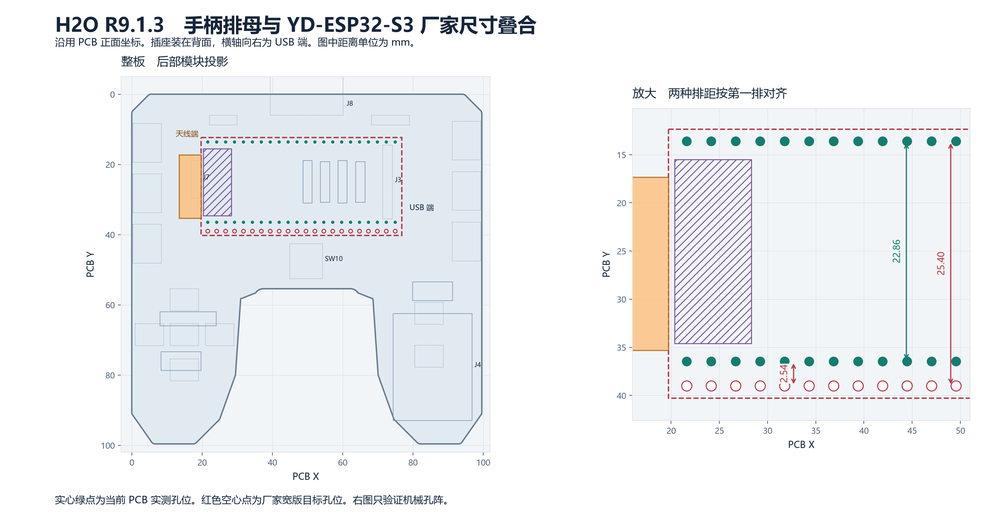
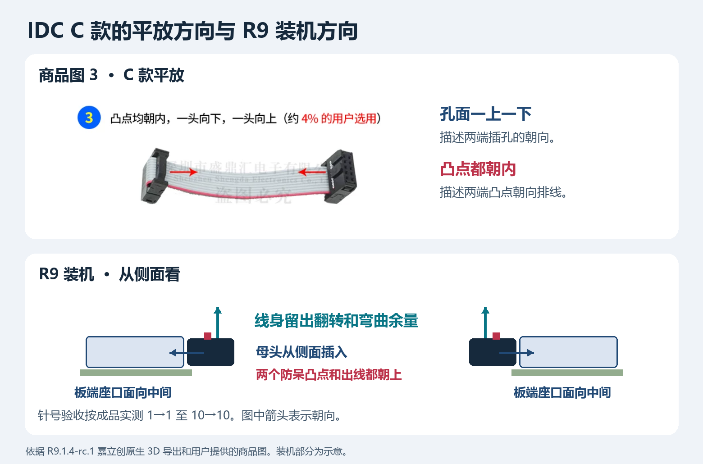

# H2O R9 元器件选型与购买

2026 年 11 月 23 日 · 一套主控板和执行板 · 硬件基线 R9.1.4-rc.1

最新版主控板尺寸 99.60 × 99.60 mm，执行板 86 × 64 mm。本版汇总板载件、外接模块、线束和五金，并收录 R9 历次选型与仍沿用的早期器件资料。数量按整套双板统计。商品图用于核对对应款式，价格、货源批次和库存以实际商家为准。

[采购 BOM](data/pcb-bom.csv) · [外接件与五金清单](data/modules-cables-hardware.csv) · [商品图和数据索引](证据索引.md) · [原版嘉立创工程与复核](https://gitee.com/hjz0810/H2O/releases/tag/r9.1.4-rc.1)

## 下单前先核对的器件

| 器件 | 最新版采购规格 | 装配与验收 |
| --- | --- | --- |
| ESP32-S3 开发板 | 源地工作室 **YD-ESP32-S3 双 Type-C N16R8**，两排各 22 针，脚距 **2.54 mm**，两排中心距 **25.40 mm** | R9.1.3 使用乐鑫 DevKitC-1 v1.1 的 **22.86 mm**。同为 N16R8 的开发板可能有不同排距。宽版工程旧量尺文字仍可能显示 22.860 mm，按 44 针回读、原厂图和实物对孔。 |
| 板间 IDC | **FC-10P、双母头、防呆、2×5、2.54 mm**，线芯间距 **1.27 mm**。两板元件面同向朝上、南北并排时，按商品图 **C／第 3 种** 确认向上出线，参考 **20 cm**。 | PCB1 J8 和 PCB2 J10 为 `BH254R-10P` 弯脚简牛。两个插孔从侧面插入、两个防呆凸点朝上。两座 1 脚分居左右，排线中段留宽松半扭转。成品要求 1 对 1 至 10 对 10，逐芯测通断。 |
| 自锁键与端子 | XKB8585-Z-150（C318850）**2 只**。KF301-5.0-2P（C474881）**9 只**，PCB1 六只，PCB2 J11/J23/J24 三只。 | SW10 接 EN，SW20 接 STBY 与舵机 PWM，100 mA 开关用于控制信号。启停键弹起时板上仍有 5 V，上游电源负责断电。 |
| TFT 屏 | **1.8 英寸 ST7735S，128×160、8 针 SPI、3.3 V**；RBS16460 是外形和针序参考。 | PCB1 J3 焊盘 `1=BLK 供 3.3V，2=CS，3=DC，4=RST，5=SDA/MOSI，6=SCL/SCK，7=3.3V，8=GND`。商家图常从模块 GND 端开始标号。另一块验证板的 FPC 压接和 GPIO 仅适用于该验证板。 |
| 取电板 | 信德电子紫色 **20 × 30 mm** USB-C 触发板，商品 `836213166399`、SKU `5760314786845`，只设实测 **5 V**。 | PCB1 J4 是主输入表面焊盘，孔距不合时用 J14 短飞线。J21 是备用输入焊盘。J22 只跨一档，1–2 主、2–3 备。J4 的 18.50 mm 是早期名义设计值，按实物校准。 |
| 驱动板 | **Pololu #713 TB6612FNG**，2×8，单排 2.54 mm，两排中心 12.70 mm。 | 对照 J12/J13 全针序。PCB2 J4 是 A 路焊点，线经 6 × 3 mm 槽穿到底面。J11 为 B 路输出，J23 为 B 路方向，J24 为 PWM/GND。 |
| 舵机 | **TowerPro MG996R 180° 定位型**，带舵盘和中心螺丝。 | 安装耳 48.50 × 10.00 mm、耳开口 Ø4.4 mm，对应 PCB 四个 Ø3.20 mm M3 过孔。J3 针序 GND／5 V／PWM。早期 MG90S 两孔图仅供历史对照。 |
| 风扇电机 | 用户选的**带线 300 电机、6 mm 伸轴、短线**。商品示意外壳约 Ø24 × 12.3 mm、轴 Ø2 mm、原线约 55 mm。 | 以商品 SKU 和实物为准。早期 Mabuchi RF-300FA-12350 属参考型号。扇叶按 2 mm 轴孔选，35–40 mm 是初装参考，实际直径随护罩和摆动空间确认。 |
| DHT11 和两路 MQ | DHT11 三针 3.3 V 成品模块，带板上数据上拉。MQ-2、MQ-135 各一块四针 AO/DO 模块，用 5 V。 | DHT11 逐线按信号接。每路 MQ 只接 AO，经过 22 kΩ 串联、33 kΩ 下拉，输入 5.00 V 时名义分压 3.00 V。 |

## IDC 给商家的规格

> 需要 2.54 mm 间距、10P（双排 2×5）FC/IDC 双母防呆成品线，参考 20 cm。按商品图 C／第 3 种压接，两头凸点都朝线身。请按成品母头自己的模塑针号测量，1 对 1、2 对 2，一直到 10 对 10，红边对应两端 1 脚。两板元件面都向上、弯脚座开口相对，母头从侧面插入，安装时两个防呆凸点和两端出线都朝上。

第一、二张商品图的正文是 2.0 mm 规格。参考第二张图的 2.54 mm 商品入口和第三张图的第 3 种外形。优信 `646269733311`、盛鼎汇 `589907894888` 是已归档的历史货源，默认 A 款及商品报价属于当时页面信息，C 款需单独确认。配线额定值以实际 2.54 mm 成品为准。 [图 1](images/products/idc-01-six-press-styles-2mm.png) · [图 2](images/products/idc-02-pitch-and-options.png) · [图 3](images/products/idc-03-style-and-width-254.png)

| 针号 | 网络 | 针号 | 网络 |
| ---: | --- | ---: | --- |
| 1 | +5 V | 6 | AIN1 |
| 2 | 舵机 PWM | 7 | +3.3 V |
| 3 | BIN1 | 8 | AIN2 |
| 4 | PWMA | 9 | BIN2 |
| 5 | GND | 10 | PWMB |

## 数据回读与实物验收

- 两份嘉立创 PCB 导出覆盖 **38 个器件位置、167 个焊盘**。有 **33 件**实际板载购买件，另有 **5 组** PCB 自带焊盘。板载采购表 12 行，外接模块、线束及五金表 22 行。 [PCB 器件坐标](data/pcb-components-rc1.csv) · [全部焊盘网络](data/pcb-pads-rc1.csv) · [IDC 同号表](data/idc-pinout.csv) · [对账结果](data/verification.json)
- 在通电前先量开发板两排中心距、辨认屏幕电源脚、查 IDC 同号导通和短路、核对取电板极性与 5 V 档。舵机、扇叶和托架先检查扫掠与线束净空。用实际电源、线、舵机及电机测联合启动时的执行板 5 V 压降和温升。IDC 的 5 V、地各只占一芯。 [执行板固定件净空图](images/design/actuator-mount-clearance.png)
- R9.1.4-rc.1 是宽排距装配验证候选。历史发布记录显示保存重载后两块板原生 DRC 各 0，PCB1 出具了 39 条 DFM 提示。RF 禁布、GPIO43/48 启动、实际插接、全负载和装配尺寸仍待实物验收。本采购归档使用现有电路基线和可用商品资料。

## R9 历史选型

| 时间点 | 选型或变化 | 与当前版本的关系 |
| --- | --- | --- |
| R3 至 R8 | 两路 MQ 与 22 kΩ／33 kΩ 分压、DHT11、ST7735S、Type-C 取电、七颗软键、Pololu #713，以及弯脚简牛和单根 10 芯线，陆续确定。 | 取当前规格与针脚。历史 BOM 含当时的光敏、跳帽、独立动力线或不同开关，不按总数混买。 |
| R9.0.x | DevKitC-1 v1.1，22.86 mm 排距。原记录为 PB400EEQR1BLK 双刀自锁，紧凑执行板采用 MG90S 与两孔，旧端子清单为 7 只。 | 保留原始 BOM、对孔图和托架图供追溯。最新版为 XKB8585-Z-150、MG996R、9 只端子。 |
| R9.1.0 | 十芯改为舵机加 A/B 双路控制，增加执行板 B 路三组端子，加入直插 MOSFET 和方头电源指示灯。 | A/B 控制和三组 B 路端子沿用。R9.1.1 起移除 Q1/Q11、R25/R35、D2/D3 和 R23/R24。 |
| R9.1.1 至 R9.1.3 | XKB 自锁启停和 MG996R 四孔。安装耳孔最终确认 48.5 × 10 mm，舵机耳孔 Ø4.4 mm、PCB 孔 Ø3.2 mm。 | 四孔规则沿用。后部支撑孔使用候选版新坐标。 |
| R9.1.4-rc.1 与本次采购核对 | 25.40 mm 候选排距，重新归总端子、开关、板载数量、IDC 压头以及产品原图。 | 最新采购主表。PCB2 两处后部支撑孔中心为 (3.80, 45.00) 与 (73.80, 53.20) mm。 |

[R9 工程版本记录](https://gitee.com/hjz0810/H2O/blob/r9.1.4-rc.1/docs/R9/CHANGELOG.md) · [R9.1.3 四孔校验](https://gitee.com/hjz0810/H2O/releases/tag/r9.1.3) · [屏幕验证板接法](https://gitee.com/hjz0810/H2O/releases/tag/fw-v2.0.1-r9-ui)
