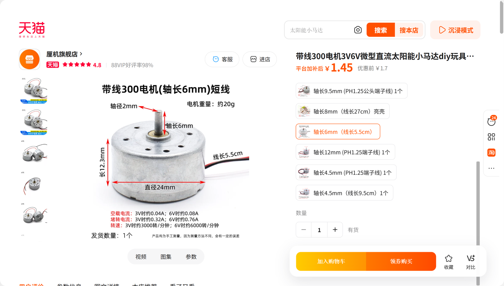

# 选型资料与截图索引

从[采购主表](README.md)开始。商品页、厂家尺寸图和嘉立创回读用于不同的核对环节。图片中出现的旧孔距、旧封装及旧用量以其当时版本为准。

## 商品截图和尺寸资料

| 器件 | 收录内容 | 原始来源或识别信息 |
| --- | --- | --- |
| IDC 线束 | [A–F 压线方式原图](images/products/idc-01-six-press-styles-2mm.png) · [2.0/2.54/1.27 间距及反扣原图](images/products/idc-02-pitch-and-options.png) · [第 1–6 种及 10P 线宽原图](images/products/idc-03-style-and-width-254.png) · [第 3 种局部](images/design/idc-style-3-detail.png) · [J8/J10 防呆和 1 脚](images/design/idc-board-headers.png) · [装机角度对照](images/design/idc-c-style-installation.png) | 第三张图为盛鼎汇商品图。优信与盛鼎汇是历史选型参考。 [优信货源](https://item.taobao.com/item.htm?id=646269733311) · [盛鼎汇货源](https://item.taobao.com/item.htm?id=589907894888) · [XFCN 板端简牛资料](https://www.lcsc.com/zh-CN/product-detail/C492448.html) |
| 300 短轴电机 | [选中 SKU](images/products/motor-300-selected-sku.png) · [卖家参数原图](images/products/motor-300-vendor-specifications.png) | 带线、短线、伸轴 6 mm。不同 SKU 转速和引线不同。 [所选商品](https://detail.tmall.com/item.htm?id=667119825655) |
| USB-C 取电模块 | [产品图](images/products/usb-c-trigger-product.png) · [商品参数原图](images/products/usb-c-trigger-vendor-specifications.png) | 信德电子。商品 836213166399，SKU 5760314786845，5 V 档。 [商品入口](https://item.taobao.com/item.htm?id=836213166399) |
| ESP32-S3 开发板 | [YD 25.40 mm 厂家图](references/yd-esp32-s3-metric.pdf) · [乐鑫 22.86 mm 厂家图](references/espressif-devkitc-v11-metric.pdf) · [两版孔位叠合](images/design/esp32-header-overlay.png) | [源地工作室项目](https://github.com/vcc-gnd/YD-ESP32-S3) · [乐鑫机械图](https://dl.espressif.com/dl/schematics/esp_idf/DXF_ESP32-S3-DevKitC-1_V1.1_20220429.pdf) |
| 1.8 英寸 TFT | [RBS16460 正面](images/products/tft-rbs16460-reference-front.png) · [商品细节](images/products/tft-rbs16460-product-detail.png) · [规格书](references/tft-rbs16460.pdf) | [RBS16460 供货参考](https://www.makermind.fr/p/module-d-affichage-tft-lcd-1-8-128x160-couleurs-st7735s) |
| 自锁开关 | [XKB8585-Z-150 尺寸图](images/products/switch-xkb8585-drawing.png) · [规格书](references/switch-xkb8585.pdf) | [立创 C318850](https://item.szlcsc.com/299942.html) · [历史同款商品参考](https://item.taobao.com/item.htm?id=895485343633) |
| MG996R 舵机 | [TowerPro 产品照片](images/products/servo-mg996r-towerpro.jpg) · [尺寸图](images/products/servo-mg996r-dimensions.png) · [机械参考 PDF](references/servo-mg996r-mechanical-reference.pdf) · [四孔对照](images/design/r9.1.3-mg996r-dimension.png) | [TowerPro 官方](https://towerpro.com.tw/product/mg996r/) |
| 电机驱动和其他板载件 | [Pololu 模块尺寸及针序](https://www.pololu.com/file/0J1724/tb6612fng-dual-motor-driver-carrier-dimensions.pdf) · [板载件逐项料号和目录入口](data/pcb-bom.csv) · [外接件清单](data/modules-cables-hardware.csv) | DHT11、两种 MQ、线材和通用五金按规格选购，现有记录未绑定唯一商家 SKU。有商品链接的项目均列在对应行。 |

## 嘉立创数据、图纸和原始批注

- `data/` 中的候选版 PCB 坐标采用同一嘉立创坐标原点，X 向右、Y 向下，单位 mm。安装层 1 为顶层，2 为底层。`pcb-pads-rc1.csv` 空网络按源数据保留。1:1 标称图使用时按真实尺寸打印，历史机械图要与当前版本孔图分别对照。
- `images/design/rc1-captures/` 收录五页原理图、3D、排母间距、支撑孔和候选 PCB 回读截图。`images/design/` 收录可直接引用的 3D、机械图和 IDC 安装对照。
- `history/user-source-images/` 的 `01–10` 是用户端子、开关、舵机接线、双路 TB6612、传感器、指示灯和背面电阻等原批注。`11–13` 及分图是早期 IDC 商品截图，`14` 是主备 5 V 批注，`15–16` 是 300 电机参数与所选 SKU。
- `history/design-captures/` 保留十芯修订、十芯直连、器件精简和舵机固定三个阶段的原理图、PCB 和 3D 核对图。
- `history/rc1-release-evidence/` 是原预发布的复核附件。`component-coordinate-audit.csv` 和 `pin-drill-audit.csv` 包含旧孔阵基线，候选版坐标请查 `data/pcb-components-rc1.csv` 与 `data/pcb-pads-rc1.csv`，其中 J2 已按 25.40 mm 排距移动。
- `history/` 还收录 R3、R4、R5、R6、R8 和 R9.0 原版 BOM，以及 R9.0 原对孔图、托架 DXF、PB400 开关与 MG90S 图。标注保留了发布时的值。

商品图保留用于选型追溯，图中规格、价格、销量等均为对应截图的历史页面信息。
