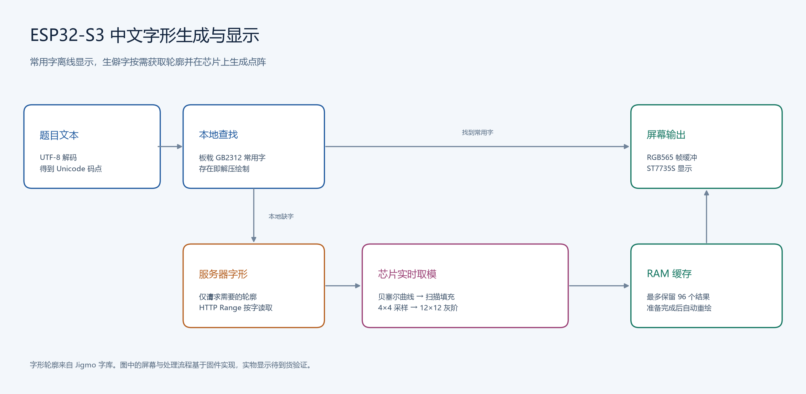
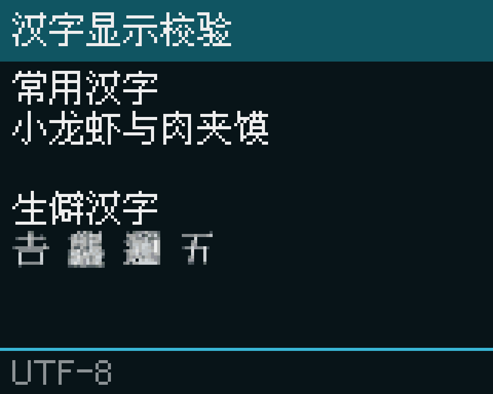
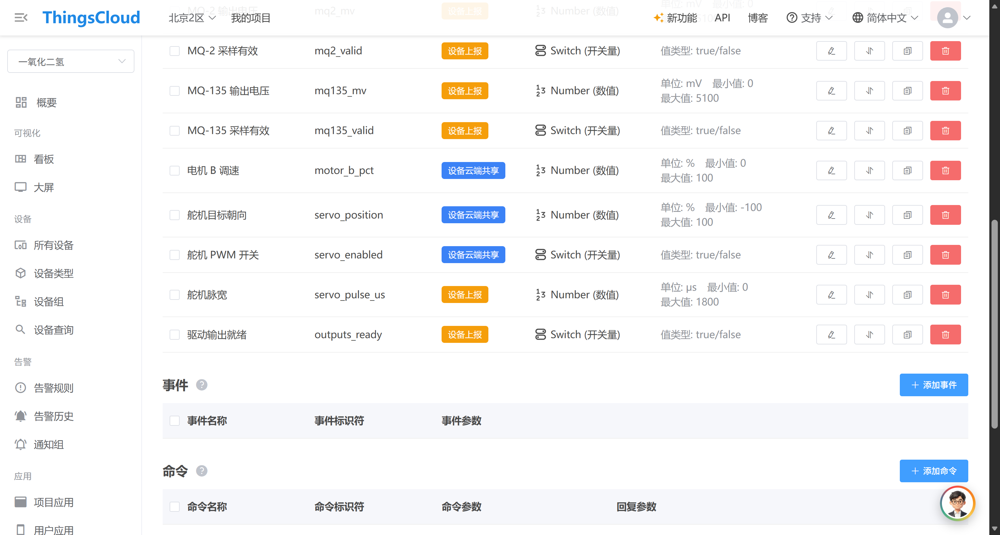
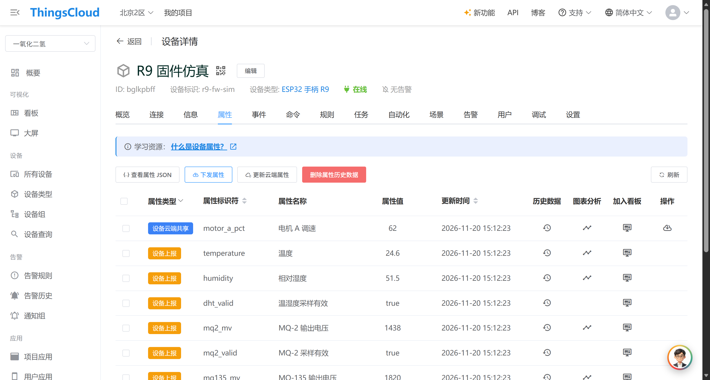
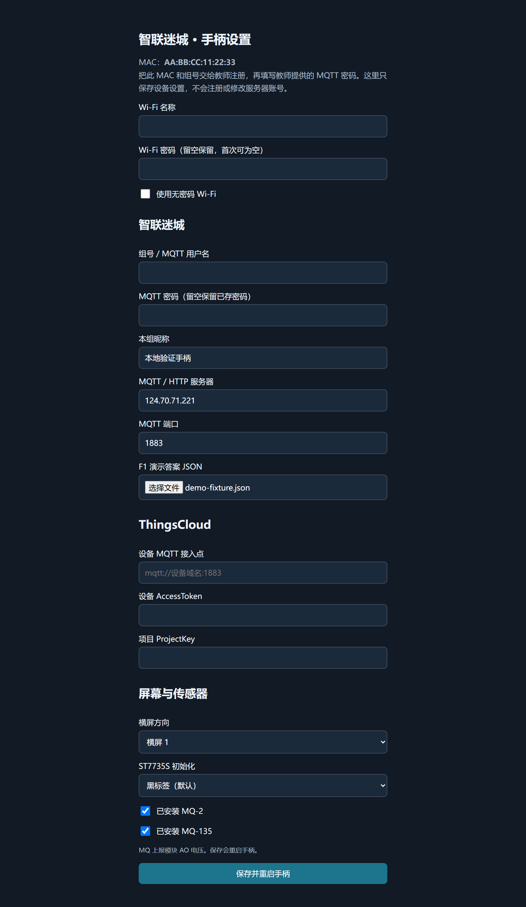

# R9 固件 1.4.0 · 汉字轮廓实时取模

本版在 ThingsCloud 和智联迷城固件基础上，增加 ESP32-S3 本地轮廓栅格化，并补充高清联调截图和可复现的算法说明。对应 R9.1.3 双板，固件目标为手柄上的 ESP32-S3。

| 项目 | 1.3.0-r9-thingscloud | 1.4.0-r9-outline |
| --- | --- | --- |
| 常用汉字 | 板载 U8g2 压缩字库离线绘制 | 保持本机离线解压绘制 |
| 生僻字来源 | 按码点读取服务器预生成的 72 字节点阵 | 按码点读取服务器的 TrueType 轮廓 |
| 字模生成 | 服务器预先生成 | ESP32-S3 实时展开曲线、扫描填充和采样 |
| 位序与显示 | 12 × 12、4 位灰阶并在帧缓冲绘制 | 使用同一 12 × 12 点阵格式，保持从左到右像素顺序 |
| 缓存与断网 | 缓存 96 个字模，缺字时显示空框 | 缓存 96 个生成结果，网络可用后自动重试缺字 |
| 图文资料 | 屏幕模拟图与文字验证 | 补充设备属性、真实云端模拟联调、停止回报、配网页及处理流程图 |

## 实现与验证

- `HanRaster.cpp` 读取 `HGO1` 轮廓记录，解析曲线上点与控制点，将二次贝塞尔曲线分段，再用非零环绕数和 4 × 4 子像素采样生成 16 级灰阶。算法代码、内存占用、字形来源及字节布局见 [汉字实时取模与显示](../汉字实时取模与显示.md)。
- 服务器轮廓库由 Jigmo 2025-09-12 和 Unicode 17.0 数据生成，共 102,999 条默认字形。主机使用实际固件栅格化代码遍历全部轮廓，102,999 条均生成非空点阵。测试覆盖方向、空洞、二次曲线、相邻控制点和损坏记录。 [轮廓库清单](r9-han-outline-atlas.json)
- 从六个样本生成固件点阵，并与 Pillow 的 FreeType 绘制结果逐像素比较，余弦相似度为 0.974–0.995。 [独立绘制对照](r9-han-outline-freetype.txt)
- 服务器使用 HTTP Range。对 U+3007、U+867E、U+9F98、U+20BB7、U+30EDE、U+323B0 和 U+33479 逐个读取索引和轮廓，均返回 HTTP 206，数据与本地生成文件逐字节一致。 [公网读取记录](r9-han-outline-http.txt)
- Arduino ESP32 核心 3.3.12 编译通过，程序占用 1,332,394 字节，静态全局变量占用 59,364 字节。 [构建输出](r9-outline-compile.txt)
- 固件主机测试通过 23 项原有协议测试、5 项 v2 协议测试及按键、配网、ThingsCloud、执行器和帧缓冲测试。对只读取得的线上判题程序进行 6 场本地随机题回放，均为 20 题、200 分，另验证 51 道题的题号和答案匹配。
- ThingsCloud 使用独立仿真设备进行了真实 MQTT 上报和控制往返。显示截图为固件帧缓冲模拟。实体屏幕、传感器和电机舵机的实际表现及取模时间待硬件到货后验证。

## 云平台与配网截图

[查看完整图文联调记录](r9-thingscloud.md#云平台与配网高清记录)，包括设备属性、模拟数据上报、控制和停止回报、实物设备待配网状态以及手柄配网页。截图中的控制数据来自仿真设备。

