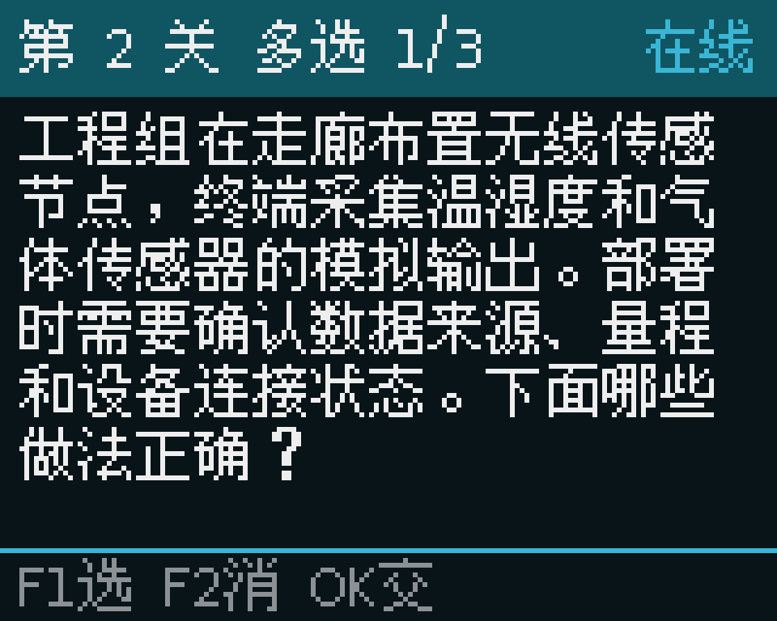
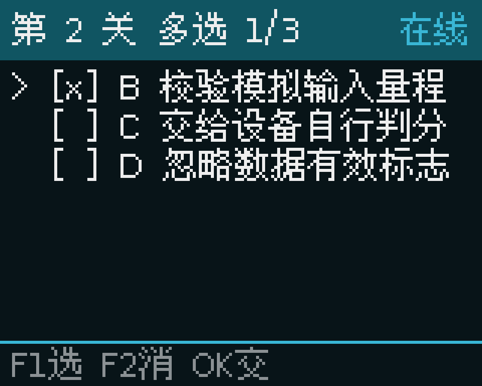
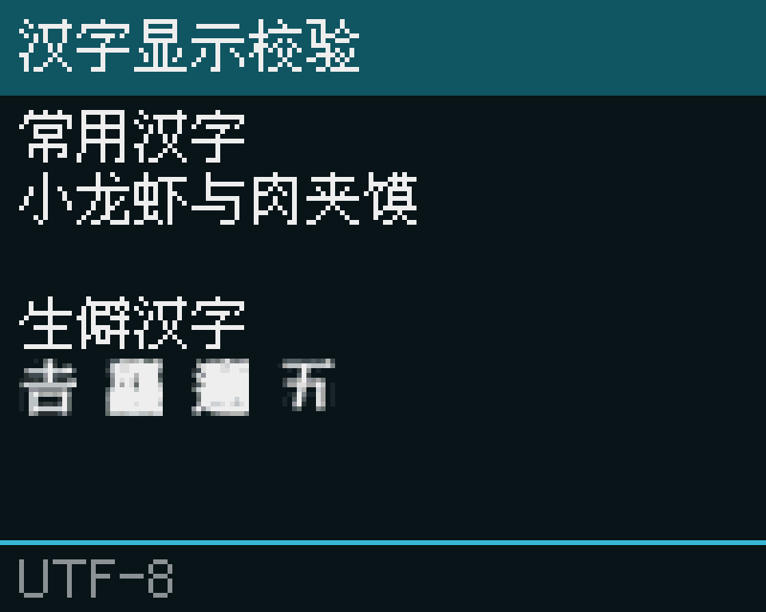

# R9 固件 1.3.0 · ThingsCloud 与随机题库

适配 R9.1.3 的手柄板和执行板。编译选项、按键、IDC 及 GPIO 对照见 [固件说明](../README_先读我.md)。

## 相对 1.2.2-r9-10p 的变更

| 项目 | 1.2.2-r9-10p | 1.3.0-r9-thingscloud |
| --- | --- | --- |
| 云平台 | 智联迷城 MQTT 接收考试与传感器数据 | 加入 ThingsCloud 独立 MQTT 链路，双向同步三路传感器与执行器设定 |
| 发题与判题 | 界面及演示按旧 35 题流程 | 同步线上抽题和 5 条生命规则，当前在线配置为 20 题、200 分 |
| 一键演示 | 按固件内置的旧题号与答案 | 从配网页导入本地答案，用题号及内容指纹匹配实际抽到的题 |
| 审题与取消 | 左右定位，F1 勾选，OK 提交 | 移动光标会显示对应选项，F2 清空本题已选项 |
| 中文绘制 | 内置 GB2312 字库 | 完整 UTF-8 解码，常用字离线绘制，生僻字按码点从服务器读取并缓存 |
| 执行器 | 手柄页面分档调速，左右调舵机脉宽 | 云端可独立调两路 0–100% 占空比与舵机朝向，回报控制值及 1200–1800 μs 脉宽 |

## 本版核对

- 从 R9.1.3 工程回读 22 个 ESP32 信号及两端 10 个 IDC 针序，与 `Board.h` 一致。ESP32-S3 Arduino 核心 3.3.12 编译通过。见 [构建输出](r9-thingscloud-compile.txt)。
- 从线上只读取回的智联迷城判题程序，在本地使用独立组号和状态文件进行回放。覆盖手动选择、取消、判题、重复请求、断线恢复及 F1 演示。6 场随机回放均为 20 题、200 分。全题库回放覆盖 51 道题，题库指纹改变时固件会停止演示。
- ThingsCloud 仿真设备使用模拟 DHT11、MQ-2 和 MQ-135 数据完成真实 MQTT 上报。控制台下发 62% / 45% / −50 后，原生 C++ 驱动模型回读 1350 μs。下发停止，两路占空比及舵机脉宽回到 0。平台三次上报响应均为成功。见 [仿真往返日志](r9-thingscloud-mqtt.txt)。
- 屏幕仿真使用固件的中文字体、折行与帧缓冲绘制。覆盖四字节码点、点阵左右半行的非对称像素和联网补字。实物上电后需确认屏幕标签选型、传感器读数、PWM 方向和两路电机与舵机的实际动作。
- 服务端字库由 Unicode 17.0 字符清单和 Jigmo 生成，包含 102,999 个有点阵的码点。通过 HTTP 206 回读样本并逐字节比对，覆盖常用汉字、扩展 B、扩展 G、扩展 J 和上界码点。见 [字库清单](r9-han-atlas.json)。

