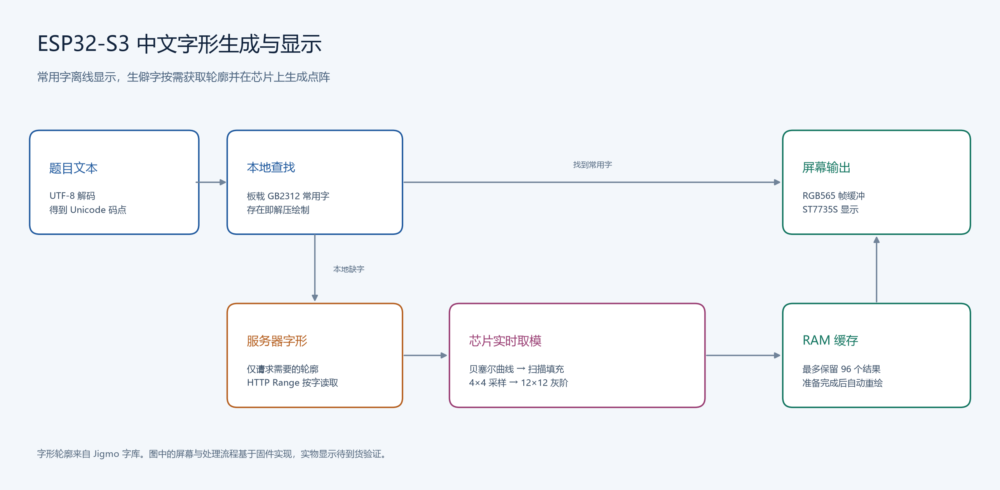
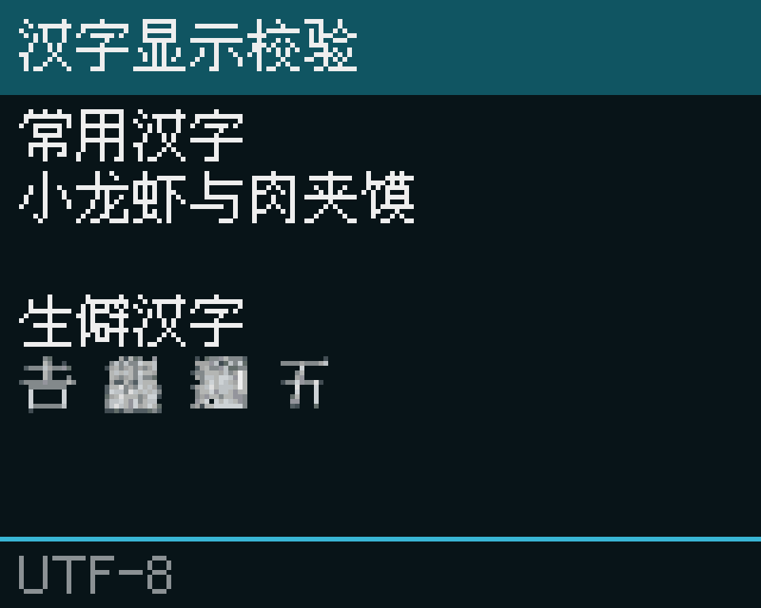

# ESP32-S3 汉字实时取模与显示

本项目把题目中的 UTF-8 文本送到 ST7735S 屏幕。常用字从手柄 Flash 中的压缩字库读取。常用字库没有的汉字，手柄按码点从服务器获取字形轮廓，在 ESP32-S3 上即时生成 12 × 12 的灰阶点阵，放入缓存，再绘制到屏幕。题目可以直接包含中文和 Unicode 扩展区汉字。



字形轮廓是这个过程的输入数据。Unicode 码点用于标识字符，笔画和形状由字体提供。本项目使用 Jigmo 的 TrueType 轮廓，生成工具保留字形的曲线上点、控制点和轮廓边界。服务器保存完整轮廓库，手柄只请求当下需要的字。 [Unicode 字符与字形](https://www.unicode.org/standard/principles.html) · [Jigmo 字库](https://kamichikoichi.github.io/jigmo/)



上图来自固件绘制代码的帧缓冲模拟，展示常用字和通过轮廓生成的四个生僻字。画面已按像素放大，实物屏幕的方向、颜色、亮度和字符效果待硬件到货后核验。12 × 12 空间有限，笔画密集的汉字仍可能难以辨认。

## 处理过程

1. **解码文本**。题目使用 UTF-8。固件将一至四个字节解码为 Unicode 码点，支持如“𠮷”这样的扩展区汉字，并处理不完整或非法编码。
2. **先查离线字库**。屏幕绘制程序先查 U8g2 的 `u8g2_font_wqy12_t_gb2312`。找到时直接在本机解压和绘制。该字库数组为 208,526 字节。
3. **按码点取轮廓**。本地缺字时，后台任务先读取服务器轮廓文件中该码点的索引，再读取该字的轮廓记录。没有数据或网络未连接时显示空框，取回后刷新画面。
4. **在 ESP32-S3 上实时生成点阵**。固件展开轮廓中的二次贝塞尔曲线，用扫描线和非零环绕数规则判断字形内部。每个像素采样 4 × 4 次，将覆盖度映射为 16 级灰阶。
5. **缓存与显示**。生成的 12 × 12 点阵按每像素 4 位排列，每字 72 字节。最近使用的最多 96 个结果保存在 RAM 中。显示程序将灰阶与前景、背景混合成 RGB565 像素并写入屏幕帧缓冲。

服务器数据覆盖 Unicode 17.0 中的 102,998 个统一及兼容汉字，另含“〇”，每个码点使用字库的默认字形。当前排版会忽略字形变体选择符，字库之外的字符使用占位框。 [Unicode 17.0 字符数据](https://www.unicode.org/Public/17.0.0/ucd/UnicodeData.txt) · [轮廓库清单](validation/r9-han-outline-atlas.json)

## 服务器按需提供的内容

`generate_han_outlines.py` 使用 FontTools 展开 Jigmo 的复合字形，把轮廓点和曲线上点标志整理为 `HGO1` 记录。它不为每个字预先生成屏幕点阵。轮廓文件的索引按码点直接寻址，每条索引为两个小端 32 位整数，分别表示轮廓记录的文件偏移与长度。

以“𠮷” U+20BB7 为例，其十进制码点为 134071。

| 步骤 | 实际数据 |
| --- | --- |
| 索引位置 | `134071 × 8 = 1072568`，读取字节 `1072568–1072575` |
| 索引内容 | 轮廓偏移 `33149110`，长度 `204` 字节 |
| 读取轮廓 | HTTP Range 读取 `33149110–33149313` |
| 芯片处理 | 将轮廓转成 12 × 12、16 级灰阶点阵并缓存 |

完整服务器文件为 113,590,197 字节。本版每次首次显示生僻字需要两次 HTTP Range 请求，实际耗时取决于网络和手柄，待实机测量。生成后的 96 个缓存字模最多占用 6,912 字节点阵数据，缓存索引、网络缓冲和临时轮廓另占内存。关机后 RAM 缓存会清空。

## 芯片端算法代码

完整实现见 [HanRaster.cpp](ExamHandheld/HanRaster.cpp)、[HanGlyph.h](ExamHandheld/HanGlyph.h) 和 [RemoteGlyphs.cpp](ExamHandheld/RemoteGlyphs.cpp)。下面是固件中的关键计算。

### 1. 二次贝塞尔曲线离散为边

TrueType 轮廓由曲线上点和控制点组成。固件对每段二次曲线取四段折线，并将不在曲线上的相邻控制点之间的中点作为隐含的曲线上点。 [TrueType 轮廓定义](https://learn.microsoft.com/en-us/typography/opentype/spec/glyf)

```cpp
const float t = static_cast<float>(step) / CurveSegments;
const float remainder = 1.0f - t;
const Point next{
    remainder * remainder * from.x + 2 * remainder * t * control.x + t * t * to.x,
    remainder * remainder * from.y + 2 * remainder * t * control.y + t * t * to.y,
    true};
appendEdge(edges, previous, next);
previous = next;
```

### 2. 扫描线填充与超采样

对每条子像素扫描线，程序计算它与轮廓边的交点。向上和向下穿过边分别改变环绕数，非零位置属于字形内部。每个目标像素累加 16 个采样点，得到覆盖度。以下代码保留了 [HanRaster.cpp](ExamHandheld/HanRaster.cpp) 中实际使用的计算。

```cpp
const float y = (Baseline - (row + 0.5f) / Samples) * UnitsPerEm / Side;
for (const auto& edge : edges) {
  const bool upward = edge.y1 <= y && edge.y2 > y;
  const bool downward = edge.y2 <= y && edge.y1 > y;
  if (!upward && !downward) continue;
  const float x = edge.x1 + (y - edge.y1) *
      (edge.x2 - edge.x1) / (edge.y2 - edge.y1);
  crossings.push_back({x, upward ? 1 : -1});
}

// 交点按 x 排序后，从左到右累加环绕数。
while (crossing < crossings.size() && crossings[crossing].x <= x) {
  winding += crossings[crossing++].direction;
}
if (winding) ++samples[(row / Samples) * Side + column / Samples];
```

### 3. 灰阶打包与屏幕方向

每个字从上到下逐行存储。每字节高四位是左侧像素，低四位是右侧像素。这个约定同时用于取模和绘制，避免字节左右半行或位序不一致引起的镜像与错位。固件从点阵取出覆盖度后，以前景色和背景色混合为 RGB565。

```cpp
// HanRaster.cpp，两个像素打包成一个字节
bitmap[i / 2] = (alpha[samples[i]] << 4) | alpha[samples[i + 1]];

// HanGlyph.h，读取屏幕坐标 (x, y) 的灰度
const uint8_t pair = bitmap[(Side * y + x) / 2];
return x % 2 ? pair & 0x0F : pair >> 4;
```

原先的取模实验中已经发现字节顺序和位方向会影响显示，本版把这些约定固定在数据格式与读取代码中。 [屏幕取模记录](https://blog.csdn.net/hjz0810/article/details/159386848)

## 构建与验证

- 用 [generate_han_outlines.py](tools/generate_han_outlines.py) 和原始 Jigmo 2025-09-12 字体包、Unicode 17.0 `UnicodeData.txt` 可重新生成轮廓文件及清单。字体包以 SHA-256 校验，Jigmo 使用 CC0 1.0。
- 主机测试依次处理了全部 102,999 条轮廓，均能生成非空点阵。测试还覆盖曲线、连续控制点、轮廓空洞、左右方向及损坏数据。逐字处理成功用于检查格式和程序稳定性，字形可辨识度仍需抽样和实屏检查。
- 六个基础区及扩展区样本与 Pillow 使用 FreeType 独立渲染的结果进行了像素对照，余弦相似度为 0.974–0.995。对照脚本为 [compare_han_samples.py](tools/compare_han_samples.py)，结果见 [记录](validation/r9-han-outline-freetype.txt)。该数值用于抽样检查形状，不能替代实屏可读性测试。
- 对多个基础区及扩展区码点，已经从服务器实际读取索引与轮廓，确认 HTTP 206 响应和文件字节一致。 [验证记录](validation/r9-outline.md)
- 在本机运行 `software/tools/test.ps1 -GlyphAtlas <han-outline.bin>` 可运行轮廓、屏幕和全字库结构测试。该测试使用实际固件中的栅格化和绘制代码。

## 与上一版的区别

| 项目 | 1.3.0 | 1.4.0 |
| --- | --- | --- |
| 常用字 | 板载压缩字库离线绘制 | 板载压缩字库离线绘制 |
| 生僻字传输 | 服务器返回已经生成的 72 字节点阵 | 服务器返回该字的轮廓点 |
| 生僻字取模位置 | 服务器预生成 | ESP32-S3 根据轮廓实时生成 |
| 显示与缓存 | 12 × 12 灰阶，96 字 RAM 缓存 | 沿用 12 × 12 灰阶与 96 字 RAM 缓存 |
| 传输开销 | 一次请求、每字 72 字节 | 两次请求，轮廓长度随笔画复杂度变化 |

本功能使用常见的字体轮廓、曲线和扫描填充方法，项目代码将这些步骤接入了手柄的题目显示和按需字形服务。算法不能单凭字符编号推断任意字的形状，因此仍需字库提供相应的轮廓。
